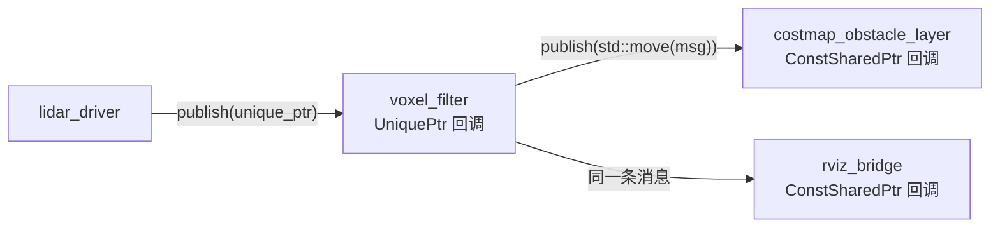

# 答案：进程内通信与零拷贝

> 先在[卡片](../cards/concurrency/intra-process.md)里自己写下答案再来对照。

## 题 1：整条链一次复制都没有

| 节点 | 回调签名 | 发布 |
|---|---|---|
| `lidar_driver` | — | `pub->publish(std::move(msg))`，`msg` 是 `std::unique_ptr` |
| `voxel_filter` | `void cb(PointCloud2::UniquePtr msg)` | 就地删点后 `pub->publish(std::move(msg))` |
| `costmap_obstacle_layer` | `void cb(PointCloud2::ConstSharedPtr msg)` 或 `const PointCloud2 &` | — |
| `rviz_bridge` | 同上 | — |

理由：
- `driver → filter` 是一对一，`UniquePtr` 回调拿到原件。🔍 实测地址相同。filter 要**修改**消息，只能用 `UniquePtr`；用 `ConstSharedPtr` 就只能先复制一份再改。
- `filter → 两个下游` 是一对多。📄 🔍 两个订阅者都用 `ConstSharedPtr`（或 `const T &`）时共享同一个只读对象，实测两个地址都和发布的相同。只要有一个下游用了 `UniquePtr`，另一个就会拿到副本（🔍 实测混用时 `ConstSharedPtr` 那一边拿副本）。
- 每次发布都要交出 `unique_ptr`。🔍 `publish(*msg)` 一定复制。

还要满足：四个组件都加 `extra_arg use_intra_process_comms=true`、在同一个容器里、QoS 用 KeepLast（🔍 KeepAll 直接抛异常）。

💡 如果 `rviz_bridge` 其实在另一个进程（比如 RViz 本身），那一路必然要序列化。📄 文档的演示表明这不会破坏进程内那几路的零拷贝。

## 题 2：地址不一样的可能原因

| 可能原因 | 怎么查 |
|---|---|
| 发布时传的是引用或值：`publish(*msg)`、`publish(msg)`（`msg` 是对象） | 看代码，改成 `publish(std::move(unique_ptr))`。🔍 实测按引用发布地址一定不同 |
| 有多个订阅者，而这个订阅者用的是 `UniquePtr` 回调 | `ros2 topic info -v /话题` 看订阅者数量；🔍 两个 `UniquePtr` 订阅者时只有一个拿原件 |
| 混用了 `ConstSharedPtr` 和 `UniquePtr` 回调 | 统一改成 `ConstSharedPtr`（只读时） |
| 发布者或订阅者所在的节点只有一端开了进程内通信 | 节点构造时打印 `get_node_options().use_intra_process_comms()`；组件检查每个 `extra_arg` |
| 两个节点其实不在同一个进程 | `ros2 component list` 看是否在同一个容器；或者在两端打印 `getpid()` |
| 比较的不是同一条消息 | 用序号对齐：💡 分配器会复用刚释放的内存，**不同**消息也可能地址相同（🔍 实测连续几条消息地址在两三个值之间来回） |

💡 判断零拷贝时要比较"同一条消息"在两端的地址，最好再比较 `msg->data.data()`（真正的大块数据）的地址。
