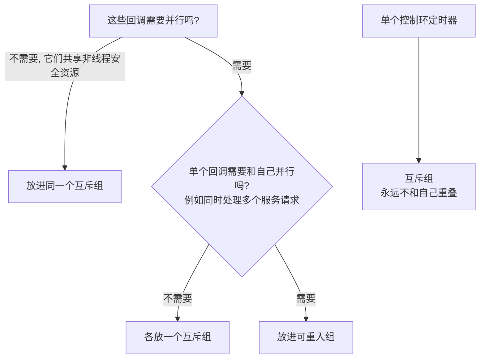

# 回调组 Callback Group

> 适用：ROS 2 **Rolling**，rclcpp（API 于 2026-11-17 对照 rclcpp `rolling` 分支 33.2.0 核实）
> 来源标记：📄 仓库文档原文 · 🔍 rclcpp 源码/实测核实 · 💡 经验补充（可信，但请自己验证）
> 源文档：[About-Executors.rst 的 Callback groups 一节](../../source/ROS-Framework/client-libraries/About-Executors/About-Executors.rst)、[Using-callback-groups.rst](../../source/ROS-Framework/nodes/Working-with-nodes/Using-callback-groups.rst)

## 1. 一句话定义

回调组（callback group）是把节点的回调分组的机制，用来告诉多线程执行器"哪些回调可以并行执行（execute in parallel）"。📄

## 2. 为什么需要

- 多线程执行器有一个线程池，但它不知道你的哪些回调共享了非线程安全的数据；回调组就是你给它的并发规则。📄
- 只有两种类型，创建时指定：📄
  - **互斥组 MutuallyExclusive**：组内回调不能并行（包括同一个回调不能和自己并行）。
  - **可重入组 Reentrant**：组内回调可以任意并行，同一个回调的多个实例也可以同时跑。
- **不同组之间的回调总是可以并行。** 📄
- **默认组**：创建订阅、定时器等时不指定组，就进入节点的默认回调组，它是**互斥组**。📄 所以"多线程执行器 + 不建回调组"约等于单线程。📄
- 实体会把自己的组传给它派生的所有回调。例如给 action client 指定组后，它的所有回调都在这个组里；service client 的响应（future 的 done-callback）也在 client 的组里。📄

### 怎么选组（据文档 "Controlling execution" 整理）📄



## 3. 最小 C++ 代码（rclcpp）

同一个节点里，让 50 Hz 控制环不被 300 ms 的规划服务阻塞。可编译文件：[card_callback_group_min.cpp](../labs/executor_lab/src/card_callback_group_min.cpp)

```cpp
class NavNode : public rclcpp::Node
{
public:
  NavNode() : Node("nav_node")
  {
    // 1. 建两个互斥组，并存成成员（不持有的话回调不会被执行）
    control_group_ = create_callback_group(rclcpp::CallbackGroupType::MutuallyExclusive);
    plan_group_ = create_callback_group(rclcpp::CallbackGroupType::MutuallyExclusive);

    // 2. 创建实体时把组传进去
    control_timer_ = create_wall_timer(20ms, [this]() {/* 发布 cmd_vel */}, control_group_);
    plan_srv_ = create_service<std_srvs::srv::Trigger>(
      "plan",
      [](const std::shared_ptr<std_srvs::srv::Trigger::Request>,
         std::shared_ptr<std_srvs::srv::Trigger::Response> res) {
        std::this_thread::sleep_for(300ms);  // 耗时规划
        res->success = true;
      },
      rclcpp::ServicesQoS(), plan_group_);
  }

private:
  rclcpp::CallbackGroup::SharedPtr control_group_, plan_group_;
  rclcpp::TimerBase::SharedPtr control_timer_;
  rclcpp::Service<std_srvs::srv::Trigger>::SharedPtr plan_srv_;
};

int main(int argc, char ** argv)
{
  rclcpp::init(argc, argv);
  auto node = std::make_shared<NavNode>();
  // 3. 必须用多线程执行器，不同组之间才可能真正并行
  rclcpp::executors::MultiThreadedExecutor executor(rclcpp::ExecutorOptions(), 2);
  executor.add_node(node);
  executor.spin();
  rclcpp::shutdown();
}
```

传组的位置（🔍 Rolling `node.hpp`）：

| 实体 | 传组方式 |
|---|---|
| 定时器 | `create_wall_timer(period, cb, group)` |
| 服务端 | `create_service<T>(name, cb, qos, group)` |
| 服务客户端 | `create_client<T>(name, qos, group)` |
| 订阅 | `rclcpp::SubscriptionOptions opts; opts.callback_group = group;` 再传给 `create_subscription` 📄 |

## 4. 常见坑（导航/控制场景）

1. **只换多线程执行器，不建回调组。** 所有回调都在默认互斥组里，控制环照样被规划服务卡住。📄 实测：`multi + default` 时控制周期最大约 310 ms，`multi + separate` 时约 20 ms。🔍 见 [实验 A](../labs/executor-blocking.md)。
2. **在回调里同步等待服务结果 → 死锁（deadlock）。** 定时器回调里 `async_send_request` 后 `future.wait_for(...)`，如果定时器和 client 在同一个互斥组，响应回调要等定时器回调结束才能跑，而定时器回调在等响应。📄 💡 导航里的典型形态：任务管理节点在定时器里同步调用 `/compute_path` 这类规划服务。🔍 见 [实验 B](../labs/executor-blocking.md)。
3. **"换个新的互斥组"不等于修好了。** 如果把定时器和 client 一起放进同一个新建互斥组，照样死锁。条件是：两者**不能在同一个互斥组**。📄
4. **回调组没有被持有。** `create_callback_group` 返回的 `shared_ptr` 如果是局部变量，构造函数结束后组被释放，执行器就不会调用其中的回调。📄 存成类成员。
5. **可重入组让同一回调和自己并行。** 💡 例如把里程计订阅放进可重入组，两条消息可能被两个线程同时处理，写 `latest_odom_` 时出现数据竞争（data race），甚至让旧消息覆盖新消息。共享状态要加锁，或者干脆用互斥组。
6. **不同组并行 ≠ 线程安全。** 💡 控制定时器和里程计订阅分在两个互斥组以后，它们可以同时读写同一个成员变量，需要 `std::mutex` 或 `std::atomic`。回调组只管"调度"，不管"数据"。
7. **单线程执行器里，回调组带来不了并行。** 实测 `single + separate` 和 `single + default` 一样差。🔍 但回调组仍有用：可以用 `add_callback_group` 把组分给另一个执行器。📄
8. **Rolling 下文档示例中的 `create_client` 调用编译不过。** `Using-callback-groups.rst` 写的是 `create_client<T>(name, rmw_qos_profile_services_default, group)`，而 Rolling 的 rclcpp 只剩 `create_client<T>(name, const rclcpp::QoS &, group)` 这个签名，需要改成 `rclcpp::ServicesQoS()`。🔍 在 `ros:rolling` 镜像里实测报错 `cannot convert 'const rmw_qos_profile_t' to 'const rclcpp::QoS&'`。

## 5. 与其他概念的关系

- [执行器 Executor](executor.md)：提供线程；回调组决定这些线程能怎么用。
- 服务 Service / 动作 Action（卡片待建）：它们派生的隐藏回调（future 的 done-callback、action client 的各种回调）都继承所属实体的组，是死锁的主要来源。📄
- 线程安全与 `std::mutex`（卡片待建）：不同组并行之后，数据保护要你自己做。💡
- 上一级：[总览脑图：让回调按时跑](../map/overview.md)

## 6. 自测题（先自己答，再看[答案](../answers/callback-group-answers.md)）

1. 一个导航节点：控制定时器在互斥组 A，里程计订阅在互斥组 B，两者都读写成员变量 `latest_odom_`，用 `MultiThreadedExecutor` 运行。这里有没有数据竞争？给出两种修复方式，并说说各自对控制环时延的影响。
2. 一个任务节点：action client 放在可重入组 X，定时器留在节点默认组。定时器回调里调用 `async_send_goal` 后用 `wait_for` 同步等待"目标被接受"。会死锁吗？如果把定时器也放进组 X 呢？如果 X 改成互斥组、定时器也在 X 里呢？
