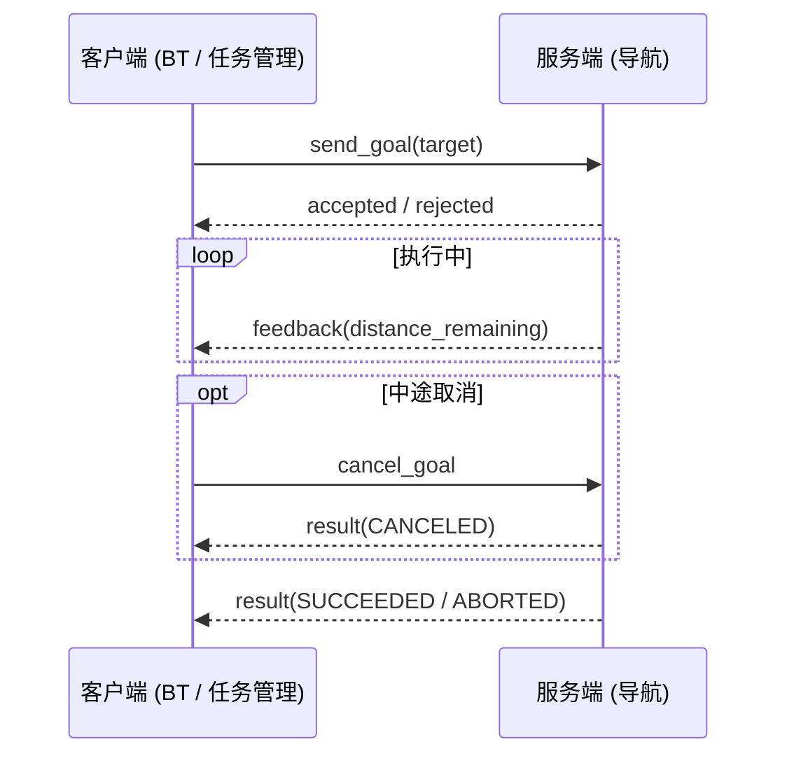

# 动作 Action（目标/反馈/结果）

> 适用：ROS 2 **Rolling**，rclcpp / rclcpp_action（2026-11-17 在 `ros:rolling-ros-base`、rclcpp 33.2.0 上实测）
> 来源标记：📄 仓库文档原文 · 🔍 rclcpp 源码/实测核实 · 💡 经验补充（可信，但请自己验证）
> 源文档：[About-Actions.rst](../../../source/ROS-Framework/interfaces/About-Actions.rst)、[Understanding-ROS2-Actions.rst](../../../source/ROS-Framework/interfaces/actions/Working-with-actions/Understanding-ROS2-Actions/Understanding-ROS2-Actions.rst)、[Writing-an-Action-Server-Client/Cpp.rst](../../../source/ROS-Framework/interfaces/actions/Working-with-actions/Writing-an-Action-Server-Client/Cpp.rst)、[Creating-an-Action.rst](../../../source/ROS-Framework/interfaces/actions/Working-with-actions/Creating-an-Action.rst)
> 📐 设计动机：[服务与动作的设计](../../design/service-action-design.md)：为什么动作 = 3 个服务 + 2 个话题、目标 UUID 由客户端生成、结果缓存多久

## 1. 一句话定义

动作（action）是一种**长时间运行、带反馈、可取消**的远程过程调用：客户端发目标（goal），服务端执行中持续发反馈（feedback），结束时返回结果（result）。📄

## 2. 为什么需要

- 文档的原例子就是导航：高层状态机调用动作让导航子系统去某个路点，可能要几秒到几分钟；途中导航子系统报告进度，状态机可以随时取消或抢占。📄
- 服务做不到"中途看进度"和"中途取消"，动作可以。📄
- 动作建立和监控连接有额外开销，所以短任务用服务。📄
- **一个动作名只应有一个服务端**，客户端数量不限。📄

### 底层组成 📄

`ros2 action info -v` 显示一个动作由 **3 个服务 + 2 个话题**组成：

| 组成 | 类型 | 作用 |
|---|---|---|
| Goal 服务 | `<Action>_SendGoal` | 发送目标，服务端回复接受/拒绝 |
| Cancel 服务 | `action_msgs/srv/CancelGoal` | 请求取消 |
| Result 服务 | `<Action>_GetResult` | 取最终结果 |
| Feedback 话题 | `<Action>_FeedbackMessage` | 执行中的反馈 |
| Status 话题 | `action_msgs/msg/GoalStatusArray` | 所有目标的状态 |

### 目标的结局 📄

- **成功 succeed**：服务端完成任务。
- **取消 canceled**：**客户端**请求停止，服务端同意。
- **中止 aborted**：**服务端**自己决定停止（出错、被新目标抢占等）。
- 执行中又来了新目标怎么办，**由服务端实现决定**：可以拒绝新目标、接受新目标并中止旧目标、或者两个都执行。turtlesim 选择的是"接受新的、中止旧的"。



## 3. 最小 C++ 代码（rclcpp_action）

接口：[MoveTo.action](../../labs/study_interfaces/action/MoveTo.action)。可编译文件：[card_action_min.cpp](../../labs/comm_lab/src/card_action_min.cpp)

**服务端：三个回调都必须很快返回**，长任务放到别的线程。📄

```cpp
server_ = rclcpp_action::create_server<MoveTo>(
  this, "move_to",
  // 1. handle_goal：接受还是拒绝
  [this](const rclcpp_action::GoalUUID &, std::shared_ptr<const MoveTo::Goal> goal) {
    if (busy_) { return rclcpp_action::GoalResponse::REJECT; }
    return rclcpp_action::GoalResponse::ACCEPT_AND_EXECUTE;
  },
  // 2. handle_cancel：是否同意取消
  [](const std::shared_ptr<ServerGoalHandle>) {
    return rclcpp_action::CancelResponse::ACCEPT;
  },
  // 3. handle_accepted：启动执行，立即返回
  [this](const std::shared_ptr<ServerGoalHandle> gh) {
    busy_ = true;
    if (worker_.joinable()) { worker_.join(); }
    worker_ = std::thread([this, gh]() { execute(gh); busy_ = false; });
  });

void execute(const std::shared_ptr<ServerGoalHandle> gh)
{
  auto feedback = std::make_shared<MoveTo::Feedback>();
  auto result = std::make_shared<MoveTo::Result>();
  rclcpp::Rate rate(10);
  while (rclcpp::ok() && !arrived()) {
    if (gh->is_canceling()) { gh->canceled(result); return; }  // 客户端要求取消
    feedback->distance_remaining_m = distance();
    gh->publish_feedback(feedback);
    rate.sleep();
  }
  result->reached = true;
  gh->succeed(result);
}
```

**客户端：三个回调分别处理"是否接受""反馈""结果"。**

```cpp
client_ = rclcpp_action::create_client<MoveTo>(this, "move_to");

rclcpp_action::Client<MoveTo>::SendGoalOptions opts;
opts.goal_response_callback = [this](const ClientGoalHandle::SharedPtr & gh) {
  RCLCPP_INFO(get_logger(), gh ? "accepted" : "rejected");   // gh 为空 = 被拒绝
};
opts.feedback_callback = [this](ClientGoalHandle::SharedPtr,
                                const std::shared_ptr<const MoveTo::Feedback> fb) {
  RCLCPP_INFO(get_logger(), "remaining %.2f m", fb->distance_remaining_m);
};
opts.result_callback = [this](const ClientGoalHandle::WrappedResult & wr) {
  // wr.code: SUCCEEDED / ABORTED / CANCELED
};
client_->async_send_goal(goal, opts);
```

CMake：除了 `rclcpp` 还要 `rclcpp_action`；文档教程还用 `rclcpp_components` 把服务端、客户端注册成组件。📄

命令行：`ros2 action list -t`、`ros2 action info -v /move_to`、`ros2 action send_goal /move_to study_interfaces/action/MoveTo "{target: {x: 1.0}}" --feedback`。📄

## 4. 常见坑（导航/控制场景）

1. **在 `handle_accepted` 或 `handle_goal` 里做长任务。** 📄 文档强调这些回调"必须很快返回，否则会饿死执行器"（starving the executor）。导航动作执行几十秒，必须放到工作线程或用定时器分步推进。
2. **文档示例用 `std::thread{...}.detach()`。** 📄 这是教程写法。💡 工程里分离线程的生命周期没人管：节点析构时线程可能还在访问 `this`。保存线程对象、在析构函数里 `join`，或者忙时拒绝新目标（本卡代码的做法）。
3. **没定义"忙时来新目标"的策略。** 📄 行为由服务端实现决定。🔍 [练习](../../labs/action-preempt.md) 实测两种策略：`reject` 时 B 被拒绝、A 正常 `SUCCEEDED`；`preempt` 时 B 被接受、A 立刻 `ABORTED`、B 随后 `SUCCEEDED`。💡 导航通常选抢占（用户点了新目标，就该去新目标）。
4. **把 cancel 和 abort 混为一谈。** 📄 cancel 是客户端发起，abort 是服务端发起。💡 行为树里两者的处理通常不同：被取消一般不算失败，被中止要走恢复行为。
5. **执行循环里不检查 `is_canceling()`。** 💡 取消请求被接受了，但目标一直跑到底。循环每一轮都要检查，并且在退出前调用 `canceled()`、`abort()` 或 `succeed()` 之一，否则客户端永远等不到结果。
6. **在回调里同步等动作结果。** 和服务一样会死锁；动作客户端的所有回调都继承客户端的回调组。📄 见 [回调组卡片](../concurrency/callback-group.md) 自测题 2。

## 5. 与其他概念的关系

- [通信方式怎么选](communication-patterns.md) · [服务](service.md)（动作 = 3 个服务 + 2 个话题）
- [接口定义](interface-definition.md)：`.action` 文件的三段式
- [回调组](../concurrency/callback-group.md)、[执行器](../concurrency/executor.md)：服务端回调不能阻塞
- [组件与组合](../concurrency/component.md)：文档教程把动作服务端写成组件
- 练习：[动作服务端忙时来了新目标](../../labs/action-preempt.md)
- [服务与动作的设计](../../design/service-action-design.md)（📐 设计动机）：结果默认缓存 10 s、status 话题的 QoS、反馈内容过滤
- 上一级：[总览脑图](../../map/overview.md)

## 6. 自测题（先自己答，再看[答案](../../answers/action-answers.md)）

1. 你在写一个"沿路径行驶"的动作服务端。用户在机器人行驶途中点了一个新目标。分别写出"拒绝"和"抢占"两种策略下，旧目标和新目标各自的最终结果码，以及客户端（行为树）应该怎样区分"被抢占"和"真的失败"。
2. 同事的服务端在 `handle_accepted` 里直接写了 `execute(goal_handle);`（没开线程），节点用单线程执行器运行。行驶期间客户端发了取消请求。会发生什么？为什么？
