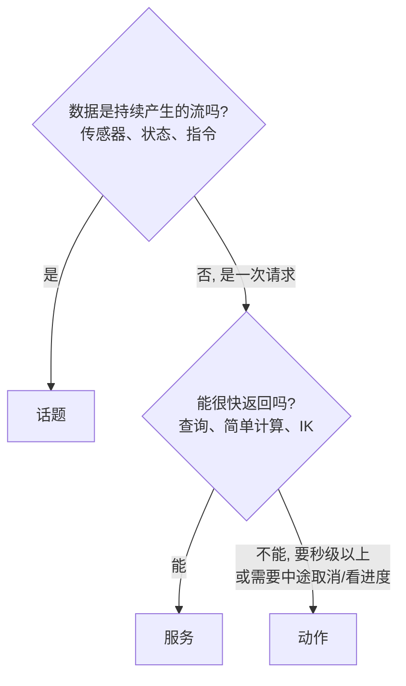

# 通信方式怎么选：话题、服务、动作

> 适用：ROS 2 **Rolling**
> 来源标记：📄 仓库文档原文 · 🔍 rclcpp 源码/实测核实 · 💡 经验补充（可信，但请自己验证）
> 源文档：[Interfaces-Topics-Services-Actions.rst](../../../source/ROS-Framework/Interfaces-Topics-Services-Actions.rst)

## 1. 一句话定义

ROS 2 节点之间有三种通信接口（interface）：话题（topic）用于持续的数据流，服务（service）用于很快返回的请求/响应，动作（action）用于耗时、要反馈、可取消的任务。📄

## 2. 为什么需要

选错通信方式是 ROS 系统里最常见的设计错误之一 💡：用服务跑 5 秒的规划，调用方就被卡 5 秒且无法取消；用话题发"去某个点"的命令，就拿不到"到了没有"的结果。

| | 话题 | 服务 | 动作 |
|---|---|---|---|
| 模式 | 发布/订阅 | 请求/响应 | 目标/反馈/结果 |
| 方向 | 单向 | 双向，一个请求一个响应 | 双向，执行中持续反馈 |
| 有结果吗 | 没有 | 有 | 有 |
| 能取消吗 | 不能 | 不能 | **能** |
| 一个名字上的服务端 | 多个发布者都可以 | **只应有一个**，多个时谁响应未定义 | **只应有一个**，同左 |
| 定义文件 | `.msg` | `.srv` | `.action` |

以上全部 📄。



### 导航里的典型对应（💡）

| 需求 | 选择 | 例子 |
|---|---|---|
| 激光、里程计、速度指令 | 话题 | `/scan`、`/odom`、`/cmd_vel` |
| 地图（一次发布、后来者也要） | 话题 + TransientLocal QoS | `/map` |
| 清空代价地图、查询一个参数 | 服务 | `clear_costmap` 类服务 |
| 导航到目标点、沿路径走 | 动作 | Nav2 的 `NavigateToPose` |
| 计算一条全局路径 | 动作或服务都有人用；耗时不可控时用动作 | Nav2 用 `ComputePathToPose` 动作 |

## 3. 最小 C++ 代码（rclcpp）

三种方式的创建入口（🔍 Rolling `node.hpp` 与 `rclcpp_action`）：

```cpp
// 话题
auto pub = node->create_publisher<geometry_msgs::msg::Twist>("cmd_vel", 10);
auto sub = node->create_subscription<geometry_msgs::msg::Twist>("cmd_vel", 10, callback);
// 服务
auto srv = node->create_service<study_interfaces::srv::ComputePath>("compute_path", handler);
auto cli = node->create_client<study_interfaces::srv::ComputePath>("compute_path");
// 动作（需要 rclcpp_action 包）
auto as = rclcpp_action::create_server<study_interfaces::action::MoveTo>(
  node, "move_to", handle_goal, handle_cancel, handle_accepted);
auto ac = rclcpp_action::create_client<study_interfaces::action::MoveTo>(node, "move_to");
```

完整例子分别见 [话题](topic.md)、[服务](service.md)、[动作](action.md) 卡片。

## 4. 常见坑（导航/控制场景）

1. **用服务做长任务。** 文档明确说服务"不应用于长时间运行的过程，尤其是可能需要因异常而被抢占的过程"。📄 规划可能卡几秒、需要被新目标打断时用动作。
2. **在回调里阻塞等服务结果。** 可能死锁，而且没有任何报错或异常。📄 见 [服务卡片](service.md) 和 [回调组卡片](../concurrency/callback-group.md)。
3. **一个服务名起了两个服务端。** 谁收到请求是未定义的。📄 💡 常见于 launch 里不小心启动了两份同一个节点。
4. **用话题发"一次性命令"然后等状态话题判断完成。** 💡 能做，但要自己处理超时、去重、谁的命令，基本就是在手写一个动作。

## 5. 与其他概念的关系

- [话题](topic.md) · [服务](service.md) · [动作](action.md) · [接口定义](interface-definition.md)
- 动作底层就是 3 个服务 + 2 个话题，见 [动作卡片](action.md)
- 上一级：[总览脑图](../../map/overview.md)

## 6. 自测题（先自己答，再看[答案](../../answers/communication-patterns-answers.md)）

1. 你要做一个"重定位"功能：给定初始位姿猜测，定位模块大约需要 0.5～3 秒收敛，期间用户可能改主意。你会用话题、服务还是动作？说出两条理由。
2. 同事说："`/cmd_vel` 也应该用服务，这样能确认底盘收到了。"你怎么回答？如果确实需要知道底盘是否在执行指令，有什么替代办法？
