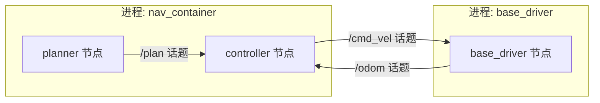

# 节点与 ROS 图 Node

> 适用：ROS 2 **Rolling**，rclcpp（2026-11-17 在 `ros:rolling-ros-base`、rclcpp 33.2.0 上核实）
> 来源标记：📄 仓库文档原文 · 🔍 rclcpp 源码/实测核实 · 💡 经验补充（可信，但请自己验证）
> 源文档：[About-Nodes.rst](../../../source/ROS-Framework/About-Nodes.rst)、[How-ROS-Works.rst](../../../source/ROS-Framework/How-ROS-Works.rst)、[Understanding-ROS2-Nodes.rst](../../../source/ROS-Framework/nodes/Working-with-nodes/Understanding-ROS2-Nodes/Understanding-ROS2-Nodes.rst)、[Using-Sub-Nodes.rst](../../../source/ROS-Framework/nodes/Working-with-nodes/Using-Sub-Nodes.rst)

## 1. 一句话定义

节点（node）是 ROS 图（ROS graph）里的一个参与者，负责一项具体任务（读传感器、跑算法、驱动电机），通过话题、服务、动作和其他节点通信。📄

## 2. 为什么需要

- **节点 ≠ 可执行文件。** `ros2 run` 启动的是一个进程；一个进程里可以有一个或多个节点。📄 💡 导航里常见做法：把规划器、控制器、代价地图作为组件放进同一个进程，省掉进程间拷贝。
- **节点之间靠"发现"（discovery）自动找到对方。** 默认的 DDS 中间件是分布式发现，没有中心服务器；启动时广播自己，之后周期性广播，正常退出时也会通知。📄
- **被发现 ≠ 能通信。** QoS 兼容性是按"每一对端点"单独检查的，不兼容的一对不会连上，即使两边节点在 ROS 图里都看得见。📄
- **节点有三个"内建能力"：** 参数（运行时配置行为）、日志（默认输出到终端 stderr、磁盘日志文件、`/rosout` 话题）、名字空间。📄



### 两节点连不上的 6 个原因（📄 文档 FAQ）

1. `ROS_DOMAIN_ID` 不同
2. 发现范围被限制（例如 `ROS_AUTOMATIC_DISCOVERY_RANGE=LOCALHOST`，节点却在不同机器上）
3. 中间件（RMW）实现不同且不兼容
4. 话题、服务、动作的**名字或类型**不一致
5. 发布端和订阅端的 **QoS 不兼容**（见 [QoS 卡片](qos.md)）
6. 防火墙或网络配置挡住了发现或数据流量

## 3. 最小 C++ 代码（rclcpp）

继承 `rclcpp::Node`，在构造函数里创建通信实体，把句柄存成成员。可编译版本见 [card_topic_min.cpp](../../labs/comm_lab/src/card_topic_min.cpp)。

```cpp
#include "rclcpp/rclcpp.hpp"

class Controller : public rclcpp::Node
{
public:
  Controller() : Node("controller")   // 节点名
  {
    // 在这里 create_publisher / create_subscription / create_wall_timer ...
    // 返回的 SharedPtr 必须存成成员，否则离开构造函数就被销毁
  }
};

int main(int argc, char ** argv)
{
  rclcpp::init(argc, argv);
  rclcpp::spin(std::make_shared<Controller>());  // 见执行器卡片
  rclcpp::shutdown();
  return 0;
}
```

子节点（sub-node）：`create_sub_node("local_costmap")` 在同一个节点里开一个子名字空间，共享父节点的上下文、参数、时钟和 ROS 图身份，不会多出一个被发现的节点。📄 适合把一个大节点内部的子模块话题名分组。

> 📄 `rclcpp/rclcpp.hpp` 是"便利头文件"，会把整个 rclcpp API 都拉进来。正式代码里只包含用到的头文件（例如 `rclcpp/node.hpp`），头文件、插件、工具库里收益最大。

## 4. 常见坑（导航/控制场景）

1. **把实体句柄存成局部变量。** 构造函数里 `auto sub = create_subscription(...)`，离开作用域订阅就被销毁，回调永远不来。💡 必须存成类成员。
2. **两台机器"看得见但收不到"。** `ros2 node list` 能看到对方，`ros2 topic echo` 却没数据，十有八九是 QoS 不兼容。📄 用 `ros2 topic info -v <topic>` 对比两端 QoS。💡
3. **节点崩溃后，别人不会立刻知道。** 正常退出会广播离开；崩溃时其他节点要等它的周期性广播停止才发现。📄 💡 需要快速感知上游掉线，用 QoS 的 Deadline 或 Liveliness（见 [QoS 卡片](qos.md)）。
4. **同名节点。** 💡 同一个 ROS 图里出现两个同名节点时，工具和参数服务会混乱。用 launch 的名字空间或 `--ros-args -r __node:=新名字` 区分（启动参数见第 3 批）。
5. **跨语言没问题，跨中间件可能有问题。** C++ 节点和 Python 节点可以互通 📄；但不同 RMW 实现之间不保证互通（第 7 批会讲）。

## 5. 与其他概念的关系

- [话题 Topic](topic.md)、[服务 Service](service.md)、[动作 Action](action.md)：节点之间的三种通信方式，怎么选见 [通信方式怎么选](communication-patterns.md)
- [执行器 Executor](../concurrency/executor.md)：节点只是登记回调，真正调用回调的是执行器
- 参数、生命周期节点、组件（第 3、4 批）
- 上一级：[总览脑图](../../map/overview.md)

## 6. 自测题（先自己答，再看[答案](../../answers/node-answers.md)）

1. 你的导航进程里用组件容器装了 `planner_server` 和 `controller_server` 两个节点。`ros2 node list` 会显示几个节点？`ps` 会看到几个进程？如果 `controller_server` 抛出未捕获异常，`planner_server` 会怎样？
2. 机器人上的 `base_driver` 和工作站上的 RViz 都在跑，工作站 `ros2 node list` 能看到 `base_driver`，但 `ros2 topic echo /odom` 没有输出。按可能性从高到低列出你要检查的三件事，并说出每件事用什么命令检查。
