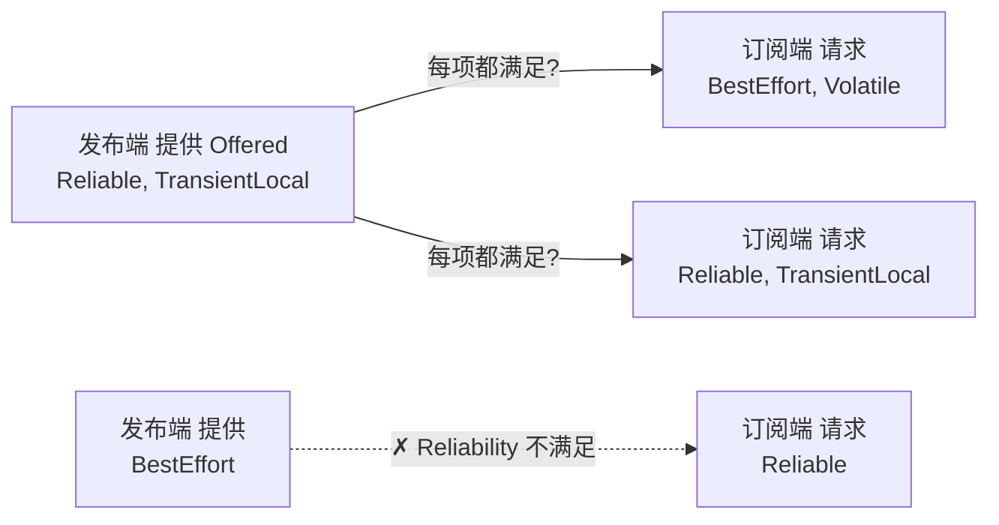

# 服务质量 QoS（Quality of Service）

> 适用：ROS 2 **Rolling**，rclcpp（2026-11-17 在 `ros:rolling-ros-base`、rclcpp 33.2.0、默认 RMW `rmw_fastrtps_cpp` 上实测）
> 来源标记：📄 仓库文档原文 · 🔍 rclcpp 源码/实测核实 · 💡 经验补充（可信，但请自己验证）
> 源文档：[About-Quality-of-Service-Settings.rst](../../../source/ROS-Framework/interfaces/topics/About-Quality-of-Service-Settings.rst)、[Quality-of-Service.rst](../../../source/ROS-Framework/interfaces/topics/Working-with-topics/Quality-of-Service.rst)、[Configuring-QoS-Overrides.rst](../../../source/ROS-Framework/interfaces/topics/Working-with-topics/Configuring-QoS-Overrides.rst)

## 1. 一句话定义

QoS 是一组策略（policy），规定一个发布者、订阅者、服务端或客户端"怎么传数据"：丢不丢、缓存几条、后来者能不能拿到旧数据、多久必须来一次。一组策略合起来叫一个 QoS 配置（profile）。📄

## 2. 为什么需要

- ROS 1 基本只有 TCP；ROS 2 借助 DDS，可以像 TCP 一样可靠，也可以像 UDP 一样"尽力而为"，适应有损的无线网络和有时限要求的实时系统。📄
- **两端 QoS 不兼容就收不到任何消息**，这是 ROS 2 新增的、ROS 1 没有的故障来源。📄

### 策略一览 📄

| 策略 | 取值 | 含义 |
|---|---|---|
| History 历史 | KeepLast / KeepAll | 只存最近 N 条 / 全存（受中间件资源上限约束） |
| Depth 深度 | N | 队列大小，只在 KeepLast 时生效 |
| Reliability 可靠性 | BestEffort / Reliable | 尽力发、可能丢 / 保证送达、会重传 |
| Durability 持久性 | Volatile / TransientLocal | 不保存 / 发布者为"后加入的订阅者"保留样本 |
| Deadline 截止期 | 时长 | 相邻两条消息之间的最大间隔 |
| Lifespan 寿命 | 时长 | 消息从发布到接收的最长时间，过期的被静默丢弃 |
| Liveliness 活跃性 | Automatic / ManualByTopic | 怎样算"发布者还活着" |
| Lease Duration 租约 | 时长 | 多久不表明存活就算失去活跃性 |

非时长类策略都有 "system default"（用中间件默认）；时长类策略的 "default" 通常被解释为无穷大。📄

### 预设配置 📄

| 配置 | 要点 | 用于 |
|---|---|---|
| 默认（发布/订阅） | KeepLast 10、Reliable、Volatile | 一般话题 |
| 服务 | Reliable、**Volatile** | 服务端重启后不会收到过期请求 |
| 传感器数据 `SensorDataQoS` | **BestEffort**、更小队列 | 激光、相机、IMU |
| 参数 | 基于服务，队列深度大得多 | 参数服务 |
| 系统默认 | 全部用 RMW 的默认值 | 不同 RMW 可能不同 |

### 兼容规则："请求 vs 提供"（Request vs Offered）📄

订阅者**请求**它能接受的最低质量，发布者**提供**它能给的最高质量；**每一项**请求都不比提供更严格，才会连接。任何一项不兼容，整对都不连。

| 策略 | 不兼容的组合（发布端 → 订阅端） |
|---|---|
| Reliability | BestEffort → Reliable |
| Durability | Volatile → TransientLocal |
| Deadline | 发布端 default（无限）→ 订阅端 x；或 发布端 x → 订阅端 y 且 y < x |
| Liveliness | Automatic → ManualByTopic |
| Lease Duration | 同 Deadline 的规则 |

记忆法 💡：**订阅端不能比发布端"要求更高"。**



一个发布者可以同时连接 QoS 不同的多个订阅者；某一对是否兼容，不受其他发布者、订阅者影响。📄

### QoS 事件与匹配事件 📄

| 端 | 事件 |
|---|---|
| 发布端 | Offered deadline missed、Liveliness lost、Offered incompatible QoS |
| 订阅端 | Requested deadline missed、Liveliness changed、Requested incompatible QoS |
| 两端 | Matched（与对端建立或断开连接） |

## 3. 最小 C++ 代码（rclcpp）

导航里三类典型话题的 QoS 写法 + 事件回调。可编译文件：[card_qos_min.cpp](../../labs/comm_lab/src/card_qos_min.cpp)

```cpp
// 1. 传感器：BestEffort + 小队列
scan_pub_ = create_publisher<sensor_msgs::msg::LaserScan>("scan", rclcpp::SensorDataQoS());

// 2. 地图：只发一次，后来的订阅者也要拿到
auto map_qos = rclcpp::QoS(rclcpp::KeepLast(1)).reliable().transient_local();
map_pub_ = create_publisher<nav_msgs::msg::OccupancyGrid>("map", map_qos);

// 3. 控制指令：默认 QoS，订阅端加 Deadline 检测上游掉线
rclcpp::SubscriptionOptions opts;
opts.event_callbacks.deadline_callback =
  [this](rclcpp::QOSDeadlineRequestedInfo & info) {
    RCLCPP_WARN(get_logger(), "cmd_vel deadline missed, total=%d", info.total_count);
    // 例如：触发减速停车
  };
opts.event_callbacks.incompatible_qos_callback =
  [this](rclcpp::QOSRequestedIncompatibleQoSInfo & info) {
    RCLCPP_ERROR(get_logger(), "incompatible QoS, policy kind=%d",
                 static_cast<int>(info.last_policy_kind));
  };
// 注意：订阅端设了 Deadline，发布端也必须设一个不大于它的 Deadline，否则不兼容
cmd_sub_ = create_subscription<geometry_msgs::msg::Twist>(
  "cmd_vel", rclcpp::QoS(10).deadline(200ms), callback, opts);
```

### 不改代码改 QoS：QoS overrides 📄

节点作者在创建时**选择开启**，用户就能在启动时通过参数文件改 QoS：

```cpp
rclcpp::PublisherOptions pub_opts;
pub_opts.qos_overriding_options = rclcpp::QosOverridingOptions::with_default_policies();
pub_ = create_publisher<std_msgs::msg::String>("chatter", 10, pub_opts);
```

```yaml
my_node:
  ros__parameters:
    qos_overrides:
      /chatter:
        publisher:
          reliability: best_effort
          depth: 5
```

- 参数名格式：`qos_overrides.<话题>.<publisher|subscription>[_<id>].<策略>`。📄
- `with_default_policies()` 默认开放 history、depth、reliability 三项；可以传校验回调，不合格时节点初始化抛 `InvalidQosOverridesException`。📄
- 这些参数是**只读**的，`ros2 param set` 改不了，只能在启动时给。📄

## 4. 常见坑（导航/控制场景）

1. **BestEffort 发布 + Reliable 订阅 = 一条都收不到。** 🔍 实测 3 秒内 `received=0`，两端各触发 1 次 incompatible 事件。典型场景：激光驱动用 `SensorDataQoS` 发布，你的节点用默认 QoS（Reliable）订阅。订阅端改用 `SensorDataQoS` 即可。反过来（Reliable 发、BestEffort 收）是兼容的。🔍
2. **后启动的节点拿不到地图。** `map_server` 用 TransientLocal 发布一次地图；如果你的订阅是 Volatile，就永远收不到那一次。🔍 实测 `late-volatile` 收到 0 条，`late-transient` 收到 1 条。"锁存"（latched）效果需要**两端都** TransientLocal。📄
3. **只在订阅端设 Deadline。** 发布端不设（default = 无限）时与订阅端的 Deadline 不兼容，直接连不上。📄 两端都要设，且发布端 ≤ 订阅端。
4. **有损 Wi-Fi 上用 Reliable 发大数据。** 📄 文档实验：5% 丢包时 Reliable 会不停重传，图像帧率明显下降；改 BestEffort 后丢帧但不卡。💡 远程监控用的相机、点云话题优先 BestEffort。
5. **同机测试测不出网络问题。** 📄 Fast DDS、Connext 在同一台机器上走共享内存，用 `tc` 给回环接口加丢包对它们无效。💡 测网络相关的 QoS 要在两台机器之间测。
6. **服务端不要用 TransientLocal。** 📄 否则重启的服务端可能收到过期请求，产生副作用。
7. **排查顺序。** 💡 `ros2 topic info -v <话题>` 列出每个端点的 QoS，对照上面的不兼容表逐项比。代码里注册 incompatible 事件回调，比靠猜快得多。

## 5. 与其他概念的关系

- [话题](topic.md)：QoS 最常用在话题上；服务、动作底层也有 QoS
- [节点](node.md)：被发现 ≠ 能通信，QoS 兼容是单独检查的
- 参数（第 3 批）：QoS overrides 是基于参数的
- rosbag（第 6 批）：录制和回放时也要处理 QoS（文档有专门一篇 Overriding-QoS-Policies-For-Recording-And-Playback）
- 练习：[QoS 不匹配时到底发生了什么](../../labs/qos-mismatch.md)
- 上一级：[总览脑图](../../map/overview.md)

## 6. 自测题（先自己答，再看[答案](../../answers/qos-answers.md)）

1. 你的定位节点订阅 `/scan`，激光驱动用 `SensorDataQoS` 发布。你的订阅写成 `create_subscription<LaserScan>("scan", 10, cb)`。能收到数据吗？如果把订阅改成 `SensorDataQoS`，而另一个调试工具用 Reliable 订阅同一个话题，你的节点还能收到吗？调试工具呢？
2. 你想让底盘驱动在 `/cmd_vel` 超过 200 ms 没来时自动刹车。写出两端各自需要的 QoS 设置，并说明：如果控制器那边忘了设 Deadline，会发生什么？这种"安全设计"本身有什么风险？
