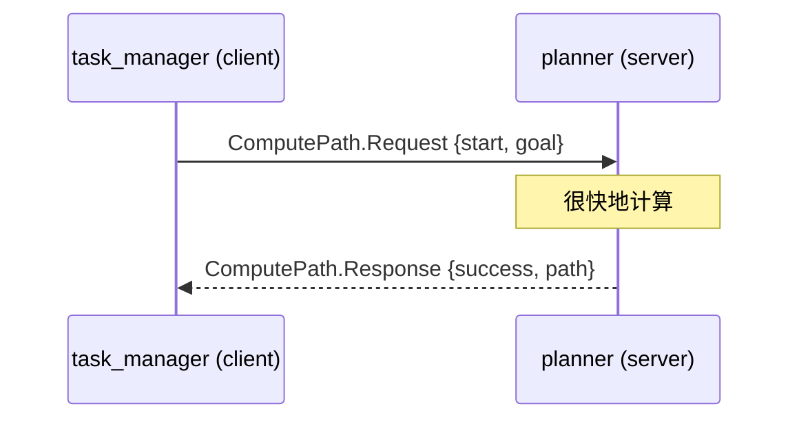

# 服务 Service（请求/响应）

> 适用：ROS 2 **Rolling**，rclcpp（2026-11-17 在 `ros:rolling-ros-base`、rclcpp 33.2.0 上核实）
> 来源标记：📄 仓库文档原文 · 🔍 rclcpp 源码/实测核实 · 💡 经验补充（可信，但请自己验证）
> 源文档：[About-Services.rst](../../../source/ROS-Framework/interfaces/About-Services.rst)、[Sync-Vs-Async.rst](../../../source/ROS-Framework/interfaces/services/Working-with-services/Sync-Vs-Async.rst)、[Writing-A-Simple-Cpp-Service-And-Client.rst](../../../source/ROS-Framework/client-libraries/Working-with-Client-Libraries/Writing-A-Simple-Cpp-Service-And-Client.rst)、[Understanding-ROS2-Services.rst](../../../source/ROS-Framework/interfaces/services/Working-with-services/Understanding-ROS2-Services/Understanding-ROS2-Services.rst)

## 1. 一句话定义

服务（service）是一种远程过程调用（remote procedure call）：客户端（client）发一个请求，服务端（server）做一次**很快**的计算，返回一个响应。📄

## 2. 为什么需要

- 有些交互天然是"问一次、答一次"：查询状态、清空代价地图、做一次逆运动学。📄
- 服务**应当很快返回**，因为客户端通常在等结果；长时间运行、可能需要被抢占的任务不要用服务，用[动作](action.md)。📄
- **一个服务名只应有一个服务端**；有多个时由谁处理请求是未定义的。客户端数量不限。📄
- rclcpp 的客户端只有**异步** API（`async_send_request`）。"同步调用"是你自己等 future 造出来的，危险就出在这里。📄



## 3. 最小 C++ 代码（rclcpp）

规划服务端 + **用回调取结果**的客户端，单线程执行器也不会死锁。可编译文件：[card_service_min.cpp](../../labs/comm_lab/src/card_service_min.cpp)（接口定义见 [study_interfaces](../../labs/study_interfaces/srv/ComputePath.srv)）

```cpp
using ComputePath = study_interfaces::srv::ComputePath;

// 服务端
srv_ = create_service<ComputePath>(
  "compute_path",
  [](const std::shared_ptr<ComputePath::Request> req,
     std::shared_ptr<ComputePath::Response> res) {
    res->path = {req->start, req->goal};
    res->success = true;
  });

// 客户端（在定时器回调里调用也安全）
client_ = create_client<ComputePath>("compute_path");

void request_path()
{
  if (!client_->service_is_ready()) { return; }   // 不在回调里阻塞等待服务上线
  auto req = std::make_shared<ComputePath::Request>();
  req->goal.x = 3.0;
  client_->async_send_request(
    req, [this](rclcpp::Client<ComputePath>::SharedFuture future) {
      auto res = future.get();   // 回调被调用时结果已经就绪
      RCLCPP_INFO(get_logger(), "path with %zu poses", res->path.size());
    });
}
```

在 `main` 里一次性调用（不在回调中）时，文档教程的写法是 📄：

```cpp
while (!client->wait_for_service(1s)) {
  if (!rclcpp::ok()) { return 0; }   // Ctrl-C 时退出
}
auto future = client->async_send_request(request);
if (rclcpp::spin_until_future_complete(node, future) == rclcpp::FutureReturnCode::SUCCESS) {
  auto result = future.get();
} else {
  client->remove_pending_request(future);   // 失败时清理挂起的请求
}
```

命令行：`ros2 service list -t`、`ros2 service type /compute_path`、`ros2 service call /compute_path study_interfaces/srv/ComputePath "{goal: {x: 3.0}}"`。📄

## 4. 常见坑（导航/控制场景）

1. **在回调里同步等待 → 死锁，而且毫无提示。** 📄 文档警告：死锁时没有警告、没有异常、栈里也看不出来，调用永远不返回。在定时器、订阅、服务回调里等结果，等同于占着执行器线程等一个需要执行器线程才能完成的回调。解决办法按推荐程度：① 用带回调的 `async_send_request`；② 必须同步时，把回调和 client 放进不同回调组 + 多线程执行器（见[回调组卡片](../concurrency/callback-group.md)和[实验 B](../../labs/executor-blocking.md)）。
2. **在回调里用 `spin_until_future_complete(node, ...)`。** 💡 它内部会新建一个执行器并 `add_node`；节点已经在别的执行器里时，按 [执行器卡片](../concurrency/executor.md) 坑 6 的实测，会抛 "already been added to an executor" 异常（推导，未单独实测）。它只适合 `main` 里的"一次性脚本"写法。
3. **服务端里做耗时计算。** 📄 服务应当很快返回。💡 一次全局规划如果可能超过几百毫秒，或者需要被新目标打断，改用动作。
4. **超时后不清理。** 💡 等待超时后要调用 `remove_pending_request(future)`，否则挂起的请求会一直留在客户端里（🔍 实验 B 的超时分支就是这样做的）。
5. **启动顺序。** 💡 客户端先于服务端启动很常见。在回调里用 `service_is_ready()` 检查然后跳过本次，不要在构造函数里 `wait_for_service` 死等，否则节点会卡在构造函数里。
6. **同名服务端。** 📄 两个服务端注册同一个名字时，请求由谁处理未定义。

## 5. 与其他概念的关系

- [通信方式怎么选](communication-patterns.md)：服务和动作的边界
- [动作](action.md)：底层由 3 个服务 + 2 个话题组成
- [回调组](../concurrency/callback-group.md)：同步调用不死锁的条件
- [QoS](qos.md)：服务默认 Reliable + Volatile
- [接口定义](interface-definition.md)：`.srv` 文件格式
- 上一级：[总览脑图](../../map/overview.md)

## 6. 自测题（先自己答，再看[答案](../../answers/service-answers.md)）

1. 一个节点订阅 `/goal_pose`，在订阅回调里调用 `/compute_path` 服务并 `future.wait_for(5s)`，节点用 `rclcpp::spin(node)` 运行，没有建任何回调组。描述会发生什么（包括 5 秒后），并给出两种修复方法。
2. `planner` 节点崩溃重启了。如果服务用的是 TransientLocal 持久性（而不是默认的 Volatile），可能出现什么问题？结合"清空代价地图"这类有副作用的服务说明。
