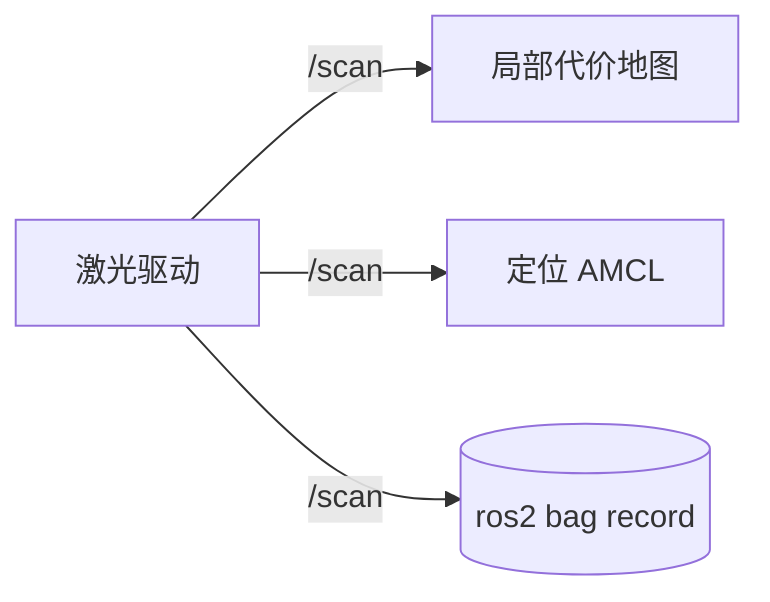

# 话题 Topic（发布/订阅）

> 适用：ROS 2 **Rolling**，rclcpp（2026-11-17 在 `ros:rolling-ros-base`、rclcpp 33.2.0 上核实）
> 来源标记：📄 仓库文档原文 · 🔍 rclcpp 源码/实测核实 · 💡 经验补充（可信，但请自己验证）
> 源文档：[About-Topics.rst](../../../source/ROS-Framework/interfaces/About-Topics.rst)、[Understanding-ROS2-Topics.rst](../../../source/ROS-Framework/interfaces/topics/Understanding-ROS2-Topics/Understanding-ROS2-Topics.rst)、[Writing-A-Simple-Cpp-Publisher-And-Subscriber.rst](../../../source/ROS-Framework/client-libraries/Working-with-Client-Libraries/Writing-A-Simple-Cpp-Publisher-And-Subscriber.rst)

## 1. 一句话定义

话题（topic）是一个有名字、有类型的数据通道：发布者（publisher）往里发消息，所有订阅者（subscription）都会收到，用于持续的数据流。📄

## 2. 为什么需要

文档把 ROS 2 话题概括为"强类型、匿名的发布/订阅系统"（strongly-typed, anonymous publish/subscribe），三个词各有含义：📄

- **发布/订阅：** 同名话题上可以有 0 个或多个发布者、0 个或多个订阅者；任一发布者发出的数据，所有订阅者都收到。像一条"总线"（bus）。
- **匿名：** 订阅者一般不知道也不关心数据来自哪个发布者（想知道也能查到）。好处是发布者、订阅者可以随时替换，不影响系统其他部分。
- **强类型：** 字段类型在多个层面被强制检查；字段的**语义**也有约定（例如 IMU 消息的角速度单位是 rad/s），但语义没有自动检查，要靠大家遵守。

💡 后果：`ros2 bag record` 只是多加一个订阅者，不打扰原有数据流；调试和录包因此很自然。📄



## 3. 最小 C++ 代码（rclcpp）

控制器发布 `/cmd_vel`，底盘驱动订阅 `/cmd_vel`。可编译文件：[card_topic_min.cpp](../../labs/comm_lab/src/card_topic_min.cpp)

```cpp
class Controller : public rclcpp::Node
{
public:
  Controller() : Node("controller")
  {
    // 第二个参数 10 = QoS 的队列深度（KeepLast 10），其余用默认 QoS
    pub_ = create_publisher<geometry_msgs::msg::Twist>("cmd_vel", 10);
    timer_ = create_wall_timer(50ms, [this]() {
        geometry_msgs::msg::Twist cmd;
        cmd.linear.x = 0.2;
        pub_->publish(cmd);
      });
  }
private:
  rclcpp::Publisher<geometry_msgs::msg::Twist>::SharedPtr pub_;
  rclcpp::TimerBase::SharedPtr timer_;
};

class BaseDriver : public rclcpp::Node
{
public:
  BaseDriver() : Node("base_driver")
  {
    sub_ = create_subscription<geometry_msgs::msg::Twist>(
      "cmd_vel", 10,
      [this](const geometry_msgs::msg::Twist::ConstSharedPtr & msg) {
        // 把 msg->linear.x / msg->angular.z 转成轮速
      });
  }
private:
  rclcpp::Subscription<geometry_msgs::msg::Twist>::SharedPtr sub_;
};
```

常用命令行（📄 Understanding-ROS2-Topics）：

| 命令 | 用途 |
|---|---|
| `ros2 topic list -t` | 列出话题及类型 |
| `ros2 topic echo /cmd_vel` | 打印消息 |
| `ros2 topic info -v /cmd_vel` | 看发布者、订阅者以及各自的 QoS |
| `ros2 topic hz /scan` | 实际频率 |
| `ros2 topic pub /cmd_vel geometry_msgs/msg/Twist "{linear: {x: 0.1}}"` | 手动发一条 |
| `ros2 interface show geometry_msgs/msg/Twist` | 看消息定义 |

## 4. 常见坑（导航/控制场景）

1. **队列深度不是"缓冲越大越好"。** 💡 控制器只关心最新的 `/odom`，深度 10 意味着回调慢时会依次处理 10 条旧数据，延迟反而变大；这类话题用深度 1～5，或用 `SensorDataQoS`。见 [QoS 卡片](qos.md)。
2. **发布频率不等于接收频率。** 💡 订阅端回调慢、执行器被阻塞、BestEffort 丢包都会让 `ros2 topic hz` 在订阅端偏低。先在发布端所在机器上测。
3. **语义靠约定。** 📄 类型检查只保证字段类型对，不保证单位和坐标系对。💡 速度用 m/s 和 rad/s，位姿带 `header.frame_id`，遵守 REP 103/105。
4. **回调参数按值接收消息。** 💡 写成 `[](geometry_msgs::msg::Twist msg)` 会多一次拷贝；点云、图像这种大消息用 `ConstSharedPtr`，更进一步见进程内通信（第 4 批）。
5. **话题名前面有没有 `/`。** 💡 `cmd_vel` 是相对名，会加上节点名字空间（例如 `/robot1/cmd_vel`）；`/cmd_vel` 是绝对名，不受名字空间影响。多机器人时尽量用相对名。

## 5. 与其他概念的关系

- [QoS](qos.md)：决定可靠性、队列、后来者能否收到旧数据，以及两端能不能连上
- [接口定义](interface-definition.md)：`.msg` 文件怎么写、怎么生成代码
- [话题进阶](topic-advanced.md)：内容过滤订阅、键控话题、等待确认
- [执行器](../concurrency/executor.md)：订阅回调什么时候、在哪个线程被调用
- 上一级：[通信方式怎么选](communication-patterns.md) · [总览脑图](../../map/overview.md)

## 6. 自测题（先自己答，再看[答案](../../answers/topic-answers.md)）

1. 局部规划器以 20 Hz 运行，订阅 `/odom`（50 Hz），回调里只把最新里程计存起来。你把订阅的队列深度设为 100，觉得"更保险"。某次规划器卡了 1 秒，恢复后会发生什么？深度应该怎么设，为什么？
2. 两个机器人共用一个 ROS 域，各自的节点在名字空间 `/r1`、`/r2` 下。`r1` 的控制器代码里写的是 `create_publisher<Twist>("/cmd_vel", 10)`。会出什么问题？怎么改？
