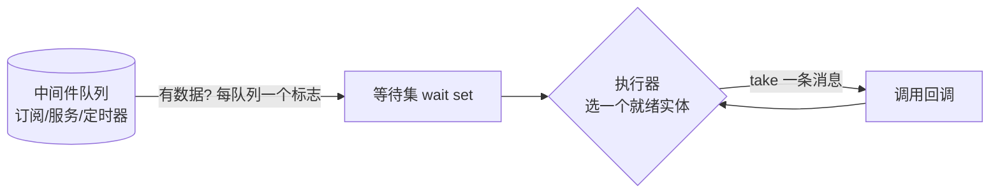

# 执行器 Executor

> 适用：ROS 2 **Rolling**，rclcpp（API 于 2026-11-17 对照 rclcpp `rolling` 分支 33.2.0 核实）
> 来源标记：📄 仓库文档原文 · 🔍 rclcpp 源码/实测核实 · 💡 经验补充（可信，但请自己验证）
> 源文档：[About-Executors.rst](../../../source/ROS-Framework/client-libraries/About-Executors/About-Executors.rst)
> 📐 设计动机：[实时系统的设计](../../design/realtime-design.md)：设计文档要求执行器的同步原语可替换、实时安全，Rolling 还没做到；`StaticSingleThreadedExecutor` 已从 Rolling 删除

## 1. 一句话定义

执行器（executor）是一个调度器：它用一个或多个操作系统线程，去调用订阅、定时器、服务端、动作服务端等实体的回调（callback）。📄

## 2. 为什么需要

- **回调不会自己运行。** 节点只是"登记"了回调；在哪个线程、什么时候、按什么顺序调用，全由执行器决定。📄
- **`rclcpp::spin(node)` 只是语法糖**，展开后就是"建一个单线程执行器 SingleThreadedExecutor → `add_node` → `spin()`"。📄
- **消息不在客户端库里排队。** 为了不破坏 QoS 设置，消息留在中间件层，直到回调取走它；执行器通过等待集（wait set）知道"某个队列里有没有数据"，每个队列只有一个二值标志。📄
- 由此产生一个重要后果：回调处理不过来时，执行器按**轮询（round-robin）**而不是严格的先进先出（FIFO）顺序处理各实体的消息。📄
- 💡 对规划控制的意义：控制环能不能准时、传感器回调延迟多大、规划服务会不会卡住控制，最终都取决于"回调被分配到哪个执行器、哪个线程、哪个回调组"。



## 3. Rolling 里的执行器类型

| 类型 | 线程 | 要点 | 来源 |
|---|---|---|---|
| `SingleThreadedExecutor` | 1（调用 `spin()` 的线程） | `rclcpp::spin()` 默认用它；组件容器（component container）也用它 | 📄 |
| `MultiThreadedExecutor` | 可配置；构造参数 `number_of_threads` 默认 0 = 按 CPU 核数（最少 2） | 实际并行度取决于**回调组** | 📄 🔍 |
| `EventsCBGExecutor` | 可配置 | Lyrical Luth 起提供；用 FIFO 事件队列代替等待集，CPU 开销更低，可直接替换 MultiThreadedExecutor；**队列无上限** | 📄 |

> 🔍 Rolling 的 `rclcpp/executors.hpp` 还包含 `rclcpp::experimental::executors::EventsExecutor`，仓库文档没有讲，本卡暂不展开。

## 4. 最小 C++ 代码（rclcpp）

一个执行器、两个节点、两个线程。可编译文件：[card_executor_min.cpp](../../labs/executor_lab/src/card_executor_min.cpp)

```cpp
#include <chrono>
#include <memory>
#include <thread>
#include "rclcpp/rclcpp.hpp"
using namespace std::chrono_literals;

int main(int argc, char ** argv)
{
  rclcpp::init(argc, argv);
  auto controller = std::make_shared<rclcpp::Node>("controller");
  auto planner = std::make_shared<rclcpp::Node>("planner");

  auto control_timer = controller->create_wall_timer(20ms, [controller]() {
      /* 50 Hz 控制环 */
    });
  auto plan_timer = planner->create_wall_timer(1s, []() {
      std::this_thread::sleep_for(300ms);  // 模拟耗时规划
    });

  // 两个节点各有自己的默认回调组 -> 属于不同组 -> 多线程下可以并行
  rclcpp::executors::MultiThreadedExecutor executor(rclcpp::ExecutorOptions(), 2);
  executor.add_node(controller);
  executor.add_node(planner);
  executor.spin();  // 阻塞当前线程，直到 Ctrl-C

  rclcpp::shutdown();
  return 0;
}
```

关键 API（🔍 Rolling `node.hpp` / `multi_threaded_executor.hpp`）：

- `executor.add_node(node)`：一个执行器可以服务多个节点。📄
- `executor.add_callback_group(group, node->get_node_base_interface())`：把单个回调组分给另一个执行器，再给那个执行器的线程设操作系统优先级，就能让控制环优先于其他回调。📄（示例包：`examples_rclcpp_cbg_executor`）
- `MultiThreadedExecutor(options, number_of_threads)`。🔍

## 5. 常见坑（导航/控制场景）

1. **单线程执行器里，一个慢回调卡住所有回调。** 规划服务每次算 300 ms，同一执行器里的 50 Hz 控制定时器就会出现 300 ms 的空档，相当于连续漏掉约 15 拍控制。🔍 实测见 [实验 A](../../labs/executor-blocking.md)。
2. **只把执行器换成 `MultiThreadedExecutor` 往往没用。** 如果所有回调都在节点的默认回调组里（默认组是互斥组），节点的行为等同于单线程。📄 实验 A 中 `multi + default` 的结果和单线程一样差。🔍
3. **`spin()` 会阻塞。** 在 `main` 里写 `rclcpp::spin(node1); rclcpp::spin(node2);`，第二个节点要等第一个 spin 返回（通常是进程退出时）才会被处理。💡 多节点请用一个执行器 `add_node` 多次。
4. **回调太慢时不是 FIFO。** 激光（高频）和目标点（低频）同时积压时，执行器在各实体间轮询，不保证"先到先处理"；要保证顺序或实时性，需要更强的手段（WaitSet、rclc Executor、优先级线程）。📄
5. **`EventsCBGExecutor` 的事件队列没有上限。** 进程过载时就绪事件会无限增长，内存和延迟一起涨。📄
6. **同一个节点不能同时加进两个执行器。** 🔍 实测抛出异常："Node '/x' has already been added to an executor."。💡 需要拆分时，用 `add_callback_group` 按回调组拆，而不是按节点拆。

## 6. 与其他概念的关系

- [回调组 Callback Group](callback-group.md)：决定多线程执行器里**哪些回调能并行**。执行器给线程，回调组定规则。
- 组件 Composition（卡片待建）：组件容器默认用单线程执行器。📄 源文档：[About-Composition.rst](../../../source/ROS-Framework/nodes/About-Composition.rst)
- QoS（卡片待建）：消息积压在中间件层，队列深度由 QoS 的 depth 决定。📄 + 💡
- WaitSet（卡片待建）：不用执行器、自己决定处理顺序的替代方案，适合需要确定性的控制链路。📄
- [实时系统的设计](../../design/realtime-design.md)（📐 设计动机）：执行器路径上的内存分配
- 上一级：[总览脑图：让回调按时跑](../../map/overview.md)

## 7. 自测题（先自己答，再看[答案](../../answers/executor-answers.md)）

1. 一个节点里有 50 Hz 控制定时器和一个激光订阅（每次回调耗时 40 ms），都没有指定回调组，用 `MultiThreadedExecutor`（4 线程）运行。控制定时器两次触发的最大间隔大约是多少？为什么 4 个线程没有帮上忙？
2. 你要把这两个回调拆到两个节点里（`controller` 和 `scan_filter`），仍然不显式创建任何回调组，还用同一个 4 线程 `MultiThreadedExecutor`。现在控制定时器还会被激光回调阻塞吗？说出你的推理依据。
