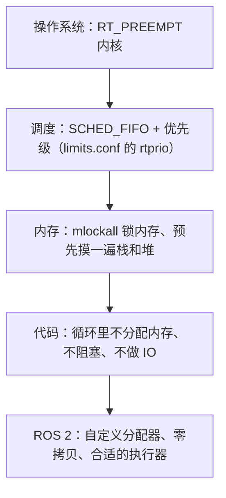

# 实时编程 Real-time Programming

> 适用：ROS 2 **Rolling**（2026-11-17 在 `ros:rolling-ros-base` 容器里实测，rclcpp 33.2.0；容器跑在普通 Linux 内核上，**不是** RT_PREEMPT）
> 来源标记：📄 仓库文档原文 · 🔍 源码或实测核实 · 💡 经验补充（可信，但请自己验证）
> 源文档：[Real-Time-Programming.rst](../../../source/Capabilities/Motion-planning/Real-Time-Programming.rst)、[Allocator-Template-Tutorial.rst](../../../source/ROS-Framework/client-libraries/Working-with-Client-Libraries/Allocator-Template-Tutorial.rst)、[Building-Realtime-rt_preempt-kernel-for-ROS-2.rst](../../../source/Developer-Tools/Build/Building-Realtime-rt_preempt-kernel-for-ROS-2/Building-Realtime-rt_preempt-kernel-for-ROS-2.rst)

## 1. 一句话定义

实时（real-time）不是"快"，而是"**按时**"：周期循环每次都必须在截止期（deadline）前完成，允许的误差（最大抖动 jitter）很小。为此执行路径上要避开**不确定耗时**的操作：缺页（page fault）、动态内存分配/释放、可能无限阻塞的同步原语。📄

## 2. 为什么需要

📄 倒立摆是典型例子：控制器偶尔阻塞得太久，摆就倒了。💡 移动机器人里对应的是底盘速度环、MPC 控制环、安全停车逻辑：平均延迟再低也没用，**最坏情况**才决定会不会撞。

### 衡量什么

| 指标 | 含义 |
|---|---|
| 延迟（latency） | 实际唤醒时刻 - 计划时刻 📄 |
| 最大延迟 / p99 | 决定能不能满足截止期 💡 |
| 缺页次数 | 📄 minor（页在内存里但未映射）/ major（要从磁盘读） |

📄 文档的例子：1 kHz（1 ms）循环，目标是最大延迟不超过周期的 5%（50 μs）。平均延迟很好，但最大延迟超过了一个周期，就不合格。

### 实时的几层手段



📄 要点：
- 普通 Linux 内核的调度器不能在用户态任意抢占线程，不装 RT_PREEMPT 基本达不到严格的实时目标。仓库有编译 RT_PREEMPT 内核的教程（基于 Ubuntu 20.04 / 5.4 内核，版本较旧）。
- 实时优先级范围 0~99。**不要**把上限设成 99，会和看门狗等系统最高优先级进程争抢。演示程序用 98。
- `mlockall` 失败时报 `mlockall failed: Cannot allocate memory`，原因是 `memlock` 限制；在 `/etc/security/limits.conf` 里加 `<用户名> - memlock <kB 或 -1>`，`<用户名> - rtprio 98`，重新登录后生效。
- 内存锁定后 swap 不再起作用，要有足够的空闲内存。
- 📄 rclcpp 的发布者、订阅者、执行器都接受分配器（Allocator）模板参数；推荐基于 C++17 `std::pmr::memory_resource`。rcl 层要的是 C 风格的 `rcl_allocator_t`，回调不能抛异常，失败时要返回 `nullptr`。
- 📄 文档示例里自定义分配器只接住了约 2/3 的分配，剩下 1/3 来自底层 DDS 实现。ROS 2 还提供 TLSF 分配器（`tlsf_cpp`，GPL/LGPL 双许可）。

## 3. 最小 C++ 代码

用绝对时间睡眠的周期循环（思路同 [rt_lab.cpp](../../labs/perf_lab/src/rt_lab.cpp)，下面是可以单独编译的精简版）：

```cpp
#include <pthread.h>
#include <sched.h>        // SCHED_FIFO、sched_param
#include <sys/mman.h>
#include <time.h>

#include <atomic>
#include <cstdio>
#include <cstring>
#include <vector>

void control_step(std::vector<double> & buf);   // 你的控制计算：不分配、不阻塞、不打日志

void run_control_loop(std::atomic<bool> & running, long period_ns)
{
  // 1. 启动阶段：锁内存、设实时优先级。都需要权限，一定要检查返回值
  if (mlockall(MCL_CURRENT | MCL_FUTURE) != 0) {
    std::perror("mlockall");
  }
  sched_param sp{};
  sp.sched_priority = 80;
  if (int rc = pthread_setschedparam(pthread_self(), SCHED_FIFO, &sp); rc != 0) {
    std::fprintf(stderr, "SCHED_FIFO: %s\n", std::strerror(rc));
  }

  // 2. 预先分配好循环里要用的一切
  std::vector<double> buf(1000);

  // 3. 周期循环：下一次唤醒 = 上一次计划时刻 + 周期（绝对时间，误差不累积）
  timespec next{};
  clock_gettime(CLOCK_MONOTONIC, &next);
  while (running.load()) {
    next.tv_nsec += period_ns;
    while (next.tv_nsec >= 1000000000L) {
      next.tv_nsec -= 1000000000L;
      ++next.tv_sec;
    }
    clock_nanosleep(CLOCK_MONOTONIC, TIMER_ABSTIME, &next, nullptr);
    control_step(buf);
  }
}
```

💡 实际项目里常见的分工：实时线程只做控制计算，通过无锁队列（lock-free queue）和普通线程交换数据；ROS 通信、日志、参数都在普通线程里。ros2_control 就是这种结构。

## 4. 常见坑

🔍 以下结果来自[实时循环练习](../../labs/realtime-jitter.md)，1 kHz、3000 个周期，在 4 核云主机的 Docker 容器里测得。这台机器不是实时系统，数字只用来比较趋势。

| 情形 | p50 | p99 | 最大 | 缺页 |
|---|---|---|---|---|
| 基线（绝对时间睡眠） | 122 μs | 303 μs | 4.4 ms | 8 |
| 每周期分配 64 KB | 120 μs | 396 μs | 3.5 ms | 25 |
| 每周期分配 4 MB | 106 μs | **1175 μs** | 3.1 ms | **1962** |
| 8 个忙等线程抢 4 个核 | 69 μs | **4879 μs** | 8.9 ms | 9 |

1. **循环里分配大块内存。** 🔍 每周期 `std::vector<char>(4 MB)` 让缺页从 8 次涨到 1962 次，p99 从 0.3 ms 涨到 1.2 ms，超过了 1 ms 的周期。💡 小块分配（64 KB）缺页少，是因为 glibc 复用了堆里的空闲块，但它仍是不确定的。所有缓冲区在启动时分配好。
2. **`mlockall` 在默认权限下失败。** 🔍 容器里报 `mlockall failed: Cannot allocate memory`（`ulimit -l` 是 8192 kB），和文档描述一致。程序会继续运行，但没有锁住内存。要检查返回值并打日志。
3. **`SCHED_FIFO` 在默认权限下失败。** 🔍 报 `Operation not permitted`，循环照常跑但仍是普通优先级。📄 要在 `limits.conf` 里给 `rtprio`。💡 一定要检查返回值，否则你以为是实时线程，其实不是。
4. **CPU 被抢占时最坏延迟暴涨。** 🔍 8 个忙等线程抢 4 个核时，p99 到 4.9 ms，最大 8.9 ms，连续错过好几个周期。💡 解决办法是实时优先级 + CPU 隔离（`isolcpus`、把实时线程绑核）。本环境没有权限验证这一步。
5. **CPU 空闲反而更慢。** 🔍 基线 p50 122 μs；有 4 个忙等线程（每核一个）时 p50 反而降到 70 μs。💡 很可能是 CPU 空闲时进入深度睡眠状态（C-state）、降频，唤醒需要时间。实时系统常关闭深度 C-state 并固定频率。
6. **用 rclcpp 定时器做硬实时控制环。** 🔍 1 kHz 的 `create_wall_timer` 在单线程执行器里，相邻两次回调间隔的 p99 偏差 158 μs、最大 4 ms；3 秒内回调 3000 次，按时长应为 3006 次，说明有周期被跳过（rclcpp 定时器晚了超过一个周期时不补发）。💡 软实时（导航规划、10~50 Hz 控制）用定时器没问题；硬实时环用独立线程 + `clock_nanosleep`。
7. **以为发布一条消息不分配内存。** 🔍 统计全局 `operator new`：`make_unique<Int32>` 再发布，每次约 1.07 次；`String`（64 字符）约 2 次；复用预先分配好的消息、按引用发布，`Int32` 是 0 次，`String` 约 0.08 次。💡 这只是 rclcpp 层看得见的分配，DDS 内部用 `malloc` 的不会被统计到（📄 文档也说剩下的分配来自 DDS）。

## 5. 与其他概念的关系

- [执行器](executor.md)：执行器类型、回调组决定回调在哪个线程跑
- [回调组](callback-group.md)：把实时相关的回调和普通回调分开
- [进程内通信与零拷贝](intra-process.md)：减少复制和分配；自定义分配器要在创建节点时就开进程内通信
- [组件与组合](component.md)：多个节点放进同一进程
- tracing 性能追踪（第 6 批）：用 ros2_tracing 找延迟来源
- 练习：[实时循环的抖动](../../labs/realtime-jitter.md)
- 上一级：[总览脑图](../../map/overview.md)

## 6. 自测题（先自己答，再看[答案](../../answers/realtime-answers.md)）

1. 一个 500 Hz 的底盘速度控制环，代码在每个周期里：从 `std::map` 里查电机参数、`std::vector::push_back` 记录历史、`RCLCPP_INFO` 打一行日志、调用 `publisher->publish(*msg)` 发布状态。指出其中所有可能破坏实时性的地方，并说明怎么改。
2. 同事在一台普通 Ubuntu（非 RT 内核）上测控制环，平均延迟 30 μs，非常满意。你会让他再看哪两三个指标、在什么条件下测，才能判断这个环在现场是否可靠？
