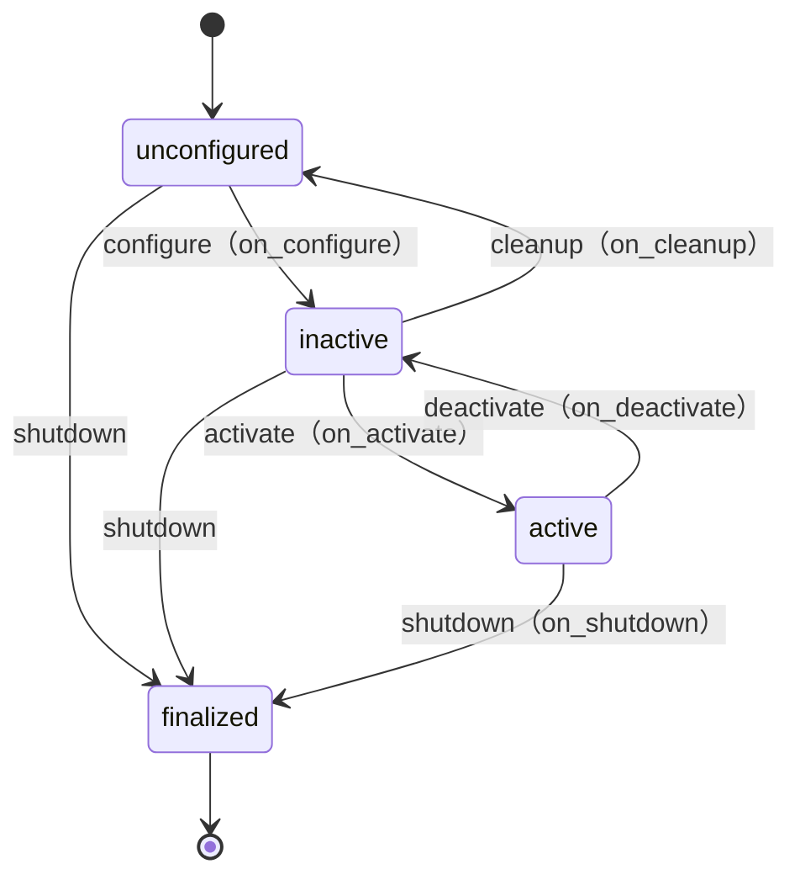

# 生命周期节点 Lifecycle Node

> 适用：ROS 2 **Rolling**（2026-11-17 在 `ros:rolling-ros-base` 上编译实测，rclcpp_lifecycle 33.2.0，launch_ros 0.30.3）
> 来源标记：📄 仓库文档原文 · 🔍 rclcpp_lifecycle 源码或实测核实 · 💡 经验补充（可信，但请自己验证）
> 源文档：[Managed-Nodes.rst](../../../source/ROS-Framework/nodes/Working-with-nodes/Managed-Nodes.rst)、[About-Nodes.rst](../../../source/ROS-Framework/About-Nodes.rst)（Lifecycle 段）、[Using-Node-Interfaces-Template-Class.rst](../../../source/ROS-Framework/nodes/Working-with-nodes/Using-Node-Interfaces-Template-Class.rst)
> 📐 设计动机：[生命周期的设计](../../design/lifecycle-design.md)：为什么是 4 个主状态 + 6 个转换状态，FAILURE 和 ERROR 分别把节点带到哪里，`transition_event` 为什么不是锁存的
> 说明：仓库里这部分文档很薄（Managed-Nodes 只有概述和外链），本卡片的状态机细节主要来自 `rclcpp_lifecycle` 头文件和实测，标为 🔍。

## 1. 一句话定义

生命周期节点（lifecycle node，又叫托管节点 managed node）是带**状态机**的节点：资源按"配置 → 激活 → 停用 → 清理"的顺序分阶段创建和释放，状态切换由外部（launch 或管理节点）触发。📄

## 2. 为什么需要

📄 典型用途是控制硬件的节点：相机、激光雷达、电机驱动等必须**按受控的顺序**启动、配置、关闭，确保硬件就绪后才初始化，关机或出错恢复时能安全释放。

💡 导航里：先让地图服务器和定位都 configure 好（加载地图、读参数），再统一 activate 开始发布；出错时 deactivate 控制器让机器人停下，而不用杀掉进程。Nav2 的 lifecycle manager 就是这样管理整套导航栈的。

### 状态机 🔍



- 4 个**主状态**（primary state）：`unconfigured`、`inactive`、`active`、`finalized`。中间还有 `configuring`、`activating` 等过渡状态（transition state），回调就在过渡状态里执行。
- 回调返回值决定去向：`SUCCESS` 进入目标状态；`FAILURE` 回到原状态；`ERROR` 进入错误处理并调用 `on_error`，`on_error` 返回 `SUCCESS` 回到 `unconfigured`，否则进入 `finalized`。
- 🔍 实测：`on_configure` 返回 FAILURE → `Transitioning failed`，状态仍是 `unconfigured`；返回 ERROR → 日志 `Callback returned ERROR during the transition: configure`，`on_error` 被调用，返回 SUCCESS 后状态也是 `unconfigured`。
- 只有当前状态允许的转换才能触发。🔍 在 `unconfigured` 时请求 `activate`：`Unknown transition requested, available ones are: - configure [1]`。

### 每个状态里该做什么（💡 惯例）

| 回调 | 做什么 | 导航例子 |
|---|---|---|
| 构造函数 | 只声明参数 | `declare_parameter("rate_hz", 10.0)` |
| `on_configure` | 读参数、分配内存、创建发布者/订阅/定时器、打开设备 | 加载地图、打开串口 |
| `on_activate` | 激活发布者，开始工作 | 开始发布 `/cmd_vel` |
| `on_deactivate` | 停止输出，但保留资源 | 发一次零速度，停发 |
| `on_cleanup` | 释放 configure 里创建的一切，回到干净状态 | 关闭串口、释放地图 |
| `on_shutdown` / `on_error` | 不管从哪个状态来，都安全释放 | — |

## 3. 最小 C++ 代码（rclcpp_lifecycle）

节选自 [card_lifecycle_min.cpp](../../labs/config_lab/src/card_lifecycle_min.cpp)（完整文件还有故障注入参数）：

```cpp
#include "rclcpp/rclcpp.hpp"
#include "rclcpp_lifecycle/lifecycle_node.hpp"
#include "rclcpp_lifecycle/lifecycle_publisher.hpp"
#include "std_msgs/msg/string.hpp"
using namespace std::chrono_literals;
using CallbackReturn = rclcpp_lifecycle::node_interfaces::LifecycleNodeInterface::CallbackReturn;

class LidarDriver : public rclcpp_lifecycle::LifecycleNode
{
public:
  LidarDriver() : LifecycleNode("lidar_driver") { declare_parameter("rate_hz", 2.0); }

  CallbackReturn on_configure(const rclcpp_lifecycle::State &) override
  {
    pub_ = create_publisher<std_msgs::msg::String>("scan_status", 10);  // LifecyclePublisher
    timer_ = create_wall_timer(500ms, [this]() {
      std_msgs::msg::String m;
      m.data = "scan " + std::to_string(++count_);
      pub_->publish(m);                      // 未激活时消息被丢弃
    });
    return CallbackReturn::SUCCESS;          // FAILURE：留在原状态；ERROR：进 on_error
  }
  CallbackReturn on_activate(const rclcpp_lifecycle::State & s) override
  {
    LifecycleNode::on_activate(s);           // 基类激活所有 LifecyclePublisher，别漏
    return CallbackReturn::SUCCESS;
  }
  CallbackReturn on_deactivate(const rclcpp_lifecycle::State & s) override
  {
    LifecycleNode::on_deactivate(s);
    return CallbackReturn::SUCCESS;
  }
  CallbackReturn on_cleanup(const rclcpp_lifecycle::State &) override
  {
    timer_.reset();
    pub_.reset();
    return CallbackReturn::SUCCESS;
  }
  // on_shutdown、on_error 同理
private:
  rclcpp_lifecycle::LifecyclePublisher<std_msgs::msg::String>::SharedPtr pub_;
  rclcpp::TimerBase::SharedPtr timer_;
  int count_ = 0;
};

int main(int argc, char ** argv)
{
  rclcpp::init(argc, argv);
  auto node = std::make_shared<LidarDriver>();
  rclcpp::spin(node->get_node_base_interface());   // 不是 rclcpp::Node，要传 base interface
  rclcpp::shutdown();
}
```

CMake：`find_package(rclcpp_lifecycle REQUIRED)`，链接 `rclcpp_lifecycle::rclcpp_lifecycle`，用到 `lifecycle_msgs` 时再链接 `${lifecycle_msgs_TARGETS}`。

命令行（🔍 实测）：

```bash
ros2 lifecycle get /lidar_driver           # unconfigured [1]
ros2 lifecycle list /lidar_driver          # 当前状态下可用的转换
ros2 lifecycle set /lidar_driver configure # 再 activate / deactivate / cleanup / shutdown
```

🔍 生命周期节点额外提供 `~/change_state`、`~/get_state`、`~/get_available_states`、`~/get_available_transitions`、`~/get_transition_graph` 服务和 `~/transition_event` 话题。

launch 里自动拉起（🔍 launch_ros 0.30.3 有 `autostart` 参数，实测会自动 configure + activate）：

```xml
<lifecycle_node pkg="config_lab" exec="card_lifecycle_min" name="lidar_driver"
                namespace="" autostart="true"/>
```

📄 `rclcpp::Node` 和 `rclcpp_lifecycle::LifecycleNode` **没有共同的父类**。写一个两种节点都能用的工具函数，用 `rclcpp::node_interfaces::NodeInterfaces<>` 作参数，可以直接把 `*node` 传进去：

```cpp
using MyIfaces = rclcpp::node_interfaces::NodeInterfaces<
  rclcpp::node_interfaces::NodeBaseInterface, rclcpp::node_interfaces::NodeLoggingInterface>;
void node_info(MyIfaces ifs)
{
  RCLCPP_INFO(ifs.get_node_logging_interface()->get_logger(), "%s",
    ifs.get_node_base_interface()->get_name());
}
node_info(*node);      // rclcpp::Node
node_info(*lc_node);   // LifecycleNode
```

💡 这就是第 2 批里 `TransformBroadcaster(*this)`、`MessageFilter(..., *this)` 要传 `*this` 的原因：tf2_ros 的构造函数接收的就是 `NodeInterfaces`。

## 4. 常见坑

🔍 以下结果来自[生命周期练习](../../labs/lifecycle-transitions.md)的实测。

1. **重写 `on_activate` 却忘了调用基类。** 节点状态显示 `active [3]`，但 `pub_->is_activated()` 是 `false`，`/scan_status` 上收不到任何消息，只有一条警告 `Trying to publish message on the topic '/scan_status', but the publisher is not activated`。`on_deactivate` 同理。
2. **以为 inactive 时定时器会停。** 定时器照常运行，`publish()` 被调用但消息被丢弃（计数器继续增长：激活后第一条收到的是 `scan 12`）。💡 计算量大的回调要自己判断状态或在 deactivate 时取消定时器。
3. **警告只打一次。** 未激活时连续调用 `publish()`，每次进入未激活状态只看到一条警告，容易被忽略。
4. **普通订阅、服务不受状态控制。** 🔍 Rolling 的 `rclcpp_lifecycle` 头文件里只有 `LifecyclePublisher` 一种托管实体（managed entity），`LifecycleNode::create_subscription` 返回的是普通订阅。💡 所以订阅回调在 inactive 状态照样执行。控制器在 inactive 时收到 `/goal` 也会处理，需要在回调里自己检查状态。
5. **在构造函数里创建发布者、打开硬件。** 💡 那样 configure/cleanup 就失去意义，也无法在不重启进程的情况下重新配置。
6. **进程退出时节点还在 active。** 🔍 launch 结束时日志里出现 `LifecycleNode is not shut down: Node still in state(3) in destructor`。💡 需要干净关闭硬件时，在退出前触发 shutdown 转换，或在析构里释放资源。
7. **把 `LifecycleNode` 当 `rclcpp::Node` 传。** 📄 两者没有继承关系，`rclcpp::spin(node)` 要写成 `spin(node->get_node_base_interface())`；工具函数用 `NodeInterfaces<>`。

## 5. 与其他概念的关系

- [节点与 ROS 图](../communication/node.md)：生命周期节点是节点的一种
- [参数](parameter.md)：构造时声明，configure 时读取
- [launch 启动系统](launch.md)：`lifecycle_node` + `autostart`
- [话题](../communication/topic.md)：`LifecyclePublisher`
- [组件与组合](../concurrency/component.md)：生命周期节点也可以做成组件
- 练习：[生命周期状态切换](../../labs/lifecycle-transitions.md)
- [生命周期的设计](../../design/lifecycle-design.md)（📐 设计动机）：设计与 Rolling 在失败处理、管理接口上的差别
- 上一级：[总览脑图](../../map/overview.md)

## 6. 自测题（先自己答，再看[答案](../../answers/lifecycle-node-answers.md)）

1. 把底盘驱动写成生命周期节点。下面这些操作分别放在哪个回调里：打开串口、声明 `port` 参数、创建 `/odom` 发布者、开始发布、急停时发零速度并停止发布、关闭串口？如果 `on_configure` 里打开串口失败，应该返回 FAILURE 还是 ERROR？
2. 同事写的生命周期控制器 activate 成功了，`ros2 lifecycle get` 显示 `active`，但 `/cmd_vel` 上 `ros2 topic echo` 什么都没有，日志里只有一条 warning。最可能的原因是什么？你会怎么改？
