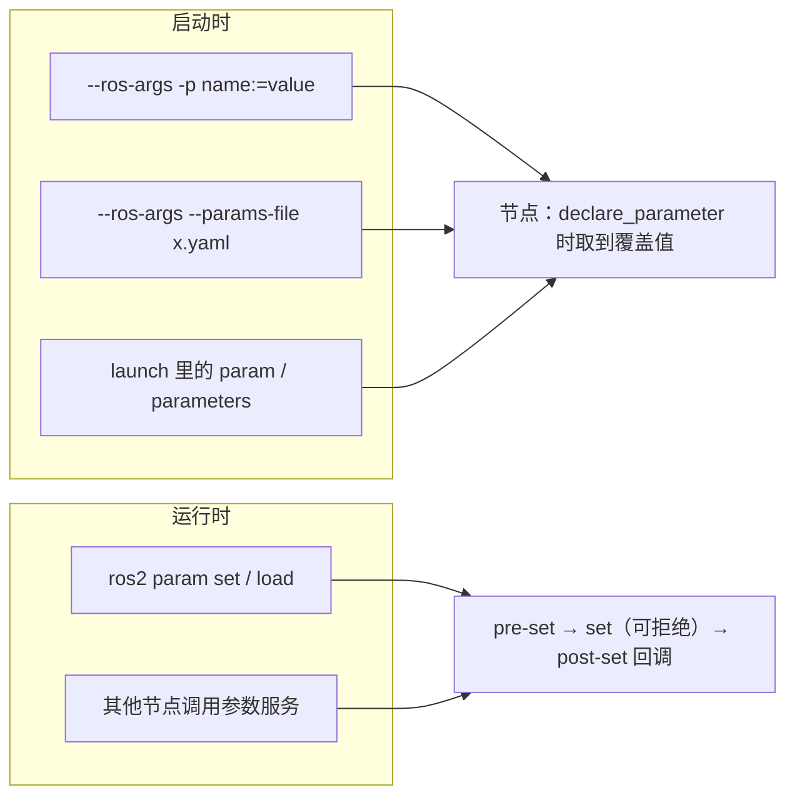

# 参数 Parameter

> 适用：ROS 2 **Rolling**（2026-11-17 在 `ros:rolling-ros-base` 上编译实测，rclcpp 33.2.0）
> 来源标记：📄 仓库文档原文 · 🔍 rclcpp 源码或实测核实 · 💡 经验补充（可信，但请自己验证）
> 源文档：[About-Parameters.rst](../../../source/ROS-Framework/About-Parameters.rst)、[Working-with-parameters.rst](../../../source/ROS-Framework/parameters/Working-with-parameters.rst)、[Understanding-ROS2-Parameters.rst](../../../source/ROS-Framework/parameters/Working-with-parameters/Understanding-ROS2-Parameters/Understanding-ROS2-Parameters.rst)、[Using-ros2-param.rst](../../../source/ROS-Framework/parameters/Working-with-parameters/Using-ros2-param.rst)、[Using-Parameters-In-A-Class-CPP.rst](../../../source/ROS-Framework/client-libraries/Working-with-Client-Libraries/Using-Parameters-In-A-Class-CPP.rst)、[Monitoring-For-Parameter-Changes-CPP.rst](../../../source/ROS-Framework/parameters/Working-with-parameters/Monitoring-For-Parameter-Changes-CPP.rst)、[Node-arguments.rst](../../../source/Developer-Tools/Launch/Node-arguments.rst)（参数部分）

## 1. 一句话定义

参数（parameter）是**每个节点自己保存**的配置值，由"名字 + 值 + 可选描述符（descriptor）"组成，用来在启动时和运行时配置节点而不改代码；参数的生命周期和节点相同。📄

## 2. 为什么需要

💡 规划控制里大量"调参"：最大速度、加速度、PID 增益、代价地图膨胀半径、坐标系名字。写成参数后，同一份二进制可以用不同的 YAML 跑在不同机器人上，现场调参用 `ros2 param set` 不用重新编译。

### 基本规则 📄

| 规则 | 说明 |
|---|---|
| 必须先声明 | 默认节点只接受声明过的参数，名字和类型在启动时就确定，减少配错的机会。构造时传 `allow_undeclared_parameters(true)` 可放开 |
| 类型固定 | 允许的类型：`bool`、`int64`、`float64`、`string`、`byte[]`、`bool[]`、`int64[]`、`float64[]`、`string[]`。运行时改类型默认失败；需要多类型时在描述符里设 `dynamic_typing = true` |
| 描述符 | `ParameterDescriptor`：文字说明、取值范围、只读等。默认为空 |
| 每个节点都有 `use_sim_time` | 默认 `false`，仿真或回放 bag 时设 `true` |
| 点号分组 | 代码里写 `controller.kp`，YAML 里写成嵌套的 `controller: {kp: ...}` |
| 外部访问靠服务 | 每个节点自动创建 `~/get_parameters`、`~/set_parameters`、`~/set_parameters_atomically`、`~/list_parameters`、`~/describe_parameters`、`~/get_parameter_types` 六个服务，`ros2 param` 就是调用它们 |

### 设置参数的途径



### 三种回调 📄

| 回调 | 注册函数 | 能做什么 |
|---|---|---|
| pre-set | `add_pre_set_parameters_callback` | 改写"即将设置"的参数列表（增、删、改），例如改 A 时顺带改 B |
| set | `add_on_set_parameters_callback` | 检查并返回 `SetParametersResult`，可以**拒绝**。📄 必须**没有副作用**：多个 set 回调串联，你不知道后面的会不会拒绝 |
| post-set | `add_post_set_parameters_callback` | 参数已经生效，在这里更新成员变量、重建对象 |

## 3. 最小 C++ 代码（rclcpp）

[card_parameter_min.cpp](../../labs/config_lab/src/card_parameter_min.cpp)：

```cpp
// 带范围的 double
rcl_interfaces::msg::ParameterDescriptor d;
d.description = "最大线速度 m/s";
rcl_interfaces::msg::FloatingPointRange range;
range.from_value = 0.0;
range.to_value = 2.0;
d.floating_point_range = {range};
max_speed_ = declare_parameter("max_speed", 0.5, d);   // 返回值：启动覆盖值或默认值

rcl_interfaces::msg::ParameterDescriptor ro;
ro.read_only = true;                                    // 只能在启动时给值
robot_id_ = declare_parameter("robot_id", "bot_0", ro);
kp_ = declare_parameter("controller.kp", 1.0);

// set 回调：只检查
set_handle_ = add_on_set_parameters_callback(
  [](const std::vector<rclcpp::Parameter> & params) {
    rcl_interfaces::msg::SetParametersResult r;
    r.successful = true;
    for (const auto & p : params) {
      if (p.get_name() == "controller.kp" && p.as_double() < 0.0) {
        r.successful = false;
        r.reason = "controller.kp must be >= 0";
      }
    }
    return r;
  });

// post-set 回调：已生效，更新缓存
post_handle_ = add_post_set_parameters_callback(
  [this](const std::vector<rclcpp::Parameter> & params) {
    for (const auto & p : params) {
      if (p.get_name() == "max_speed") {max_speed_ = p.as_double();}
    }
  });
// 句柄是成员变量：析构就注销
```

YAML 参数文件（[planner.yaml](../../labs/config_lab/config/planner.yaml)）：

```yaml
/**/planner:            # 任意命名空间下名为 planner 的节点
  ros__parameters:      # 固定写法，两个下划线
    max_speed: 0.8
    robot_id: "bot_7"
    controller:
      kp: 2.0
/**:                    # 所有节点
  ros__parameters:
    use_sim_time: false
```

📄 通配符：`*` 匹配一段（两个 `/` 之间），`**` 匹配零段或多段，不支持部分匹配（如 `foo*`）。

监听**别的节点**的参数（[param_watcher.cpp](../../labs/config_lab/src/param_watcher.cpp)）：

```cpp
handler_ = std::make_shared<rclcpp::ParameterEventHandler>(this);
handle_ = handler_->add_parameter_callback(
  "max_speed", [this](const rclcpp::Parameter & p) { /* ... */ }, "/planner");
// 📄 必须保存返回的句柄，否则回调不会保持注册
```

命令行 📄：

```bash
ros2 param list /planner
ros2 param get /planner max_speed
ros2 param set /planner max_speed 1.5     # 只影响当前运行，不会写回文件
ros2 param describe /planner max_speed
ros2 param dump /planner > planner.yaml   # 导出，下次 --params-file 用
ros2 param load /planner planner.yaml     # 运行时批量加载
```

## 4. 常见坑

🔍 以下结果来自[参数练习](../../labs/parameter-rules.md)的实测。

1. **整数写给 double 参数。** `ros2 param set /planner max_speed 1` 失败：`Wrong parameter type ... {double}, setting it to {integer} is not allowed`。更危险的是**启动时**：YAML 里写 `max_speed: 1` 或 `-p max_speed:=1`，`declare_parameter` 抛 `InvalidParameterTypeException`，**节点直接崩溃**。double 参数一律写 `1.0`。
2. **启动值不经过你的回调。** 回调是在 `declare_parameter` 之后才注册的，所以 `-p controller.kp:=-1.0` 被**接受**（set 回调拒绝不了），`-p max_speed:=1.2` 也没有触发 pre-set 回调去联动 `max_accel`。💡 启动值要在构造函数里自己校验一次；描述符里的范围检查对启动值仍然有效（`-p max_speed:=5.0` 启动即崩溃：`doesn't comply with floating point range`）。
3. **YAML 节点名写错，静默无效。** 键写成 `planer:` 不报任何错，节点用默认值启动。键写成 `planner:`（不带命名空间）而节点实际是 `/robot1/planner` 时**也不匹配**。💡 多机器人场景用 `/**/planner:`，启动后用 `ros2 param get` 核对一个关键值。
4. **YAML 解析让字符串变了类型。** 📄 `ros2 param set /n my_string off` 会把 `off` 解析成布尔；要写 `'!!str off'`。🔍 `frame_ids "[off]"` 被当成 `bool_array` 被拒绝，`"[\"off\"]"` 或 `"[!!str off]"` 才成功。📄 异构列表（如 `[foo, off, 1]`）会被当作单个字符串。
5. **在 set 回调里改成员变量。** 📄 会和真实参数值不同步。应该放到 post-set 回调。
6. **忘了保存回调句柄。** 📄 `add_on_set_parameters_callback` 等返回的句柄、`ParameterEventHandler::add_parameter_callback` 返回的句柄一旦析构，回调就失效。
7. **想用 `ros2 param delete` 删除声明过的参数。** 🔍 报 `cannot undeclare a statically typed parameter`。📄 只能删除动态参数。
8. **只读参数运行时改不了。** 🔍 `parameter 'robot_id' cannot be set because it is read-only`。这是设计用途：机器人 ID、坐标系名这类"改了就要重启"的值应设为只读。
9. **`ros2 param set` 的修改重启后丢失。** 📄 要保留就 `ros2 param dump` 存成 YAML。

## 5. 与其他概念的关系

- [launch 启动系统](launch.md)：launch 里设置参数、加载 YAML
- [启动参数与重映射](node-arguments.md)：`-p`、`--params-file`
- [服务](../communication/service.md)：`ros2 param` 底层就是参数服务
- [QoS](../communication/qos.md)：`qos_overrides.*` 也是参数
- [生命周期节点](lifecycle-node.md)：参数在构造时声明、在 configure 时读取
- 练习：[参数的规则与陷阱](../../labs/parameter-rules.md)
- 上一级：[总览脑图](../../map/overview.md)

## 6. 自测题（先自己答，再看[答案](../../answers/parameter-answers.md)）

1. 你的控制器有参数 `max_speed`（double，范围 0~2）、`controller.kp`（set 回调拒绝负数）。分别预测下面三种情况的结果，并说明原因：(a) YAML 写 `max_speed: 2`；(b) 启动时 `-p controller.kp:=-0.5`；(c) 运行中 `ros2 param set /ctrl controller.kp -0.5`。
2. 两台机器人分别运行在 `/robot1` 和 `/robot2` 命名空间下，节点都叫 `controller`。写一个 YAML：两台共用 `kp: 1.5`，但 `robot2` 的 `max_speed` 是 0.5、`robot1` 是 1.0。如果你把 `robot1` 那一段的键写成 `controller:`，会发生什么？
