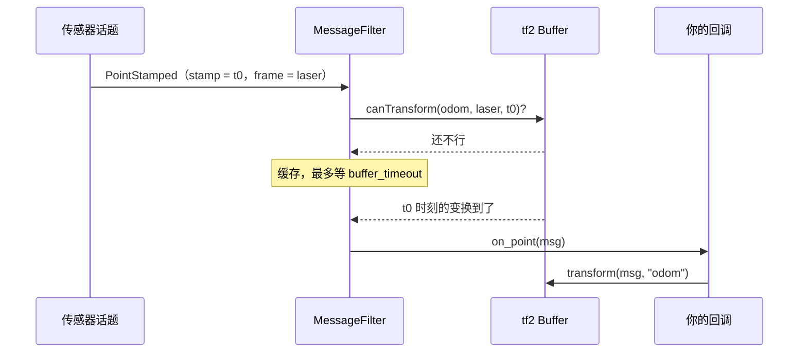

# tf2 与时间

> 适用：ROS 2 **Rolling**（2026-11-17 在 `ros:rolling-ros-base` 上编译实测，tf2_ros 0.46.5，message_filters 8.0.5）
> 来源标记：📄 仓库文档原文 · 🔍 rclcpp/tf2 源码或实测核实 · 💡 经验补充（可信，但请自己验证）
> 源文档：[Learning-About-Tf2-And-Time-Cpp.rst](../../../source/ROS-Framework/client-libraries/Working-with-Client-Libraries/Tf2/Learning-About-Tf2-And-Time-Cpp.rst)、[Time-Travel-With-Tf2-Cpp.rst](../../../source/ROS-Framework/client-libraries/Working-with-Client-Libraries/Tf2/Time-Travel-With-Tf2-Cpp.rst)、[Using-Stamped-Datatypes-With-Tf2-Ros-MessageFilter.rst](../../../source/ROS-Framework/client-libraries/Working-with-Client-Libraries/Tf2/Using-Stamped-Datatypes-With-Tf2-Ros-MessageFilter.rst)、[Debugging-Tf2-Problems.rst](../../../source/Developer-Tools/Debugging/Debugging-Tf2-Problems/Debugging-Tf2-Problems.rst)
> 📐 设计动机：[时钟与时间的设计](../../design/time-design.md)：三种时钟、`use_sim_time` 与 `/clock`、时间往回跳时 tf2 为什么清空缓存

## 1. 一句话定义

tf2 给每个变换都存了一段时间的历史（默认 10 s），`lookupTransform` 的**时间参数**决定你要"哪一刻的变换"；时间选错，就会得到**外推异常**（extrapolation exception）或用错时刻的位姿。📄

## 2. 为什么需要

传感器数据都带时间戳。激光扫描在 $t_0$ 时刻采集，等它被你的回调处理时机器人已经走了一段。要把这帧激光正确地放进 `odom`，必须用 **$t_0$ 时刻**的 `odom ← laser`，而不是"现在"或"最新"的变换。💡 机器人转弯时角速度 1 rad/s、延迟 50 ms，用错时刻就是约 3° 的偏差，5 m 外的障碍物会偏约 0.26 m，足以让代价地图出现"拖影"。

### 时间参数的四种用法

| 写法 | 含义 | 实测结果（🔍 [练习](../../labs/tf-time-lookup.md)，20 Hz 广播，每 100 ms 查一次，共 8 s） |
|---|---|---|
| `tf2::TimePointZero` | 最新可用的变换📄 | 78 次成功；返回结果平均比 now 旧 5.8 ms |
| `now()`，不带超时 | 严格要"现在" | **0 次成功**，全是 `extrapolation into the future` |
| `now()` + 超时 50 ms | 阻塞等到"现在"的数据到达📄 | 78 次成功；每次查询最多阻塞约 50 ms |
| `msg->header.stamp` + 超时 | 传感器采集时刻 | 💡 处理传感器数据的正确做法，或交给 MessageFilter |

📄 原因：广播到 buffer 有几毫秒延迟，要"现在"的变换时，buffer 里最新的数据总是比现在旧一点。tf2 只**插值**（interpolate），不**外推**（extrapolate）。🔍 用 `BufferCore` 离线实测：0..20 s 每秒一条 x = t 的变换，查 15.5 s 得到 x = 15.50（线性插值），查 20.2 s 报"外推到未来"，查 5 s 报"外推到过去"（最早只保留到 9 s）。

### 时间旅行：两个时刻、一个固定坐标系 📄

```cpp
// 「carrot1 在 5 秒前的位置」相对于「turtle2 现在的位置」
t = buffer->lookupTransform(
  "turtle2", now,            // target 坐标系，以及在哪个时刻取 target
  "carrot1", now - 5s,       // source 坐标系，以及在哪个时刻取 source
  "world",                   // 固定坐标系（fixed frame）：不随时间变化
  50ms);                     // 超时
```

📄 tf2 在过去把 source 变到 `world`，在 `world` 里从过去"走到"现在，再在现在把它变到 target。只用 4 参数版本 `lookupTransform("turtle2", "carrot1", now - 5s)` 问的是"5 秒前 carrot1 相对 5 秒前的 turtle2"，跟随者会乱转。💡 导航对应场景：把上一帧的检测结果对齐到当前帧（固定坐标系用 `odom`）。

### MessageFilter：等到变换可用再回调 📄

`tf2_ros::MessageFilter` 订阅任意带 `header` 的消息，先缓存，直到能把它变换到目标坐标系时才调用你的回调；等太久就丢弃。



## 3. 最小 C++ 代码（rclcpp）

**带超时的查询**（[tf_time_lab.cpp](../../labs/tf_lab/src/tf_time_lab.cpp)）：

```cpp
try {
  auto t = buffer_->lookupTransform("odom", "laser", msg->header.stamp, 50ms);
} catch (const tf2::TransformException & ex) {   // 超时后抛出的是外推异常
  RCLCPP_WARN(get_logger(), "%s", ex.what());
}
```

**MessageFilter**（[card_tf2_filter_min.cpp](../../labs/tf_lab/src/card_tf2_filter_min.cpp)，🔍 Rolling 实测可编译运行）：

```cpp
#include "message_filters/subscriber.hpp"
#include "tf2_ros/create_timer_ros.hpp"
#include "tf2_ros/message_filter.hpp"

buffer_ = std::make_shared<tf2_ros::Buffer>(get_clock());
buffer_->setCreateTimerInterface(                       // 📄 必须在用 MessageFilter 之前设置
  std::make_shared<tf2_ros::CreateTimerROS>(*this));
listener_ = std::make_shared<tf2_ros::TransformListener>(*buffer_, *this);

sub_.subscribe(this, "obstacle", rclcpp::SensorDataQoS());   // Rolling：必须给 QoS
filter_ = std::make_shared<tf2_ros::MessageFilter<PointStamped>>(
  sub_, *buffer_, "odom", 10,                 // 目标坐标系、队列长度
  *this,                                      // Rolling：传节点接口
  std::chrono::milliseconds(500));            // 最多等 0.5 s
filter_->registerCallback(&ObstacleFilter::on_point, this);

void on_point(const PointStamped::ConstSharedPtr & msg)
{
  auto out = buffer_->transform(*msg, "odom");   // 此时一定能变换
}
```

## 4. 常见坑

1. **用 `now()` 不带超时。** 📄 必然外推失败，🔍 实测 79 次 0 成功。改法：要最新就用 `TimePointZero`，要指定时刻就加超时。📄 调试教程里"`now() - 0.1 s`"只是为了定位问题，不是正确修法。
2. **在同一个单线程执行器里，自己广播、自己带超时等待。** 🔍 练习 `self-broadcast` 情形：节点用 20 Hz 定时器广播 `odom → self`，另一个定时器用 `now()` + 50 ms 查询，**8 s 内 0 次成功**。等待期间执行器被阻塞，广播定时器跑不了，等的数据永远不会来。🔍 `buffer.hpp` 里也有对应提示：没有专门线程填充数据时，带超时的 `canTransform/lookupTransform` "will always timeout"。💡 和[执行器](../concurrency/executor.md)卡片的"控制环被卡住"是同一个问题。
3. **超时也会拖慢控制环。** 🔍 `now()` + 50 ms 每次都阻塞约 50 ms。💡 在 20 Hz 控制环（周期 50 ms）里这么写，控制周期直接翻倍。控制环里优先用 `TimePointZero`；如果必须等待，把等待放到单独的回调组**并且**用多线程执行器（`MultiThreadedExecutor`）。只分回调组、仍用单线程执行器，等待照样会占住唯一的线程（见[回调组](../concurrency/callback-group.md)）。
4. **查的时刻超出缓存。** 📄 默认存 10 s。🔍 `now() - 15 s` 实测全部失败（外推到过去）。`now() - 5 s` 在启动后前 5 s 也会失败（buffer 里还没有那么久的数据），实测 5.1 s 后首次成功。
5. **MessageFilter 教程代码在 Rolling 上编译不过。** 🔍 仓库教程有三处与 Rolling API 不符（tf2_ros 0.46.5、message_filters 8.0.5 实测）：
   - `point_sub_.subscribe(this, "topic")` 缺 QoS 参数，Rolling 要求 `subscribe(node, topic, rclcpp::QoS)`，`rmw_qos_profile_t` 也不再接受；
   - `CreateTimerROS(get_node_base_interface(), get_node_timers_interface())` 改为 `CreateTimerROS(*this)`；
   - `MessageFilter(sub, buffer, frame, 100, get_node_logging_interface(), get_node_clock_interface(), timeout)` 改为传 `*this` 代替两个接口。
   - 另外教程包含的 `tf2_ros/*.h` 头文件在 Rolling 已废弃，编译时有 `#warning`，请用 `.hpp`。
6. **时间旅行时固定坐标系选了会动的坐标系。** 📄 固定坐标系必须不随时间变化。💡 室内导航用 `odom` 或 `map`，绝不能用 `base_link`。
7. **仿真时间。** 💡 用 rosbag 回放或仿真器时要设 `use_sim_time: true`，否则 `now()` 是墙上时间，和消息时间戳差几十年，全部外推失败。（参数见第 3 批）

## 5. 与其他概念的关系

- [tf2 坐标变换](tf2.md)：树、广播、监听的基础
- [执行器](../concurrency/executor.md)、[回调组](../concurrency/callback-group.md)：带超时的等待会阻塞执行器
- [话题](../communication/topic.md)：MessageFilter 包装的就是一个订阅
- 练习：[lookupTransform 的时间参数](../../labs/tf-time-lookup.md)、[四元数与 tf2 缓冲](../../labs/quaternion-buffer.md)
- [时钟与时间的设计](../../design/time-design.md)（📐 设计动机）：时间跳变回调、`rclcpp::Rate` 的默认时钟
- 上一级：[总览脑图](../../map/overview.md)

## 6. 自测题（先自己答，再看[答案](../../answers/tf2-time-answers.md)）

1. 你在写一个把激光点云投影到 `odom` 的节点，回调里写了 `lookupTransform("odom", "laser", this->now())`，日志里全是 "extrapolation into the future"。同事建议改成 `TimePointZero`，你会接受吗？什么情况下 `TimePointZero` 会让结果出错？你会给出什么更好的方案？
2. 一个跟随机器人要走到"领航机器人 3 秒前所在的位置"。写出 `lookupTransform` 调用（坐标系：`follower/base_link`、`leader/base_link`、`map`），并说明如果用 3 参数版本会发生什么。
