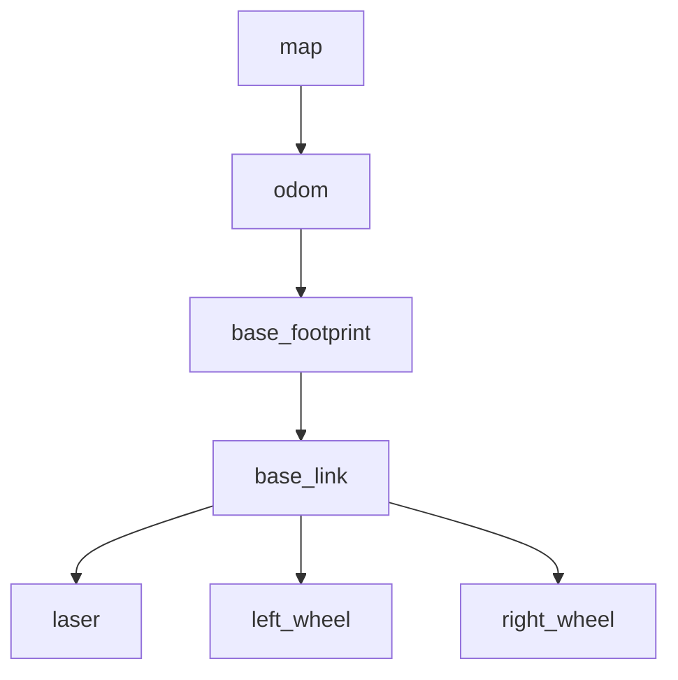

# tf2 坐标变换

> 适用：ROS 2 **Rolling**（2026-11-17 在 `ros:rolling-ros-base` 上编译实测，tf2_ros 0.46.5）
> 来源标记：📄 仓库文档原文 · 🔍 rclcpp/tf2 源码或实测核实 · 💡 经验补充（可信，但请自己验证）
> 源文档：[About-Tf2.rst](../../../source/ROS-Framework/interfaces/Working-with-interfaces/About-Tf2/About-Tf2.rst)、[Introduction-To-Tf2.rst](../../../source/ROS-Framework/interfaces/Working-with-interfaces/Introduction-To-Tf2/Introduction-To-Tf2.rst)、[Writing-A-Tf2-Static-Broadcaster-Cpp.rst](../../../source/ROS-Framework/client-libraries/Working-with-Client-Libraries/Tf2/Writing-A-Tf2-Static-Broadcaster-Cpp.rst)、[Writing-A-Tf2-Broadcaster-Cpp.rst](../../../source/ROS-Framework/client-libraries/Working-with-Client-Libraries/Tf2/Writing-A-Tf2-Broadcaster-Cpp.rst)、[Writing-A-Tf2-Listener-Cpp.rst](../../../source/ROS-Framework/client-libraries/Working-with-Client-Libraries/Tf2/Writing-A-Tf2-Listener-Cpp.rst)、[Adding-A-Frame-Cpp.rst](../../../source/ROS-Framework/client-libraries/Working-with-Client-Libraries/Tf2/Adding-A-Frame-Cpp.rst)、[Debugging-Tf2-Problems.rst](../../../source/Developer-Tools/Debugging/Debugging-Tf2-Problems/Debugging-Tf2-Problems.rst)

## 1. 一句话定义

tf2 是变换库（transform library）：它把系统里所有坐标系（coordinate frame）的相对关系存成一棵**带时间缓冲的树**（tree buffered in time），让你在任意时刻、任意两个坐标系之间变换点、向量、位姿。📄

## 2. 为什么需要

导航里的每个数据都"带着坐标系"：激光点在 `laser`，里程计在 `odom`，全局路径在 `map`。规划器要把障碍物和路径放进同一个坐标系才能比较。📄 tf2 回答的就是这类问题：

- 机器人底盘现在在地图的哪里？（`map` ← `base_link`）
- 激光看到的障碍物，在底盘坐标系里离车头多远？（`base_link` ← `laser`）
- 5 秒前头部相对世界在哪里？（时间维度，见 [tf2 与时间](tf2-time.md)）

tf2 是分布式的：任何节点都能广播自己负责的那段变换，任何节点都能监听整棵树。📄

### 核心模型



- **树，不是图**：每个坐标系**只有一个父**（parent），可以有多个子（child），不允许闭环。📄 💡 所以 `map → odom` 由定位（AMCL 等）发布，`odom → base_link` 由里程计发布，两者不能都直接发 `map → base_link`，否则 `base_link` 就有两个父。
- **两类变换**：📄
  - 静态变换（static）：不随时间变化，比如传感器安装位置。只发一次，不存历史，发到 `/tf_static`。
  - 动态变换（dynamic）：随时间变化，比如里程计。持续发布，每条都带时间戳，发到 `/tf`。
- 🔍 `/tf_static` 的发布端 QoS 是 **Reliable + TransientLocal + KeepLast(1)**（`ros2 topic info -v /tf_static` 实测），所以后启动的监听者也能拿到静态变换。这正是 [QoS](../communication/qos.md) 卡片里"地图话题"的同一招。

### 方向：最容易搞反的地方 📄

`lookupTransform(target, source, time)` 返回的变换 $_{target}T_{source}$ 满足：

$$
P_{target} = {}_{target}T_{source} \cdot P_{source}
$$

也就是：**把 source 坐标系里的数据变到 target 坐标系**；同一个结果也可以读作 "source 坐标系在 target 坐标系里的位姿"。📄 文档特别提醒：`TransformStamped` 消息描述的是**坐标系本身**的位姿（frame 表述），和"变换数据"（data 表述）互为逆，tf2 会根据你在树上走的方向自动求逆。

💡 记忆法：`lookupTransform("odom", "laser", t)` 读作"**在 odom 里看** laser"。

## 3. 最小 C++ 代码（rclcpp）

**广播**（[card_tf2_min.cpp](../../labs/tf_lab/src/card_tf2_min.cpp)：静态 `base_link → laser` + 20 Hz 动态 `odom → base_link`）：

```cpp
#include "tf2_ros/static_transform_broadcaster.hpp"
#include "tf2_ros/transform_broadcaster.hpp"

// 构造函数里
static_broadcaster_ = std::make_shared<tf2_ros::StaticTransformBroadcaster>(*this);
geometry_msgs::msg::TransformStamped laser;
laser.header.stamp = now();
laser.header.frame_id = "base_link";   // 父
laser.child_frame_id = "laser";        // 子
laser.transform.translation.x = 0.2;
laser.transform.translation.z = 0.15;
laser.transform.rotation.w = 1.0;      // 单位四元数，不要全 0
static_broadcaster_->sendTransform(laser);           // 发一次即可

broadcaster_ = std::make_unique<tf2_ros::TransformBroadcaster>(*this);
// 定时器回调里：每次都带当前时间戳
tf.header.stamp = now();
tf.header.frame_id = "odom";
tf.child_frame_id = "base_link";
tf.transform.rotation = tf2::toMsg(q);   // q 来自 setRPY，见「四元数」卡片
broadcaster_->sendTransform(tf);
```

**监听 + 变换数据**（[card_tf2_listener_min.cpp](../../labs/tf_lab/src/card_tf2_listener_min.cpp)）：

```cpp
#include "tf2_geometry_msgs/tf2_geometry_msgs.hpp"   // 让 transform() 认识 PointStamped
#include "tf2_ros/buffer.hpp"
#include "tf2_ros/transform_listener.hpp"

tf_buffer_ = std::make_unique<tf2_ros::Buffer>(get_clock());
tf_listener_ = std::make_shared<tf2_ros::TransformListener>(*tf_buffer_, *this);

// 定时器回调里
geometry_msgs::msg::PointStamped in;
in.header.frame_id = "laser";
in.header.stamp = rclcpp::Time(0);        // 0 = 用最新可用的变换
in.point.x = 1.0;
try {
  auto out = tf_buffer_->transform(in, "odom");   // 推荐：自动读 source、写 target
} catch (const tf2::TransformException & ex) {
  RCLCPP_WARN(get_logger(), "%s", ex.what());     // 一定要接异常
}
```

📄 文档推荐优先用 `transform<T>(data, target_frame)`：它从数据的 `header.frame_id` 读 source，并把结果的 `frame_id` 写成 target，比手动 `lookupTransform` 再相乘少一类错误。

**命令行工具**：

```bash
# 发布静态变换（--frame-id 和 --child-frame-id 必填，其余省略即为 0 / 单位旋转）📄
ros2 run tf2_ros static_transform_publisher --x 0.2 --z 0.15 --yaw 0 \
  --frame-id base_link --child-frame-id laser
ros2 run tf2_ros tf2_echo odom laser       # 打印变换，见下方坑 2 的参数顺序
ros2 run tf2_tools view_frames             # 监听 5 秒，生成 frames.pdf 树图（📄 仅 Linux）
ros2 run tf2_ros tf2_monitor odom laser    # 每条链的延迟、发布频率
```

## 4. 常见坑

1. **Rolling 上广播器构造要传 `*this`，不能传 `this`。** 🔍 仓库里 [Writing-A-Tf2-Static-Broadcaster-Cpp](../../../source/ROS-Framework/client-libraries/Working-with-Client-Libraries/Tf2/Writing-A-Tf2-Static-Broadcaster-Cpp.rst)、[Adding-A-Frame-Cpp](../../../source/ROS-Framework/client-libraries/Working-with-Client-Libraries/Tf2/Adding-A-Frame-Cpp.rst) 和 URDF 教程写的是 `make_shared<...Broadcaster>(this)`，在 Rolling（tf2_ros 0.46.5）上编译报错 `no matching function for call to 'tf2_ros::TransformBroadcaster::TransformBroadcaster(N*)'`。构造函数现在接收节点接口 `NodeInterfaces`，传 `*this` 即可。`TransformListener(*buffer, this)` 两种写法都能编译。
2. **`tf2_echo` 的参数顺序。** 文档写作 `tf2_echo [source_frame] [target_frame]`📄，但 🔍 实测 `static_transform_publisher --x 1 --yaw 1.5708 --frame-id world --child-frame-id a` 后，`tf2_echo world a` 打印 Translation `[1, 0, 0]`、yaw 90°，即 **a 在 world 里的位姿**；`tf2_echo a world` 打印 `[0, 1, 0]`、yaw -90°，报错信息也写着 `"a" passed to canTransform argument target_frame`。所以 `tf2_echo X Y` 等价于 `lookupTransform(X, Y)`：**第一个参数是参考系（target）**。看名字会搞反，按"在 X 里看 Y"记。
3. **启动后最初几次查询失败。** 🔍 监听节点刚启动时 buffer 是空的，第一次查询报 `"odom" passed to lookupTransform argument target_frame does not exist`，0.5 s 后就正常了。💡 导航节点启动阶段要容忍这类异常（打日志、跳过本周期），不要直接退出；或者启动时用带超时的 `canTransform` 等待。
4. **一个坐标系两个父。** 📄 tf2 不允许。💡 典型错误：定位节点直接发布 `map → base_link`，同时里程计发布 `odom → base_link`。正确做法是定位节点算出 `map → odom` 再发布。
5. **动态变换用了静态广播器，或反过来。** 📄 静态变换不存历史；💡 用静态广播器发会变的位姿，监听者只会看到最后一次的值且没有时间插值。反过来用动态广播器发安装位置，则必须持续发布：一旦停发，查询停发之后的时刻（新到消息的时间戳或 `now()`）都会报"外推到未来"（extrapolation into the future）；停发之前、仍在缓存时间窗内的时刻还能查到，`TimePointZero` 也仍返回最后一次的值，所以这种错误不一定立刻暴露。
6. **四元数全 0。** 🔍 `rotation` 默认构造是 `(0,0,0,0)`。tf2 收到后报 `TF_DENORMALIZED_QUATERNION ... Ignoring transform`，**这条变换被丢弃**（实测见[四元数](quaternion.md)卡片）。没有旋转也要写 `rotation.w = 1.0`。
7. **自己手算 "frame 位姿" 和 "data 变换" 时方向搞反。** 📄 二者互为逆。💡 尽量只用 `transform()`，让 tf2 处理方向。

## 5. 与其他概念的关系

- [tf2 与时间](tf2-time.md)：`lookupTransform` 的时间参数、超时、MessageFilter
- [四元数](quaternion.md)：`transform.rotation` 的表示和运算
- [URDF 与机器人模型](urdf.md)：机器人本体上的坐标系通常由 `robot_state_publisher` 根据 URDF 发布，不需要手写广播器
- [QoS](../communication/qos.md)：`/tf_static` 用 TransientLocal
- [执行器](../concurrency/executor.md)：`TransformListener` 默认自带一个线程处理 `/tf` 订阅
- 练习：[lookupTransform 的时间参数](../../labs/tf-time-lookup.md)
- 上一级：[总览脑图](../../map/overview.md)

## 6. 自测题（先自己答，再看[答案](../../answers/tf2-answers.md)）

1. 激光安装在底盘前方 0.2 m、高 0.15 m 处，朝向与底盘相同。机器人在 `odom` 里位于 (2, 1)，朝向 90°（朝 +y）。激光测到正前方 1 m 有障碍物。障碍物在 `odom` 里的平面坐标是多少？你会调用 `lookupTransform` 的哪两个坐标系参数、按什么顺序？
2. 同事说："我用 `ros2 run tf2_ros tf2_echo base_link map` 看机器人在地图里的位置，可数字怎么跟 RViz 里不一样？" 问题可能出在哪？应该怎么改命令？
