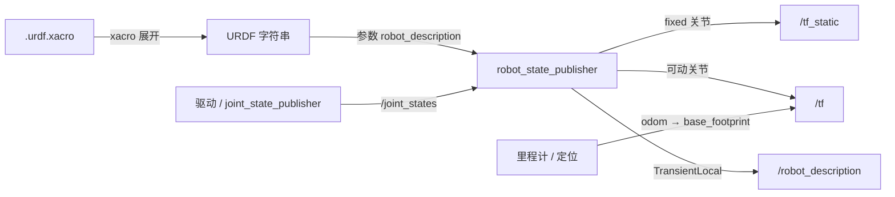

# URDF 与机器人模型

> 适用：ROS 2 **Rolling**（2026-11-17 在 `ros:rolling-ros-base` 上实测，robot_state_publisher 3.6.3，xacro 2.1.1，urdf 2.14.1）
> 来源标记：📄 仓库文档原文 · 🔍 源码或实测核实 · 💡 经验补充（可信，但请自己验证）
> 源文档：[URDF-Main.rst](../../../source/Capabilities/Simulation/URDF/URDF-Main.rst)、[Building-a-Visual-Robot-Model-with-URDF-from-Scratch.rst](../../../source/Capabilities/Simulation/URDF/Building-a-Visual-Robot-Model-with-URDF-from-Scratch.rst)、[Building-a-Movable-Robot-Model-with-URDF.rst](../../../source/Capabilities/Simulation/URDF/Building-a-Movable-Robot-Model-with-URDF.rst)、[Adding-Physical-and-Collision-Properties-to-a-URDF-Model.rst](../../../source/Capabilities/Simulation/URDF/Adding-Physical-and-Collision-Properties-to-a-URDF-Model.rst)、[Using-URDF-with-Robot-State-Publisher-cpp.rst](../../../source/Capabilities/Simulation/URDF/Using-URDF-with-Robot-State-Publisher-cpp.rst)、[Exporting-an-URDF-File.rst](../../../source/Capabilities/Simulation/URDF/Exporting-an-URDF-File.rst)、[Using-Xacro-to-Clean-Up-a-URDF-File.rst](../../../source/Developer-Tools/Build/Using-Xacro-to-Clean-Up-a-URDF-File/Using-Xacro-to-Clean-Up-a-URDF-File.rst)、[dummy-robot-demo.rst](../../../source/Capabilities/Simulation/dummy-robot/dummy-robot-demo.rst)

## 1. 一句话定义

URDF（Unified Robot Description Format，统一机器人描述格式）是用 XML 描述机器人的**连杆**（link）和**关节**（joint）组成的树；`robot_state_publisher` 读入 URDF 和关节角度，把机器人本体上的所有坐标变换发布到 tf2。📄

## 2. 为什么需要

- 💡 传感器安装位置、轮子位置不用在代码里硬编码，改模型文件即可；RViz 显示、碰撞检测、仿真都读同一份模型。
- 📄 机器人本体上的 tf 不用自己写广播器：`robot_state_publisher` 解析 URDF，监听 `/joint_states`，发布 TF。

### 数据流



📄 `robot_state_publisher` 只负责模型**内部**的变换；把整台机器人放到世界里（`odom → 根 link`）要另一个节点发布，教程里由自己写的 `state_publisher` 发 `odom → axis`。

### 结构速查 📄

| 元素 | 要点 |
|---|---|
| `<link>` | `visual`（长什么样）、`collision`（碰撞形状）、`inertial`（质量与惯量）三个子元素 |
| `<joint type>` | `fixed` 固定；`revolute` 有限位转动（需 `limit`）；`continuous` 无限转动（轮子）；`prismatic` 平移（需 `limit`）；另有 `planar`、`floating` |
| `joint` 里的 `<origin xyz rpy>` | **子坐标系相对父坐标系**的位姿，`rpy` 为固定轴 RPY（见[四元数](quaternion.md)） |
| `visual` / `collision` 里的 `<origin>` | 几何形状的中心相对**本 link 坐标系**的偏移，不影响 TF |
| `<mesh filename>` | 网格文件用 `package://包名/路径` 写法 |
| `<axis xyz>` | 转动或平移轴，在关节坐标系里表示 |
| `<dynamics friction damping>` | 关节摩擦和阻尼，默认 0 |
| 根 link | 树只能有一个根；每个 link 只有一个父关节 |

### collision 与 inertial 📄

- `collision` 常与 `visual` 相同，但两种情况应该不同：网格碰撞计算太慢，换成简单几何体；想留安全区时把碰撞体做得比实物大。
- 每个参与仿真的 link 都需要 `inertial`。惯量矩阵对称，只写 6 个数。不确定时 `ixx=iyy=izz=1e-3` 是中等尺寸 link 的合理默认值（相当于边长 0.1 m、0.6 kg 的方块）；**单位矩阵太大**（相当于 600 kg）。惯量接近 0 时，实时控制器下模型可能"塌缩"到原点且没有任何警告。
- 💡 长方体惯量：$I_{xx} = \frac{m}{12}(y^2+z^2)$，其余同理，练习模型里用 xacro 宏自动算。

### xacro 📄

xacro 是 XML 的宏语言，提供三样东西：常量（`xacro:property`）、`${}` 里的数学表达式（支持 `sin`、`cos`、`pi`）、宏（`xacro:macro`，可带参数和 `*block` 块参数）。文件开头必须声明 `xmlns:xacro="http://www.ros.org/wiki/xacro"`。

## 3. 最小代码

练习模型 [mini_bot.urdf.xacro](../../labs/tf_lab/urdf/mini_bot.urdf.xacro)（差速底盘：`base_footprint → base_link`，左右轮 continuous，激光 fixed）里的轮子宏：

```xml
<xacro:property name="wheel_r" value="0.05"/>

<xacro:macro name="wheel" params="prefix reflect">
  <link name="${prefix}_wheel"> ... </link>
  <joint name="${prefix}_wheel_joint" type="continuous">
    <parent link="base_link"/>
    <child link="${prefix}_wheel"/>
    <origin xyz="0 ${reflect*(base_wid/2 + wheel_w/2)} ${-base_h/2}"/>
    <axis xyz="0 1 0"/>
  </joint>
</xacro:macro>

<xacro:wheel prefix="left" reflect="1"/>
<xacro:wheel prefix="right" reflect="-1"/>
```

展开、检查、运行（🔍 实测命令）：

```bash
xacro mini_bot.urdf.xacro > mini_bot.urdf
check_urdf mini_bot.urdf          # 打印树：root Link: base_footprint ...
ros2 run robot_state_publisher robot_state_publisher \
  --ros-args -p robot_description:="$(xacro mini_bot.urdf.xacro)"
# 轮子关节需要关节角度才会有 TF：
ros2 topic pub -r 10 /joint_states sensor_msgs/msg/JointState \
  "{header: {stamp: now}, name: [left_wheel_joint, right_wheel_joint], position: [0.5, 0.0]}"
```

📄 launch 文件里常用 `Command(['xacro ', path])` 生成 `robot_description` 参数，或者直接用 `urdf_launch` 包。launch 细节见第 3 批。

C++ 侧发布关节状态（📄 教程节选）：

```cpp
sensor_msgs::msg::JointState js;
js.header.stamp = now();
js.name = {"swivel", "tilt", "periscope"};   // 必须与 URDF 里的关节名一致
js.position = {swivel, tilt, height};
joint_pub_->publish(js);
```

## 4. 常见坑

1. **可动关节没有 `/joint_states`，子坐标系就"不存在"。** 🔍 只启动 `robot_state_publisher` 时，`/tf_static` 里只有 `base_link`、`laser`（fixed 关节）；`tf2_echo base_link left_wheel` 一直报 `"left_wheel" ... frame does not exist`。发布 `/joint_states` 后立即得到 Translation `[0, 0.165, -0.05]`、pitch 28.6°（0.5 rad）。📄 某个 link 没有 TF 时，RViz 把它画在原点、显示成白色。💡 看到轮子"飞到原点"或 "No transform" 时先查 `/joint_states`。
2. **用旧教程的 C++ 代码。** 🔍 [Using-URDF-with-Robot-State-Publisher-cpp](../../../source/Capabilities/Simulation/URDF/Using-URDF-with-Robot-State-Publisher-cpp.rst) 里 `std::make_shared<tf2_ros::TransformBroadcaster>(this)` 在 Rolling 上编译不过，改成 `(*this)`（见 [tf2](tf2.md) 坑 1）。
3. **xacro 宏名写错。** 📄 文档说"找不到同名宏时不会展开，也**不会**报错"；🔍 xacro 2.1.1 实测已经改为报错 `error: unknown macro name: xacro:wheell`，退出码 2。老版本可能静默跳过，所以 💡 每次改完都用 `check_urdf` 看一遍树。
4. **忘了 xacro 命名空间声明。** 🔍 去掉 `xmlns:xacro=...` 后报 `XML parsing error: unbound prefix`，xacro 的提示里直接给出了缺失的声明。
5. **惯量填单位矩阵或 0。** 📄 前者太大，后者可能让模型塌缩。
6. **把 visual 的 origin 当成关节位置来调。** 📄 关节 `origin` 决定子坐标系在哪里，visual `origin` 只移动显示的形状。💡 激光的 TF 位置不对，要改的是 `laser_joint` 的 `origin`，改 visual 只会让 RViz 里的模型"看起来对"而数据仍然错。
7. **关节名和 `/joint_states` 里的名字对不上。** 💡 不报错，只是对应的子坐标系一直没有变换。
8. **不知道 `/robot_description` 也是话题。** 🔍 `robot_state_publisher` 以 TransientLocal 发布 `/robot_description`，RViz 等工具晚启动也能拿到模型。
9. **复杂模型从零手写。** 📄 SolidWorks、Fusion 360、Onshape、Blender、FreeCAD 等都有 URDF 导出器（非 ROS 核心团队维护）；💡 导出的网格碰撞体通常要手动简化。

## 5. 与其他概念的关系

- [tf2 坐标变换](tf2.md)：URDF 描述的就是 tf 树里机器人本体那一部分
- [四元数](quaternion.md)：`origin` 的 `rpy` 是固定轴 RPY
- [QoS](../communication/qos.md)：`/robot_description`、`/tf_static` 都用 TransientLocal
- launch 启动系统、参数（第 3 批）：`robot_description` 是参数，通常由 launch 生成
- 练习：[URDF 关节与 TF](../../labs/urdf-joint-states.md)
- 上一级：[总览脑图](../../map/overview.md)

## 6. 自测题（先自己答，再看[答案](../../answers/urdf-answers.md)）

1. 给差速底盘加一个装在 `base_link` 正上方 0.3 m、向下俯 15° 的深度相机。写出对应的 `link` 和 `joint`。它应该是什么关节类型？发布后它出现在 `/tf` 还是 `/tf_static`？
2. 你在 RViz 里看到机器人模型的车身正常，但两个轮子都叠在 `base_footprint` 原点，Status 显示 "No transform from [left_wheel] to [odom]"。列出你排查的顺序（至少 3 步，每步说明用什么命令）。
