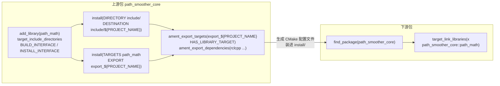

# ament_cmake

> 适用：ROS 2 **Rolling**（2026-11-17 在 `ros:rolling-ros-base` 容器里实测，CMake 规则以 ament_cmake 当前版本为准）
> 来源标记：📄 仓库文档原文 · 🔍 源码或实测核实 · 💡 经验补充（可信，但请自己验证）
> 源文档：[About-Build.rst](../../../source/Developer-Tools/About-Build.rst)、[About-Build-System.rst](../../../source/Developer-Tools/Build/About-Build-System.rst)、[Ament-CMake-Documentation.rst](../../../source/Developer-Tools/Build/Ament-CMake-Documentation.rst)、[Developing-a-ROS-2-Package.rst](../../../source/Developer-Tools/Build/Developing-a-ROS-2-Package.rst)、[Release-Kilted-Kaiju.rst](../../../source/Releases/Release-Kilted-Kaiju.rst)（`ament_target_dependencies` 弃用说明）、[Release-Humble-Hawksbill.rst](../../../source/Releases/Release-Humble-Hawksbill.rst)（头文件安装目录的变化）
> 📐 设计动机：[构建系统的设计](../../design/build-system-design.md)：ament 相对 catkin 改了什么、symlink install 怎么覆盖 `install()`

## 1. 一句话定义

ament_cmake 是 ROS 2 C++ 包的构建系统（build system）：在普通 CMake 之上加了一组宏，让一个 CMake 项目按 ROS 的约定**安装**（装到 colcon 和 `ros2 run` 找得到的位置）、**注册**（写进 ament 索引）、**导出**（下游 `find_package` 后能直接链接你的库）。📄

## 2. 为什么需要

💡 规划控制项目里，几何工具、代价函数、插件基类往往放在一个公共库包里，被规划器、控制器、测试等多个包使用。"自己能编过"只是第一步，**下游能不能用**取决于安装和导出写得对不对，而这类错误只在下游编译时才暴露。

### 一个 `CMakeLists.txt` 的骨架 📄

| 顺序 | 写什么 | 规则 |
|---|---|---|
| 1 | `project(包名)` | 必须和 `package.xml` 的 `<name>` **完全一致** |
| 2 | 编译选项 | ROS 2 面向 C++20 和 C17；用 `-Wall -Wextra -Wpedantic` 并修掉警告 |
| 3 | `find_package(依赖 REQUIRED)` | 只找自己直接用到的；`package.xml` 里也要写同样的依赖 |
| 4 | `add_library` / `add_executable` + `target_link_libraries` | 依赖用 CMake 目标链接，如 `rclcpp::rclcpp`、`${nav_msgs_TARGETS}` |
| 5 | `install(...)` | 头文件、库、可执行文件、launch/config 都要装 |
| 6 | `ament_export_targets` / `ament_export_dependencies` | 让下游能用你的库 |
| 7 | `if(BUILD_TESTING) ... endif()` | 测试，见[测试](testing.md) |
| 8 | `ament_package()` | **每个包恰好一次，并且放在最后**：它收集前面所有信息 |

📄 `ament_export_*` 等 ament 命令写在 CMake 子目录（`add_subdirectory`）里**不会生效**，因为子目录无法把变量传回调用 `ament_package()` 的父作用域。

### 库的安装与导出



| 要点 | 说明 |
|---|---|
| 头文件放 `include/<包名>/` | 📄 对外头文件放这里，源码和私有头文件放 `src/` |
| 安装到 `include/${PROJECT_NAME}` | 📄 Humble 起的约定：多加一层包名目录，避免 overlay 时拿错头文件（所以 `INSTALL_INTERFACE` 是 `include/${PROJECT_NAME}`） |
| `EXPORT` 名字 | 📄 `install(TARGETS ... EXPORT 名字)` 和 `ament_export_targets(名字)` 必须相同，习惯加 `export_` 前缀 |
| `HAS_LIBRARY_TARGET` | 📄 导出集里有库时加上，它会把库目录加进环境变量 |
| `ament_export_dependencies` | 📄 下游 `find_package(你)` 时会自动 `find_package` 这些依赖；你的公开头文件里 include 了谁，就导出谁 |
| 保留 `RUNTIME DESTINATION bin` | 📄 Windows 把 DLL 当运行时文件装进 `bin`，所以即使只在 Linux 上开发也建议保留 |
| 旧式导出 | 📄 `ament_export_include_directories` + `ament_export_libraries` 只在下游不能用 CMake 目标时才用 |
| 可执行文件 | 📄 必须装到 `lib/${PROJECT_NAME}`，`ros2 run` 只在这里找 |

### 其他功能 📄

- **ament 索引（resource index）**：`install/<包>/share/ament_index/resource_index/<资源类型>/<包名>` 这样的标记文件，让别的包在运行时快速找到"谁提供了某种资源"。pluginlib 的插件描述就是这样登记的（见 [pluginlib 插件](pluginlib.md)）。
- **环境钩子（environment hook）**：`ament_environment_hooks(xxx.dsv.in xxx.sh.in)`，source 工作空间时自动设置环境变量（例如 DDS 配置文件路径）。
- **版本头文件**：`ament_generate_version_header(目标)` 从 `package.xml` 的版本号生成 `<包>/version.h`，代码里用 `XXX_VERSION_GTE(主, 次, 补丁)` 判断 API 是否可用。🔍 Rolling 的 `rclcpp/version.h` 里 `RCLCPP_VERSION_STR` 是 `"33.2.0"`。

## 3. 最小代码

上游库包，节选自 [path_smoother_core/CMakeLists.txt](../../labs/build_lab/path_smoother_core/CMakeLists.txt)（完整文件能编译，已实测）：

```cmake
cmake_minimum_required(VERSION 3.20)
project(path_smoother_core)                 # = package.xml 的 <name>

find_package(ament_cmake REQUIRED)
find_package(rclcpp REQUIRED)
find_package(pluginlib REQUIRED)

add_library(path_math src/path_math.cpp)   # 纯 C++ 库，方便单元测试
target_include_directories(path_math PUBLIC
  "$<BUILD_INTERFACE:${CMAKE_CURRENT_SOURCE_DIR}/include>"
  "$<INSTALL_INTERFACE:include/${PROJECT_NAME}>")

add_library(smoother_interface INTERFACE)  # 只有头文件的插件基类
target_include_directories(smoother_interface INTERFACE
  "$<BUILD_INTERFACE:${CMAKE_CURRENT_SOURCE_DIR}/include>"
  "$<INSTALL_INTERFACE:include/${PROJECT_NAME}>")
target_link_libraries(smoother_interface INTERFACE path_math rclcpp::rclcpp)

install(DIRECTORY include/ DESTINATION include/${PROJECT_NAME})
install(TARGETS path_math smoother_interface
  EXPORT export_${PROJECT_NAME}
  ARCHIVE DESTINATION lib LIBRARY DESTINATION lib RUNTIME DESTINATION bin)
install(TARGETS smoother_node DESTINATION lib/${PROJECT_NAME})
install(DIRECTORY config launch DESTINATION share/${PROJECT_NAME})

ament_export_targets(export_${PROJECT_NAME} HAS_LIBRARY_TARGET)
ament_export_dependencies(rclcpp pluginlib)
ament_package()                             # 最后、只调用一次
```

下游只要两行（节选自 [path_smoother_plugins/CMakeLists.txt](../../labs/build_lab/path_smoother_plugins/CMakeLists.txt)）：

```cmake
find_package(path_smoother_core REQUIRED)
target_link_libraries(path_smoother_plugins path_smoother_core::smoother_interface)
```

## 4. 常见坑

🔍 以下结果来自[编译与依赖的常见错误](../../labs/build-pitfalls.md)练习的实测。每一项都是"删掉正确代码里的一行"得到的。

1. **Rolling 里 `ament_target_dependencies` 已经不存在。** 📄 Kilted 发行说明宣布它弃用，改用 `target_link_libraries()` 加 CMake 目标。🔍 在 Rolling 镜像里调用它直接报 `Unknown CMake command "ament_target_dependencies"`（`ament_cmake_target_dependencies` 包目录还在，但里面没有这个宏了）。网上大量教程和旧代码还在用它，迁移写法：`target_link_libraries(n rclcpp::rclcpp)` 或 `target_link_libraries(n ${rclcpp_TARGETS})`。
2. **可执行文件没 `install`，编译成功但 `ros2 run` 找不到。** 🔍 删掉 `install(TARGETS smoother_node ...)`：两个包都编译成功，`ros2 run path_smoother_core smoother_node` 输出 `No executable found`，`ros2 pkg executables path_smoother_core` 什么都不打印。可执行文件只在 `build/` 里。
3. **少了 `ament_export_targets`，上游没事、下游报错。** 🔍 core 编译成功；plugins 报 `Target "path_smoother_plugins" links to: path_smoother_core::smoother_interface but the target was not found`。
4. **头文件没装，错误同样出在下游。** 🔍 删掉 `install(DIRECTORY include/ ...)`，core 编译成功；plugins 报 `Imported target "path_smoother_core::smoother_interface" includes non-existent path ".../install/path_smoother_core/include/path_smoother_core"`。💡 所以给公共库至少配一个"下游消费者"包（或下游测试）一起编，才能发现导出问题。
5. **导出时的另外两个报错。** 🔍 用一个依赖 Eigen 的库包实测：只补上 `EXPORT` 和 `ament_export_targets`，而 `target_include_directories` 仍写相对路径 `include`，**上游自己**就报 `INTERFACE_INCLUDE_DIRECTORIES property contains path ... which is prefixed in the source directory`（必须用 `BUILD_INTERFACE` / `INSTALL_INTERFACE` 分开写）。修好后忘了 `ament_export_dependencies(Eigen3)`，下游 `find_package` 时报 `The link interface of target "geom_utils::geom_utils" contains: Eigen3::Eigen`，因为下游没人替它找 Eigen。
6. **`project()` 名字和 `package.xml` 不一致。** 🔍 报错发生在最后的 `ament_package()`：`package name 'path_smoother_core' in '/package.xml' does not match current PROJECT_NAME 'path_smoother'`。
7. **同一个包里不同目标的 C++ 标准可能不同。** 🔍 包内设 `CMAKE_CXX_STANDARD 17` 时，`path_math` 用 `-std=gnu++17` 编译，而链接了 `pluginlib::pluginlib` 的 `smoother_node` 被提升到 `-std=gnu++20`（pluginlib 6.0.3 的头文件用了 C++20 的 `std::map::contains`）。练习包现在统一设成 20，和 `ros2 pkg create` 生成的模板一致。
8. **`add_library` 不写 `SHARED`，编出来是什么取决于你 `find_package` 了谁。** 🔍 `path_math` 没写类型，装出来是 `libpath_math.so`；题目里只依赖 Eigen 的 `geom_utils` 同样写法，装出来却是 `libgeom_utils.a`。原因：`find_package(rclcpp)` 会间接加载 `ament_cmake_ros_core` 的 `build_shared_libs.cmake`，里面 `option(BUILD_SHARED_LIBS ... ON)`。pluginlib 插件库、组件库必须是动态库，💡 这类库一律显式写 `SHARED`。
9. **`find_package` 了间接依赖。** 📄 不应该需要 `find_package` 一个"依赖的依赖"；如果需要，说明上游没写好 `ament_export_dependencies`，应该给上游报 bug。
10. **Windows 符号导出。** 📄 Windows 要求显式导出符号，跨平台的库需要可见性宏（visibility macros）。只在 Linux 上开发时容易忽略。

## 5. 与其他概念的关系

- [工作空间与 colcon](workspace-colcon.md)：colcon 决定顺序，ament_cmake 决定装什么
- [rosdep 依赖管理](rosdep.md)：`package.xml` 的依赖同时服务于 colcon 排序和 rosdep 安装
- [pluginlib 插件](pluginlib.md)：`pluginlib_export_plugin_description_file` 写进 ament 索引
- [测试](testing.md)：`BUILD_TESTING`、`ament_add_gtest`、`ament_lint_auto`
- [组件与组合](../concurrency/component.md)：`rclcpp_components_register_node` 也是 ament 资源登记
- 练习：[编译与依赖的常见错误](../../labs/build-pitfalls.md)
- [构建系统的设计](../../design/build-system-design.md)（📐 设计动机）：ament 为什么要从 catkin 分出来
- 上一级：[总览脑图](../../map/overview.md)

## 6. 自测题（先自己答，再看[答案](../../answers/ament-cmake-answers.md)）

1. 同事的公共库包 `geom_utils` 的 `CMakeLists.txt` 如下，自己编译和单元测试都通过。你的 `local_planner` 包 `find_package(geom_utils REQUIRED)` 后 `target_link_libraries(planner geom_utils::geom_utils)`，结果报错。指出至少两处问题，分别说出下游会看到什么报错，并写出改正后的相关几行。
   ```cmake
   project(geom_utils)
   find_package(ament_cmake REQUIRED)
   find_package(Eigen3 REQUIRED)
   add_library(geom_utils src/geom.cpp)
   target_include_directories(geom_utils PUBLIC include)
   target_link_libraries(geom_utils Eigen3::Eigen)
   install(TARGETS geom_utils LIBRARY DESTINATION lib)
   ament_package()
   ```
2. 你从一篇 Humble 时代的教程里复制了 `ament_target_dependencies(controller rclcpp geometry_msgs)`，在 Rolling 上编译报错。(a) 报什么错，为什么？(b) 写出 Rolling 下的等价写法。(c) 消息包有 `${geometry_msgs_TARGETS}` 和 `geometry_msgs::geometry_msgs` 两种写法，如果这个包还要在 Jazzy 上编译，你选哪种？
