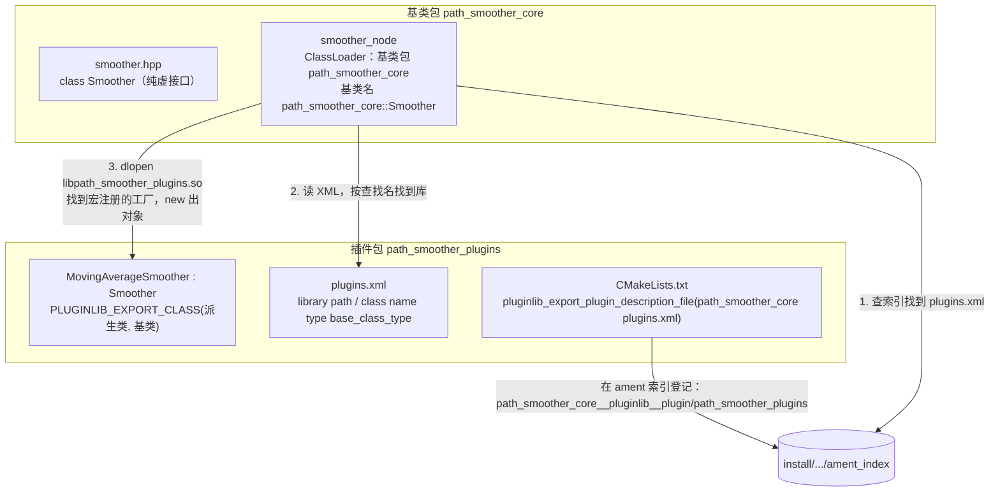

# pluginlib 插件

> 适用：ROS 2 **Rolling**（2026-11-17 在 `ros:rolling-ros-base` 容器里实测，pluginlib 6.0.3）
> 来源标记：📄 仓库文档原文 · 🔍 源码或实测核实 · 💡 经验补充（可信，但请自己验证）
> 源文档：[Pluginlib.rst](../../../source/ROS-Framework/client-libraries/Working-with-Client-Libraries/Pluginlib.rst)、[Ament-CMake-Documentation.rst](../../../source/Developer-Tools/Build/Ament-CMake-Documentation.rst)（ament 索引部分）

## 1. 一句话定义

pluginlib 让一个程序在**运行时**按名字加载"某个基类的派生类"：派生类编进一个动态库，用宏导出，再用一份 XML 描述"这个库里有哪些类、继承自哪个基类"；加载方只依赖基类，**不链接**实现所在的库。📄

## 2. 为什么需要

💡 Nav2 的全局规划器、局部控制器、代价地图层、行为树节点、路径平滑器都是 pluginlib 插件：`planner_server` 只认识 `nav2_core::GlobalPlanner` 基类，具体用 NavFn 还是 Smac 由参数里的插件名决定。你写自己的规划器，只要实现基类、导出插件，改 YAML 就能换上，不用改也不用重编 Nav2。

### 四个组成部分



| 部分 | 要点 📄 |
|---|---|
| 基类 | 纯虚接口，虚析构函数。插件默认必须能**无参构造**；要带构造参数需特化 `class_loader::InterfaceTraits<基类>`，声明 `using constructor_parameters = class_loader::ConstructorParameters<double>;` |
| 导出宏 | `PLUGINLIB_EXPORT_CLASS(派生类全名, 基类全名)`，写在插件的 `.cpp` 里 |
| `plugins.xml` | `<library path="库名">`（不带 `lib` 前缀和 `.so`）；每个 `<class>` 有 `type`（派生类全名）、`base_class_type`（基类全名）、可选 `name`（查找名）、`<description>` |
| CMake 登记 | `pluginlib_export_plugin_description_file(基类所在的包 plugins.xml)`，第一个参数是**基类的包**，不是本包 |
| 加载 | `pluginlib::ClassLoader<基类> loader("基类所在的包", "基类全名");` 然后 `loader.createSharedInstance("查找名")` |

📄 基类包**不依赖**插件包。依赖方向是插件包 → 基类包。

### Nav2 风格 vs 构造参数风格 💡

文档示例用 `InterfaceTraits` 给插件构造函数传参（`createSharedInstance("awesome_triangle", 10.0)`）。Nav2 用的是另一种更常见的写法：插件**无参构造**，加载后调用 `configure(node, name, ...)`，插件自己用 `name + ".xxx"` 声明参数。练习采用 Nav2 风格，因为同一个插件类可以有多个实例（如两个代价地图层），参数靠实例名前缀区分。

## 3. 最小 C++ 代码

基类，[smoother.hpp](../../labs/build_lab/path_smoother_core/include/path_smoother_core/smoother.hpp)：

```cpp
class Smoother
{
public:
  using Ptr = std::shared_ptr<Smoother>;
  virtual ~Smoother() = default;
  virtual void configure(const rclcpp::Node::SharedPtr & node, const std::string & name) = 0;
  virtual Path2D smooth(const Path2D & path) = 0;
protected:
  Smoother() = default;   // pluginlib 需要默认构造
};
```

插件，[moving_average_smoother.cpp](../../labs/build_lab/path_smoother_plugins/src/moving_average_smoother.cpp)（节选）：

```cpp
void MovingAverageSmoother::configure(const rclcpp::Node::SharedPtr & node, const std::string & name)
{
  const auto w = node->declare_parameter<int>(name + ".window", 3);   // 参数带实例名前缀
  if (w <= 0 || w % 2 == 0) {
    throw std::invalid_argument(name + ".window must be a positive odd number");
  }
  window_ = static_cast<std::size_t>(w);
}
// 文件末尾，命名空间外
PLUGINLIB_EXPORT_CLASS(path_smoother_plugins::MovingAverageSmoother, path_smoother_core::Smoother)
```

[plugins.xml](../../labs/build_lab/path_smoother_plugins/plugins.xml)：

```xml
<library path="path_smoother_plugins">
  <class name="moving_average"
         type="path_smoother_plugins::MovingAverageSmoother"
         base_class_type="path_smoother_core::Smoother">
    <description>Moving average over a symmetric window, endpoints fixed.</description>
  </class>
  <class type="path_smoother_plugins::NoopSmoother"
         base_class_type="path_smoother_core::Smoother">
    <description>Returns the path unchanged.</description>
  </class>
</library>
```

插件包的 [CMakeLists.txt](../../labs/build_lab/path_smoother_plugins/CMakeLists.txt)（节选）：

```cmake
add_library(path_smoother_plugins SHARED      # 必须是动态库
  src/moving_average_smoother.cpp src/noop_smoother.cpp)
target_link_libraries(path_smoother_plugins
  path_smoother_core::smoother_interface pluginlib::pluginlib rclcpp::rclcpp)
pluginlib_export_plugin_description_file(path_smoother_core plugins.xml)
install(TARGETS path_smoother_plugins
  ARCHIVE DESTINATION lib LIBRARY DESTINATION lib RUNTIME DESTINATION bin)
```

加载方，[smoother_node.cpp](../../labs/build_lab/path_smoother_core/src/smoother_node.cpp)（节选）：

```cpp
pluginlib::ClassLoader<path_smoother_core::Smoother> loader(
  "path_smoother_core", "path_smoother_core::Smoother");
path_smoother_core::Smoother::Ptr smoother;
try {
  smoother = loader.createSharedInstance(plugin);   // plugin 来自参数 smoother_plugin
} catch (const pluginlib::PluginlibException & e) {
  RCLCPP_FATAL(node->get_logger(), "cannot load '%s': %s", plugin.c_str(), e.what());
  return 1;
}
smoother->configure(node, "smoother");
```

🔍 `ros2 plugin list` 的输出格式是 `查找名 [类型] (base: 基类)`：

```text
path_smoother_plugins:
	moving_average [path_smoother_plugins::MovingAverageSmoother] (base: path_smoother_core::Smoother)
	path_smoother_plugins::NoopSmoother [path_smoother_plugins::NoopSmoother] (base: path_smoother_core::Smoother)
```

## 4. 常见坑

🔍 以下结果来自[用插件换路径平滑器](../../labs/plugin-smoother.md)练习的实测：每一项都是在正确的包上改一处，重新干净编译后运行。

1. **写了 `name` 之后，只能用 `name` 查找，不能再用 `type`。** 📄 文档说 `createSharedInstance` 的参数"可以是 `type` 也可以是 `name`"。🔍 实测不成立：`smoother_plugin:=path_smoother_plugins::MovingAverageSmoother` 报 `the class path_smoother_plugins::MovingAverageSmoother with base class type path_smoother_core::Smoother does not exist. Declared types are  moving_average path_smoother_plugins::NoopSmoother`。源码 `ClassLoader::isClassAvailable` 只查以查找名为键的 `classes_available_`，有 `name` 时查找名就是 `name`。文档里 `ros2 plugin list` 的示例输出（`Plugin(name='polygon_plugins::Triangle', ...)`）也和当前格式、和它自己的 XML（`name="awesome_triangle"`）对不上。**以 `ros2 plugin list` 方括号前的名字为准。**
2. **`ros2 plugin list` 只读 XML，列出来不代表能加载。** 🔍 删掉 Noop 的 `PLUGINLIB_EXPORT_CLASS`：编译通过，`ros2 plugin list` 照样列出它，加载时才报 `Could not create object of class type path_smoother_plugins::NoopSmoother as no factory exists for it`。
3. **`base_class_type` 写错，插件"消失"。** 🔍 把 moving_average 的基类写成 `path_smoother_core::Smootherr`：`ros2 plugin list` 显示 `(base: path_smoother_core::Smootherr)`，加载报 `does not exist`，`Declared types are` 里只剩 Noop。
4. **忘了 `pluginlib_export_plugin_description_file`。** 🔍 `ros2 plugin list` 里根本没有 `path_smoother_plugins` 这一组，加载报 `does not exist. Declared types are`（后面为空）。可以检查 `install/path_smoother_plugins/share/ament_index/resource_index/` 下有没有 `path_smoother_core__pluginlib__plugin` 目录。
5. **第一个参数写成了本包名。** 🔍 写成 `pluginlib_export_plugin_description_file(path_smoother_plugins plugins.xml)`：编译通过，`ros2 plugin list` **照常列出**两个插件（它按 XML 里的基类分组），但 `ClassLoader("path_smoother_core", ...)` 找不到任何插件，`Declared types are` 为空。这是最迷惑的一种：列表正常、加载失败。
6. **`library path` 写成文件名。** 🔍 写成 `libpath_smoother_plugins.so`：`ros2 plugin list` 正常，加载报 `Could not find library corresponding to plugin moving_average. Make sure that the library 'libpath_smoother_plugins.so' actually exists.`
7. **先销毁 `ClassLoader`，再销毁插件对象。** 🔍 实测打印 `SEVERE WARNING!!! Attempting to unload library while objects created by this loader exist in the heap! ... The library will NOT be unloaded.`，之后插件仍能用（库没卸载）。💡 不出错只是因为库被留下了；正确做法是让插件对象先于 `ClassLoader` 销毁。作为类成员时，把 `ClassLoader` 声明在插件指针**之前**（成员按声明的逆序析构）；Nav2 的服务器类也是这样排列的（本次未逐一核实）。
8. **插件里的异常会穿过 `createSharedInstance` 之后的调用。** 🔍 `smoother.window:=4` 时 `configure()` 抛 `std::invalid_argument`，没人捕获，节点 `terminate called ... Aborted`。💡 `try/catch` 不仅要包住 `createSharedInstance`（`PluginlibException`），也要包住 `configure()`。
9. **插件库必须是动态库。** 📄 插件从运行时库加载。🔍 `add_library` 不写 `SHARED` 时类型取决于 `BUILD_SHARED_LIBS`（见 [ament_cmake](ament-cmake.md) 常见坑 8），插件库要显式写 `SHARED`。

## 5. 与其他概念的关系

- [ament_cmake](ament-cmake.md)：插件描述文件通过 ament 索引登记；基类包要导出头文件和目标
- [工作空间与 colcon](workspace-colcon.md)：插件包 `<depend>` 基类包；运行前要 source 插件所在的工作空间
- [组件与组合](../concurrency/component.md)：组件也是 class_loader 动态加载，原理相同但用的是 `rclcpp_components` 的注册宏
- [参数](../configuration/parameter.md)：Nav2 风格插件用 `实例名.参数名` 声明参数
- [测试](testing.md)：插件算法可直接链接插件库做 gtest，加载流程用 launch_testing 测
- 练习：[用插件换路径平滑器](../../labs/plugin-smoother.md)
- 上一级：[总览脑图](../../map/overview.md)

## 6. 自测题（先自己答，再看[答案](../../answers/pluginlib-answers.md)）

1. 你写了一个 Nav2 控制器插件 `my_ctrl::PurePursuit`，`plugins.xml` 写的是 `<class name="my_ctrl/PurePursuit" type="my_ctrl::PurePursuit" base_class_type="nav2_core::Controller">`。YAML 里写 `plugin: "my_ctrl::PurePursuit"`，`controller_server` 报插件不存在；可 `ros2 plugin list` 里明明有它。解释为什么，给出两种改法。
2. 同事的插件包编译通过，`ros2 plugin list` 正常列出插件，`ClassLoader` 却说 `Declared types are` 后面是空的。列出两个可能的原因，并说明各自用什么办法确认。
