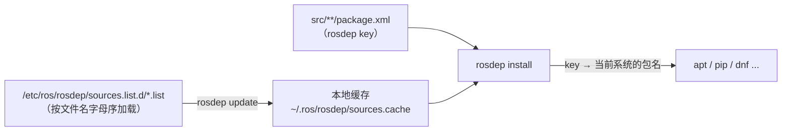

# rosdep 依赖管理

> 适用：ROS 2 **Rolling**（2026-11-17 在 `ros:rolling-ros-base` 容器里实测，Ubuntu 26.04 "resolute"）
> 来源标记：📄 仓库文档原文 · 🔍 源码或实测核实 · 💡 经验补充（可信，但请自己验证）
> 源文档：[Rosdep.rst](../../../source/ROS-Framework/client-libraries/Working-with-Client-Libraries/Rosdep.rst)、[Supplementing-Custom-Rosdep-Keys.rst](../../../source/Developer-Tools/Build/Supplementing-Custom-Rosdep-Keys.rst)

## 1. 一句话定义

rosdep 读取工作空间里所有 `package.xml` 中的依赖名（称为 rosdep key），到 rosdistro 索引里查出它在当前操作系统上对应的系统包（apt、pip 等），再调用系统包管理器安装。📄

## 2. 为什么需要

💡 新同事拉下导航仓库、CI 拉起一台干净机器、往机器人工控机部署——都要回答"这些包到底要装哪些系统库"。手写安装脚本会和 `package.xml` 慢慢不一致；rosdep 让 `package.xml` 成为**唯一**的依赖清单：colcon 用它排编译顺序，rosdep 用它装依赖，打二进制包时也用它。

### `package.xml` 里的依赖标签 📄

| 标签 | 什么时候需要 | 例子 |
|---|---|---|
| `<depend>` | 编译和运行都要（最常用） | `rclcpp`、`nav_msgs` |
| `<build_depend>` | 只在编译时要，二进制安装后不需要 | 只在 `.cpp` 里用到的头文件库 |
| `<build_export_depend>` | 你**导出的头文件**里 include 了它，下游编译时要 | 公开头文件里用的 Eigen |
| `<exec_depend>` | 只在运行时要 | launch 文件用到的 `launch_ros`、Python 模块 |
| `<test_depend>` | 只有测试要；**不要**和上面几种重复 | `ament_cmake_gtest`、`launch_testing_ros` |
| `<buildtool_depend>` | 构建工具 | `ament_cmake` |

📄 导出的库引用的库包"通常应该写 `<depend>`"，因为运行时也要。纯 Python 包没有编译阶段，用 `<exec_depend>` 而不是 `<depend>`。

### key 从哪里来 📄

| 依赖类型 | 去哪里找 key |
|---|---|
| 已发布的 ROS 包 | 就是包名，列在 rosdistro 的 `<发行版>/distribution.yaml` |
| 系统库（apt） | rosdistro 的 `rosdep/base.yaml`，例如 key `libopencv-dev` |
| Python 库 | `rosdep/python.yaml`，例如 `python3-numpy` |
| 都没有 | 给 rosdistro 提 PR 加 key（一般一周内合并），或者用自定义规则文件（见下） |



## 3. 最小代码：常用命令

```bash
# 第一次（每台机器一次）
sudo rosdep init            # 生成 /etc/ros/rosdep/sources.list.d/20-default.list
rosdep update               # 下载规则到本地缓存，不要加 sudo

# 每次拉了新代码之后，在工作空间根目录
rosdep install --from-paths src -y --ignore-src
#   --from-paths src : 在 src 下找 package.xml
#   --ignore-src     : 依赖本身也在工作空间里的，不去装它的二进制
#   -y               : 不逐个确认

# 排查
rosdep check --from-paths src --ignore-src -r     # 只检查，不安装
rosdep keys --from-paths src --ignore-src         # 列出需要解析的 key
rosdep resolve nav_msgs python3-numpy             # key 在本机对应哪个系统包
rosdep where-defined python3-numpy                # 这条规则来自哪个 YAML
rosdep install --from-paths src --ignore-src -y --simulate   # 只打印要执行的安装命令
```

自定义规则（团队内部 SDK、还没进 rosdistro 的库），📄 文档推荐的做法：

```yaml
# /etc/ros/rosdep/custom_rules.yaml
my_motor_sdk:
  ubuntu: [libsocketcan-dev]   # 也可以按版本代号细分：ubuntu: {noble: [...], resolute: [...]}
```

```bash
echo "yaml file:///etc/ros/rosdep/custom_rules.yaml" | \
  sudo tee /etc/ros/rosdep/sources.list.d/30-custom.list
rosdep update                  # 必须重新 update 才生效
rosdep resolve my_motor_sdk    # → libsocketcan-dev
```

## 4. 常见坑

🔍 以下结果来自[编译与依赖的常见错误](../../labs/build-pitfalls.md)练习第 6 部分的实测。

1. **新加的规则文件，不 `rosdep update` 就不存在。** 🔍 写好 `30-custom.list` 后直接 `rosdep resolve my_motor_sdk`，报 `ERROR: no rosdep rule for 'my_motor_sdk'`；`rosdep update` 输出 `Hit file:///.../custom.yaml` 之后才解析出 `libsocketcan-dev`。
2. **未知 key 在 `rosdep install` 时才报错。** 🔍 给 plugins 加 `<depend>my_motor_sdk</depend>` 后：`ERROR: the following packages/stacks could not have their rosdep keys resolved to system dependencies: path_smoother_plugins: Cannot locate rosdep definition for [my_motor_sdk]`。
3. **规则文件按文件名字母序加载，先加载的赢。** 📄 文件名前缀 10 会覆盖默认的 20。🔍 自定义文件里也写一条 `python3-numpy: ubuntu: [my-patched-numpy]`：放在 `30-custom.list` 时不生效（仍解析为 `python3-numpy`），改名为 `10-custom.list` 并 `rosdep update` 后解析为 `my-patched-numpy`。📄 文档警告：用二进制安装的 ROS 时**强烈不建议**覆盖已有 key，会造成很难排查的二进制不兼容；而且覆盖是整条 key 替换，不是合并，其他平台的安装方式会一并丢失。
4. **`--ignore-src` 会把 underlay 里已有的包也当作"源码在手"。** 🔍 官方镜像的环境变量里已经有 `AMENT_PREFIX_PATH=/opt/ros/rolling`，此时 `rosdep keys --from-paths src --ignore-src` 输出为空，而不带 `--ignore-src` 时列出 `rclcpp nav_msgs pluginlib ...` 等 13 个 key。也就是说 rosdep 认为 `/opt/ros/rolling` 里已有的 ROS 包不用再装。💡 所以 `rosdep install` 前要先 source 正确的 underlay，否则它会尝试安装（或报告缺少）其实已经在 underlay 里的包。
5. **`rosdep update` 不要加 `sudo`。** 📄 只有 `rosdep init` 需要 root。💡 用 sudo 执行 update 会把缓存写进 root 的家目录，普通用户的 `rosdep install` 仍然找不到规则。
6. **Ubuntu 上装错了包。** 📄 Debian/Ubuntu 上有个名字相近的 `python3-rosdep2`，装了要先卸载，再装 `python3-rosdep`。
7. **公司代理导致 `rosdep update` 失败。** 🔍 本次实测环境里，容器内 `rosdep update` 报 `SSL: CERTIFICATE_VERIFY_FAILED ... self-signed certificate in certificate chain`（出口经过一个用自签 CA 的代理）。把代理 CA 证书挂进容器并设 `SSL_CERT_FILE` / `REQUESTS_CA_BUNDLE` 后成功。💡 不要用关闭证书校验来绕过。
8. **Windows 不支持。** 📄 rosdep 目前只支持 Linux 和 macOS。

## 5. 与其他概念的关系

- [工作空间与 colcon](workspace-colcon.md)：同一份 `package.xml`，colcon 用来排序，rosdep 用来安装
- [ament_cmake](ament-cmake.md)：`find_package` 的每个依赖都应该在 `package.xml` 里有对应的 key
- [测试](testing.md)：`<test_depend>` 只在跑测试时需要
- 练习：[编译与依赖的常见错误](../../labs/build-pitfalls.md)
- 上一级：[总览脑图](../../map/overview.md)

## 6. 自测题（先自己答，再看[答案](../../answers/rosdep-answers.md)）

1. 你的 `trajectory_utils` 包：公开头文件 `trajectory_utils/spline.hpp` 里 `#include <Eigen/Dense>`；`.cpp` 里用 `fmt` 打印日志（头文件里没用到）；launch 文件启动 `robot_state_publisher`；单元测试用 gtest。给每个依赖选一个最合适的 `package.xml` 标签，并说明如果把 Eigen 写成 `<build_depend>` 会在什么场景下出问题。
2. 团队的电机驱动依赖一个内部 apt 包 `acme-motor-dev`，rosdistro 里没有。新同事执行 `rosdep install --from-paths src -y --ignore-src` 报 `Cannot locate rosdep definition for [acme_motor]`。写出让所有人都能用 rosdep 装上它的步骤；再说明为什么不应该顺手在同一个文件里把 `libopencv-dev` 指向团队自己编译的 OpenCV。
