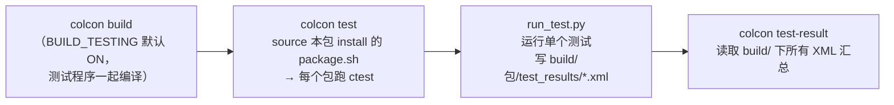

# 测试 Testing

> 适用：ROS 2 **Rolling**（2026-11-17 在 `ros:rolling-ros-base` 容器里实测，colcon-core 0.21.3、cppcheck 2.19.0）
> 来源标记：📄 仓库文档原文 · 🔍 源码或实测核实 · 💡 经验补充（可信，但请自己验证）
> 源文档：[Debugging/About-testing.rst](../../../source/Developer-Tools/Debugging/About-testing.rst)、[Testing/CLI.rst](../../../source/Developer-Tools/Debugging/Testing/CLI.rst)、[Testing/Cpp.rst](../../../source/Developer-Tools/Debugging/Testing/Cpp.rst)、[Testing/Integration.rst](../../../source/Developer-Tools/Debugging/Testing/Integration.rst)、[Testing/Testing.rst](../../../source/Developer-Tools/Debugging/Testing/Testing.rst)（预发布二进制，只收结论）、[Ament-Lint-For-Clean-Code.rst](../../../source/Developer-Tools/Build/Ament-Lint-For-Clean-Code.rst)、[Ament-CMake-Documentation.rst](../../../source/Developer-Tools/Build/Ament-CMake-Documentation.rst)（测试部分）。[Developer-Tools/About-testing.rst](../../../source/Developer-Tools/About-testing.rst) 只是目录页

## 1. 一句话定义

ROS 2 的测试是挂在 CMake `BUILD_TESTING` 里的一组 CTest 测试：**单元测试**（gtest，测一个函数或类）、**集成测试**（launch_testing，启动真实节点、检查它们的交互）、**代码规范检查**（ament_lint），由 `colcon test` 统一运行，`colcon test-result` 汇总 XML 结果。📄

## 2. 为什么需要

📄 自动化测试能防止回归、给重构兜底、充当"不用读也会自动校验"的文档；文档建议"每修一个 bug 就写一个单元测试，而且先写测试再修"。涉及硬件的测试应该用仿真、mock 或者缩小到纯软件问题。

💡 规划控制代码特别适合单元测试：路径平滑、代价计算、几何工具都是"输入路径 → 输出路径"的纯函数。把算法写成**不依赖 ROS 的库**（练习里的 `path_math`），测试就是普通 gtest，毫秒级跑完；ROS 相关的部分（参数、插件加载、话题）留给少量集成测试。

### 三类测试 📄

| 类型 | 工具 | CMake | 练习里的例子 |
|---|---|---|---|
| 单元测试 | gtest / gmock | `ament_add_gtest(名字 文件.cpp)` + `target_link_libraries` | [test_path_math.cpp](../../labs/build_lab/path_smoother_core/test/test_path_math.cpp)、[test_moving_average.cpp](../../labs/build_lab/path_smoother_plugins/test/test_moving_average.cpp) |
| 集成测试 | launch_testing（基于 Python `unittest`） | `add_launch_test(test/test_xxx.py)` | [test_smoother_node.py](../../labs/build_lab/path_smoother_plugins/test/test_smoother_node.py) |
| 代码规范 | ament_lint：copyright、cppcheck、cpplint、uncrustify、flake8、pep257、xmllint、lint_cmake | `ament_lint_auto_find_test_dependencies()` | [path_smoother_core/CMakeLists.txt](../../labs/build_lab/path_smoother_core/CMakeLists.txt) |



### 集成测试的结构 📄

| 部分 | 作用 |
|---|---|
| `generate_test_description()`（加 `@pytest.mark.launch_test`） | 返回要启动的 `LaunchDescription`，末尾加 `ReadyToTest()` 表示"可以开始测了"，不用写固定延时 |
| `EnableRmwIsolation()` | 用 `rmw_test_fixture` 隔离通信，并行跑的测试之间互不看见 |
| 普通 `unittest.TestCase` 类 | **活动测试**（active test），节点运行期间执行；参数 `proc_output` 可以等待日志 |
| `@launch_testing.post_shutdown_test()` 修饰的类 | **关闭后测试**，节点退出后执行；`launch_testing.asserts.assertExitCodes(proc_info)` 检查退出码 |
| `launch_testing_ros.WaitForTopics` | 等待话题上出现消息 |
| CMake 注册 | `add_launch_test(test/test_xxx.py RUNNER "${ament_cmake_ros_DIR}/run_test_isolated.py")`，文档把它包成 `add_ros_isolated_launch_test()` 函数；文件名习惯为 `test/test_*.py` |

### 常用命令 📄

```bash
colcon test --packages-select path_smoother_core          # 跑测试（不需要先 source 本工作空间）
colcon test-result --all                                  # 汇总（--all 连没失败的也列出）
colcon test-result --all --verbose                        # 显示失败用例的详细输出
colcon test --packages-select path_smoother_core --ctest-args -R test_path_math   # 只跑名字匹配的测试
colcon build --cmake-args -DBUILD_TESTING=OFF             # 不编译测试，加快编译
./build/path_smoother_core/test_path_math --gtest_filter='PathMath.Length*'       # 直接运行 gtest 程序
ament_uncrustify --reformat src/                          # 按 ROS 风格自动格式化 C++
```

## 3. 最小代码

单元测试（[test_path_math.cpp](../../labs/build_lab/path_smoother_core/test/test_path_math.cpp) 节选）和注册：

```cpp
#include <gtest/gtest.h>
#include "path_smoother_core/path_math.hpp"

TEST(PathMath, MovingAverageKeepsEndpoints)
{
  const Path2D raw = zigzag(11);
  const Path2D out = path_smoother_core::moving_average(raw, 3);
  ASSERT_EQ(out.size(), raw.size());          // ASSERT 失败立即结束本用例
  EXPECT_DOUBLE_EQ(out.back().x, raw.back().x);   // EXPECT 失败继续往下检查
}
```

```cmake
if(BUILD_TESTING)
  find_package(ament_lint_auto REQUIRED)
  set(ament_cmake_copyright_FOUND TRUE)   # 源文件没写版权头时跳过（ros2 pkg create 模板同款）
  set(ament_cmake_cpplint_FOUND TRUE)
  ament_lint_auto_find_test_dependencies()

  find_package(ament_cmake_gtest REQUIRED)
  ament_add_gtest(test_path_math test/test_path_math.cpp)
  target_link_libraries(test_path_math path_math)
endif()
```

`package.xml` 里要有 `<test_depend>ament_cmake_gtest</test_depend>`、`<test_depend>ament_lint_auto</test_depend>`、`<test_depend>ament_lint_common</test_depend>`。

需要 ROS 节点的单元测试用测试夹具（fixture）管理 `rclcpp::init` / `shutdown`（[test_moving_average.cpp](../../labs/build_lab/path_smoother_plugins/test/test_moving_average.cpp) 节选）：

```cpp
class MovingAverageTest : public ::testing::Test
{
protected:
  void SetUp() override {rclcpp::init(0, nullptr);}
  void TearDown() override {rclcpp::shutdown();}
};

TEST_F(MovingAverageTest, RejectsEvenWindow)
{
  auto node = std::make_shared<rclcpp::Node>(
    "test_node", rclcpp::NodeOptions().append_parameter_override("s.window", 4));
  path_smoother_plugins::MovingAverageSmoother s;
  EXPECT_THROW(s.configure(node, "s"), std::invalid_argument);
}
```

集成测试见 [test_smoother_node.py](../../labs/build_lab/path_smoother_plugins/test/test_smoother_node.py)：启动 `smoother_node`，用 transient local QoS 订阅 `smoothed_path`，检查点数、起点和中间点被平滑；关闭后检查退出码。

## 4. 常见坑

🔍 以下结果来自[测试与代码规范检查](../../labs/testing-and-lint.md)练习的实测。

1. **`colcon test` 有测试失败，退出码仍是 0。** 🔍 注入 bug 后 `colcon test` 打印 `1 package had test failures`，但 `$?` 是 0；`colcon test-result` 的退出码才是 1。CI 里要么再跑一次 `colcon test-result`，要么给 `colcon test` 加 `--return-code-on-test-failure`（实测退出码变为 1）。
2. **`colcon test-result` 会读到旧结果。** 🔍 它汇总 `build/` 下所有 XML，不管是不是这一次产生的：
   - 用 `--ctest-args -R 不存在的名字` 跑测试，ctest 打印 `No tests were found!!!`，但汇总里仍是上一次的 `test_path_math.gtest.xml: 4 tests, 1 failure`；
   - 从 CMake 里去掉 cpplint 后，旧的 `cpplint.xunit.xml` 仍让汇总显示 5 个失败；
   - 删掉 `install/path_smoother_plugins` 后 `colcon test` 直接失败（找不到 `package.sh`），汇总却显示上一次的"0 failures"。

   重跑前用 `colcon test-result --delete-yes` 清掉旧结果。
3. **测试前必须先 build。** 📄 文档说测试前"不需要 source 工作空间"。🔍 原因是 `colcon test` 会自己 source 本包 `install/` 下的 `package.sh`；没有 install 时报 `Failed to find the following files: .../package.sh. Check that the following packages have been built`。改了测试代码也要先 `colcon build`，否则跑的是旧的测试程序。
4. **静默跳过的 cppcheck。** 📄 某些版本的 cppcheck 很慢，`ament_cppcheck` 会在这些版本上禁用自己。🔍 镜像里的 cppcheck 2.19.0 就被跳过：汇总里显示 `5 skipped`，日志写着 `cppcheck 2.19.0 has known performance issues and therefore will not be used`。设环境变量 `AMENT_CPPCHECK_ALLOW_SLOW_VERSIONS=1` 后正常运行（5 个文件 0 错误）。
5. **离线环境 xmllint 失败。** 🔍 `package.xml` 第二行引用了 `http://download.ros.org/schema/package_format3.xsd`，容器无法访问外网时 xmllint 报 `failed to download schema ... File 'package.xml' is invalid`，launch XML 则正常。这是环境问题，不是 `package.xml` 写错了。💡 离线 CI 可以在 `ament_lint_auto` 前设 `set(ament_cmake_xmllint_FOUND TRUE)` 跳过，或者只在有网的 CI 上开。
6. **版权检查也藏在 cpplint 里。** 🔍 只跳过 `ament_cmake_copyright` 还不够，cpplint 同样报 `No copyright message found [legal/copyright]`（练习代码的 9 个 cpplint 错误全是这个）。这就是模板里同时跳过两者的原因。
7. **SKIP_TEST 显示为通过。** 📄 `ament_add_gtest(... SKIP_TEST)` 的测试在控制台里显示为"passed"。🔍 默认超时是 60 秒（`CTestTestfile.cmake` 里 `TIMEOUT "60"`），可用 `TIMEOUT 120` 改。
8. **进程提前退出，活动测试直接中止。** 🔍 让节点加载不存在的插件 `bogus`：节点以退出码 1 退出，launch_testing 打印 `Processes under test stopped before tests completed`，活动测试不再等待，整个测试以失败结束，并打印该进程的全部输出（含 `FATAL cannot load 'bogus'`），排查很方便。
9. **测试之间串话。** 📄 并行运行的集成测试如果在同一个 Domain 里，会互相收到对方的话题。🔍 加 `EnableRmwIsolation()` 和 `run_test_isolated.py` 后，日志显示测试命令被包在 `rmw_test_fixture_implementation/run_rmw_isolated` 里执行。
10. **没写 `main` 也能跑。** 🔍 `ament_add_gtest` 会链接 gtest 自带的 `main`（输出 `Running main() from ./googletest/src/gtest_main.cc`）；文档示例自己写 `main` 也可以。需要在 `main` 里先 `rclcpp::init` 时才自己写。

## 5. 与其他概念的关系

- [ament_cmake](ament-cmake.md)：测试都在 `if(BUILD_TESTING)` 里注册
- [工作空间与 colcon](workspace-colcon.md)：`colcon test` 依赖已经 build 好的 `install/`
- [pluginlib 插件](pluginlib.md)：算法直接链接插件库测；"能不能按名字加载"用集成测试
- [launch 启动系统](../configuration/launch.md)：集成测试的 `generate_test_description` 就是一个 launch 描述
- [QoS](../communication/qos.md)：测试订阅者用 transient local 才能收到"早就发过"的消息
- 练习：[测试与代码规范检查](../../labs/testing-and-lint.md)
- 上一级：[总览脑图](../../map/overview.md)

## 6. 自测题（先自己答，再看[答案](../../answers/testing-answers.md)）

1. CI 脚本是 `colcon build && colcon test && echo PASSED`。某次提交让一个 gtest 失败了，CI 却显示 PASSED。修复脚本后，又发现有人在本地只跑 `--ctest-args -R` 某个测试、改坏了另一个测试，却在 `colcon test-result` 里看到"0 failures"。分别解释两件事并给出 CI 和本地的正确做法。
2. 你要给自己的局部规划器包写测试：核心是 `compute_velocity(pose, path) -> cmd`，节点订阅 `/plan` 和 `/odom`、发布 `/cmd_vel`。你会写哪些单元测试、哪些集成测试？集成测试里怎样避免"测试订阅者启动得比节点晚，错过了消息"和"同时跑的另一个测试也在发 `/odom`"两个问题？
