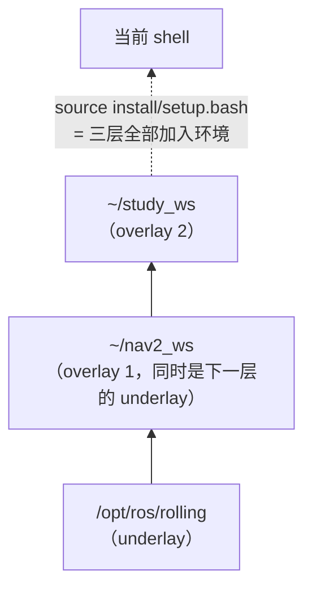

# 工作空间与 colcon Workspace & colcon

> 适用：ROS 2 **Rolling**（2026-11-17 在 `ros:rolling-ros-base` 容器里实测，colcon-core 0.21.3、colcon-ros 0.5.0）
> 来源标记：📄 仓库文档原文 · 🔍 源码或实测核实 · 💡 经验补充（可信，但请自己验证）
> 源文档：[Creating-A-Workspace.rst](../../../source/ROS-Framework/client-libraries/Working-with-Client-Libraries/Creating-A-Workspace/Creating-A-Workspace.rst)、[Colcon-Tutorial.rst](../../../source/ROS-Framework/client-libraries/Working-with-Client-Libraries/Colcon-Tutorial.rst)、[Creating-Your-First-ROS2-Package.rst](../../../source/ROS-Framework/client-libraries/Working-with-Client-Libraries/Creating-Your-First-ROS2-Package.rst)、[Using-Variants.rst](../../../source/Developer-Tools/Build/Using-Variants.rst)、[About-Build-System.rst](../../../source/Developer-Tools/Build/About-Build-System.rst)（构建工具部分）
> 📐 设计动机：[构建系统的设计](../../design/build-system-design.md)：构建工具 vs 构建系统、为什么选 colcon、`AMENT_PREFIX_PATH` 和 ament 资源索引、交叉编译

## 1. 一句话定义

工作空间（workspace）是一个放着 `src/` 的目录；构建工具 colcon 在 `src/` 下找出所有带 `package.xml` 的包，**按依赖顺序**逐个调用各包自己的构建系统（CMake、setuptools），把结果装进 `install/`，再由 `install/setup.bash` 把这些包加进当前 shell 的环境。📄

## 2. 为什么需要

💡 导航开发的典型环境是三层叠起来的：`/opt/ros/rolling`（二进制安装）← 自己编译的 Nav2 源码（为了改某个插件）← 自己的规划控制包。每层只编译自己那几个包，不用动下面的层。这种"叠层"就是 underlay / overlay。

### 核心概念 📄

| 概念 | 含义 |
|---|---|
| underlay（底层） | 编译 overlay 之前已经 source 的环境，例如 `/opt/ros/rolling`。必须包含 overlay 里所有包的依赖 |
| overlay（上层） | 你正在编译的工作空间。overlay 里的同名包**覆盖** underlay 里的 |
| `build/` `install/` `log/` | colcon 生成的三个目录：中间文件、安装结果、日志。没有 ROS 1 catkin 的 `devel` 目录 |
| `install/setup.bash` | source 本工作空间**以及编译时它所在的 underlay 链** |
| `install/local_setup.bash` | 只 source 本工作空间的包，不管 underlay |
| 构建工具 vs 构建系统 | colcon 是构建工具（build tool，决定顺序、准备环境）；CMake/ament_cmake、setuptools 是构建系统（build system，真正编译一个包） |
| 变体 variant | 官方元包（metapackage），如 `ros-rolling-ros-base`、`desktop`，自己只依赖别的包，用来"一键装一组"。自己的项目可以照样做一个只有 `exec_depend` 的 ament_cmake 包当作私有变体 |



### 常用命令 📄

| 命令 | 作用 |
|---|---|
| `colcon build` | 编译整个工作空间（在工作空间根目录执行，不是在 `src/` 里） |
| `--packages-select a b` | 只编这几个包（它们的依赖必须已经在本工作空间 `install/` 或已 source 的 underlay 里） |
| `--packages-up-to a` | 编 `a` 和它的全部依赖 |
| `--symlink-install` | 安装时用符号链接代替复制，改 Python/YAML/launch 不用重编 |
| `--event-handlers console_direct+` | 编译输出直接打到终端（默认只在出错时显示，其余在 `log/`） |
| `--executor sequential` | 一个包一个包地编，树莓派等内存小的机器防卡死 |
| `--cmake-args -DCMAKE_BUILD_TYPE=Release` | 传参数给每个包的 CMake |
| `colcon test` / `colcon test-result` | 跑测试 / 汇总结果，见[测试](testing.md) |
| `colcon list` / `colcon graph` | 列出包 / 画依赖关系 |
| 空文件 `COLCON_IGNORE` | 放进某个目录，colcon 就不再发现它 |
| `colcon_cd 包名` | 跳到包的源码目录（需按文档配置） |
| `colcon mixin` | 把常用参数组合成名字，如 `--mixin debug` |

## 3. 最小代码：建包、编译、使用

```bash
# 1. 新终端，只 source underlay
source /opt/ros/rolling/setup.bash
mkdir -p ~/study_ws/src && cd ~/study_ws/src
ros2 pkg create --build-type ament_cmake --license Apache-2.0 \
  --dependencies rclcpp --node-name my_node my_package

# 2. 在工作空间根目录编译（先用 rosdep 装依赖，见 rosdep 卡片）
cd ~/study_ws
colcon build --packages-up-to my_package --symlink-install

# 3. 换一个新终端再 source overlay，然后运行
source ~/study_ws/install/setup.bash
ros2 run my_package my_node
```

🔍 Rolling 的 `ros2 pkg create` 生成的 `CMakeLists.txt` 已经用 `target_compile_features(my_node PUBLIC c_std_17 cxx_std_20)` 要求 C++20，用 `target_link_libraries(my_node ${rclcpp_TARGETS})` 链接依赖，并在 `BUILD_TESTING` 里默认跳过版权和 cpplint 检查（细节见 [ament_cmake](ament-cmake.md)）。

练习用的两个包 [path_smoother_core](../../labs/build_lab/path_smoother_core/package.xml) 和 [path_smoother_plugins](../../labs/build_lab/path_smoother_plugins/package.xml) 演示了"一个包依赖另一个包"：

```text
$ colcon graph
path_smoother_core     +*
path_smoother_plugins   +
```

🔍 `+` 是包自己，`*` 表示"这一列的包直接依赖这一行的包"：plugins 依赖 core，所以 core 先编。

## 4. 常见坑

🔍 以下结果来自[编译与依赖的常见错误](../../labs/build-pitfalls.md)练习的实测。

1. **在编译过 A 的终端里 source A，再去编译 B，B 就永远绑上了 A。** 📄 文档要求"source overlay 之前打开新终端"，"在编译的终端里 source overlay，或者在 source 了 overlay 的终端里编译，可能造成复杂的问题"。🔍 实测：在 source 了 `/ca/install` 的终端里编译 `/cb`，`/cb/install/setup.sh` 里写死了 `/ca/install`；之后删除 `/ca`，新终端 `source /cb/install/setup.bash` 只打印 `not found: "/ca/install/local_setup.bash"`，返回码仍是 0，运行时报 `Package 'path_smoother_core' not found`。实测中这个问题还会"传染"：用同一个 shell 依次编译多个实验工作空间，后编的工作空间全都链上了前面的。
2. **`package.xml` 漏写依赖，清空重编就失败。** 🔍 删掉 plugins 的 `<depend>path_smoother_core</depend>` 后，`colcon graph` 里两个包不再相连，干净编译时两个包**同时开始**，plugins 报 `Could not find a package configuration file provided by "path_smoother_core"`，core 被中途 `Aborted`。更隐蔽的是：即使 core 已经编好，再执行 `colcon build` 仍然失败，因为 colcon 只给一个包准备"它声明的依赖"的环境；只有先手动 `source install/setup.bash` 才"碰巧"成功。所以"我本地能编"不代表依赖写对了。
3. **一个包失败，下游全部不编。** 🔍 core 编译出错时汇总是 `1 package failed` 和 `1 package not processed`，plugins 根本没开始。看错误要找**第一个** `Failed` 的包。
4. **`--symlink-install` 只省掉"复制"，C++ 仍要重新编译。** 🔍 打开后，`install/.../config/smoother.yaml` 是指向 `src/` 的链接，改 YAML 后直接 `ros2 launch` 就读到新值（`window=7`）；不加此选项时读到的还是旧值（`window=5`）。但可执行文件是指向 `build/` 的链接，改 `.cpp` 仍要 `colcon build`。
5. **关掉 `--symlink-install` 不会把链接变回文件。** 🔍 用 `--symlink-install` 编过之后再普通编译，`install/` 里的 YAML 仍是符号链接。切换方式时 💡 删掉 `build/` 和 `install/` 再编，免得"以为是复制的其实是链接"。
6. **`local_setup.bash` 不带 underlay。** 📄 它只加入本工作空间。🔍 新终端只 source `install/local_setup.bash`，`ros2` 命令都找不到，`AMENT_PREFIX_PATH` 里没有 `/opt/ros/rolling`。日常用 `setup.bash`。
7. **overlay 覆盖 underlay 时，这个镜像里没有任何提醒。** 🔍 在 overlay 里重编 underlay 已有的 `path_smoother_core`，编译成功、没有警告，`ros2 pkg prefix path_smoother_core` 指向 overlay；镜像里的 colcon 也不认识 `--allow-overriding`。💡 这个警告和参数来自 colcon 扩展 `colcon-override-check`，装了才有。更要紧的是：underlay 里依赖它的包（这里是 plugins）是按**旧头文件**编的，接口一变就可能运行时崩溃。改 underlay 的包时，把依赖它的包一起拉进 overlay 重编。
8. **`--cmake-args` 会留在 CMake 缓存里。** 🔍 用 `--cmake-args -DINJECT_BUG=ON` 编过一次后，下次不带参数编译，`CMakeCache.txt` 里仍是 `INJECT_BUG:BOOL=ON`。要关掉必须显式传 `-DINJECT_BUG=OFF` 或删掉 `build/包名`。

## 5. 与其他概念的关系

- [ament_cmake](ament-cmake.md)：colcon 调用的构建系统，决定"装什么、导出什么"
- [rosdep 依赖管理](rosdep.md)：编译前装系统依赖；同样读 `package.xml`
- [测试](testing.md)：`colcon test` 和 `colcon test-result`
- [启动参数与重映射](../configuration/node-arguments.md)：`source` 之后才能 `ros2 run`
- 练习：[编译与依赖的常见错误](../../labs/build-pitfalls.md)
- [构建系统的设计](../../design/build-system-design.md)（📐 设计动机）：为什么没有 devel space 和单一 CMake 上下文，colcon 的扩展点
- 上一级：[总览脑图](../../map/overview.md)

## 6. 自测题（先自己答，再看[答案](../../answers/workspace-colcon-answers.md)）

1. 你在终端 T1 里编译了 `~/nav2_ws`，接着在 T1 里 `source ~/nav2_ws/install/setup.bash`，然后 `cd ~/my_ws && colcon build`。一个月后为了省空间删掉了 `~/nav2_ws`，从此新终端里 `source ~/my_ws/install/setup.bash` 不报错，但 `ros2 launch my_bringup nav.launch.py` 说找不到 `nav2_controller`。解释原因，并说明以后应该怎样建立工作空间之间的关系。
2. 同事的规划包 `my_planner` 用到了你的 `my_costmap_utils`，但 `package.xml` 里忘了写依赖。他在笔记本上一直能编过，CI 的干净编译却每次失败。(a) 为什么 CI 失败？(b) 为什么他本地能编过（至少给出一种可能），以及为什么这个"能编过"不可靠？
