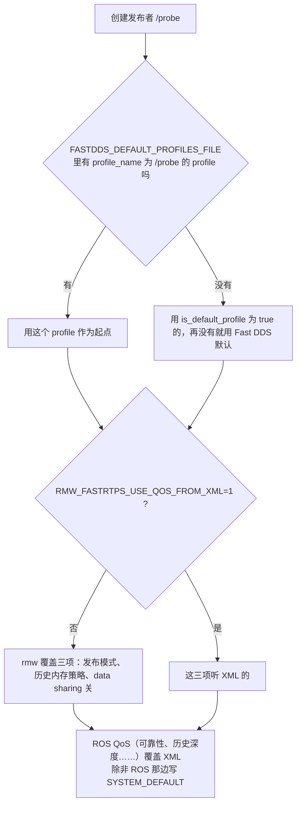

# DDS 调优与 Fast DDS XML

> 适用：ROS 2 **Rolling**，Fast DDS 3.6.2（2026-11-17 实测；`rmw_fastrtps` 源码取自当天的 GitHub 默认分支）
> 来源标记：📄 仓库文档原文 · 🔍 源码或实测核实 · 💡 经验补充（可信，但请自己验证）
> 源文档：[DDS-tuning.rst](../../../source/Developer-Tools/Build/DDS-tuning.rst)、[FastDDS-Configuration.rst](../../../source/Developer-Tools/Launch/FastDDS-Configuration.rst)

## 1. 一句话定义

DDS 调优是在 ROS 的 QoS 之外，再调两层：**Linux 内核的网络参数**（IP 分片重组、接收缓冲区）和**中间件自己的配置**（Fast DDS 用 XML profile，按话题名匹配，能设发布模式、内存策略、分区、匹配数上限等）。另外一类"调优"其实在消息设计：复合类型的大数组序列化很慢。📄

## 2. 为什么需要

📄 文档收集的都是"真实系统里遇到过"的问题：

| 现象 | 原因 | 对策 |
|---|---|---|
| Wi-Fi 上发大消息，连接时不时"卡住"几十秒 | 大 UDP 报文被拆成 IP 分片，丢一片整包重组不了；残片占满内核重组缓冲，要等 `ipfrag_time`（默认 30 s）超时才释放 | best effort QoS；`sysctl net.ipv4.ipfrag_time=3`；调大 `net.ipv4.ipfrag_high_thresh`（文档示例 128 MB） |
| `publish()` 很慢，CPU 高，`ros2 topic hz` 显示的频率偏低 | 自定义消息里有**复合类型的大数组**，逐元素序列化开销大（`builtin_interfaces/Time` 也算复合类型） | 改成"多个基本类型数组"或打包成字节数组（像 `PointCloud2`） |
| Cyclone DDS 有线网络 reliable 也收不全 9 MB 的大消息 | 接收缓冲区太小 | `sysctl -w net.core.rmem_max=2147483647` + `CYCLONEDDS_URI` 指向的 XML 里 `<SocketReceiveBufferSize min="10MB"/>` |
| Connext 同样问题 | 同上 | `rmem_max` 调到 4 MB + 使用带流控器（flow controller）的 QoS profile |

### 复合类型数组到底多慢（🔍 [serialize_bench](../../labs/mw_lab/src/serialize_bench.cpp)，4 核容器）

同样 10000 个位姿：

| 消息 | 字节数 | 序列化 | 反序列化 |
|---|---|---|---|
| `nav_msgs/Path`（每点一个 `PoseStamped`） | 720 028 | 788.6 µs | 710.8 µs |
| `geometry_msgs/PoseArray` | 560 028 | 509.0 µs | 413.9 µs |
| `sensor_msgs/PointCloud2`（7 个 `float64` 打包） | 560 189 | **14.9 µs** | **14.5 µs** |

字节数差不多，耗时差 50 倍。10 万点的 `Path` 序列化约 5.8 ms。规划器发的就是 `Path`，这一点和你直接相关。

### Fast DDS XML profile 怎么生效



🔍 `rmw_fastrtps_cpp/src/publisher.cpp`：先 `get_datawriter_qos_from_profile(topic_name, writer_qos)`，`topic_name` 是带 `/` 的 ROS 话题名；然后 `if (!leave_middleware_default_qos)` 时改写发布模式、`PREALLOCATED_WITH_REALLOC_MEMORY_MODE`、`data_sharing().off()`。所以**分区、匹配数上限这些 XML 设置不需要** `RMW_FASTRTPS_USE_QOS_FROM_XML` 就生效（🔍 实测一致）。

📄 服务和客户端各有一对话题：请求 `rq/<服务名>Request`、响应 `rr/<服务名>Reply`（文档写作 `/rq/ping`、`/rr/ping`）；XML 里用 `service` / `client` 类型的 profile 配置。

## 3. 最小用法

[partition_pub.xml](../../labs/mw_lab/config/partition_pub.xml)：

```xml
<?xml version="1.0" encoding="UTF-8" ?>
<profiles xmlns="http://www.eprosima.com">
  <publisher profile_name="/probe">          <!-- 带 / 的完整话题名 -->
    <qos>
      <partition><names><name>part1</name></names></partition>
    </qos>
  </publisher>
</profiles>
```

```bash
export FASTDDS_DEFAULT_PROFILES_FILE=/abs/path/partition_pub.xml
export RMW_FASTRTPS_USE_QOS_FROM_XML=1          # 只有要让 XML 决定发布模式 / 内存策略时才需要
export RMW_FASTRTPS_PUBLICATION_MODE=ASYNCHRONOUS   # 不写 XML 也能切换发布模式（SYNCHRONOUS / ASYNCHRONOUS / AUTO）

sysctl net.ipv4.ipfrag_time net.ipv4.ipfrag_high_thresh net.core.rmem_max   # 先看现值
sudo sysctl -w net.ipv4.ipfrag_time=3
```

消息设计上，跨进程发大量点时（C++）：

```cpp
// 不推荐跨进程高频发：每个点一个 PoseStamped，每个点都带 header 和 frame_id 字符串
nav_msgs::msg::Path path;
// 更省的写法之一：数组的结构体（自定义 msg：float64[] x, float64[] y, float64[] yaw）
// 或者像 PointCloud2 那样把字段打包进 uint8[] data，一次 memcpy 完成序列化
```

## 4. 常见坑

1. **默认发布模式：文档自相矛盾，以源码为准是同步。** 📄 [FastDDS-Configuration.rst](../../../source/Developer-Tools/Launch/FastDDS-Configuration.rst) 开头说"`rmw_fastrtps` 默认同步发布"，后面两处（"both publishers will behave the same, publishing asynchronously ... because this is the default"、"By default, these values are set to `ASYNCHRONOUS` and `PREALLOCATED_WITH_REALLOC`"）说默认异步。🔍 `rmw_fastrtps` README："Publication mode: `SYNCHRONOUS_PUBLISH_MODE`"，"If `RMW_FASTRTPS_PUBLICATION_MODE` is not set, then `rmw_fastrtps_cpp` behaves as if it were set to `SYNCHRONOUS`"。意思是：大消息的序列化和发送耗时**直接算在你调用 `publish()` 的回调里**。
2. **profile 名要带 `/`。** 🔍 rmw 用 ROS 话题全名查找 profile。写 `profile_name="probe"` 不会报错，也不会生效。文档正文说"与话题名 `sync_topic` 相同"，但它的 XML 里写的是 `/sync_topic`，以 XML 为准。
3. **XML 写错会被整个忽略。** 🔍 Fast DDS 3 解析失败时打印 `XMLPARSER Error ... Error parsing '<文件>'`，节点照常启动，所有设置都不生效。启动日志里搜 `XMLPARSER`。
4. **分区、匹配数上限在 CLI 里看不出来。** 🔍 发布端在 `part1`、订阅端在 `part2`：`ros2 topic info -v` 显示一发一收、QoS 兼容，但订阅端 `matched=0`。`matchedSubscribersAllocation` 最大 1 时，三个订阅端**都报告 `matched=1`**，只有一个真正收到数据。"QoS 都对、就是收不到"时，问一句有没有 XML。
5. **`RMW_FASTRTPS_USE_QOS_FROM_XML=1` 但 XML 里没写 `historyMemoryPolicy`。** 📄 会退回 Fast DDS 自己的默认 `PREALLOCATED`，ROS 的变长类型用不了，要写成 `DYNAMIC`（或 `PREALLOCATED_WITH_REALLOC`）。🔍 本次用 100 字节和 5000 字节的字符串没有复现失败，但别依赖。
6. **文档的内核默认值过时了。** 📄 文档说 `ipfrag_high_thresh` 默认 262144（256 KB）。🔍 测试机（Linux 6.18）读到 4194304（4 MB）；💡 新内核（4.17 起）默认就是 4 MB。调之前先 `sysctl` 读现值。
7. **内核参数是全局的。** 📄 `ipfrag_time` 影响这台机器所有的分片重组，调太小可能伤到别的应用。🔍 容器里 `/proc/sys` 默认只读（`Read-only file system`），要在宿主机上改，或用 `docker run --sysctl` 设置按网络命名空间隔离的参数。
8. **不是所有问题都要调 DDS。** 💡 大消息先问"需不需要这么大、这么快"：降采样、裁剪到局部窗口、压缩，往往比调内核参数更有效，也不影响别人。

## 5. 与其他概念的关系

- [QoS](../communication/qos.md)：XML 和 ROS QoS 谁说了算
- [中间件 RMW 与 DDS](rmw-dds.md)：这些都是 Fast DDS 的行为，换 RMW 要重来
- [Domain ID 与发现](domain-discovery.md)：Discovery Server、Super Client、`mutation_tries` 也用同一套 XML
- [接口定义](../communication/interface-definition.md)：消息结构决定序列化开销
- [进程内通信与零拷贝](../concurrency/intra-process.md)：同进程时根本不序列化
- [tracing 性能追踪](../observability/tracing.md)：量 `publish()` 在回调里花了多久
- 练习：[DDS 调优、XML 配置与容器网络](../../labs/dds-and-docker.md)
- 上一级：[总览脑图](../../map/overview.md)

## 6. 自测题（先自己答，再看[答案](../../answers/dds-tuning-answers.md)）

1. 局部规划器的控制回调是 20 Hz，每次发一条 5 万点的 `nav_msgs/Path` 给可视化。tracing 显示这个回调偶尔超过 50 ms。请从"发布模式"和"消息结构"两个角度解释，并给出至少三种改法，按改动大小排序。
2. 机器人通过 Wi-Fi 往地面站发 2 MB 的地图（reliable），每隔几分钟就卡 30 秒左右才恢复。用 IP 分片的机制解释"30 秒"从哪来，列出文档给的三种对策，并说说每种的代价。
