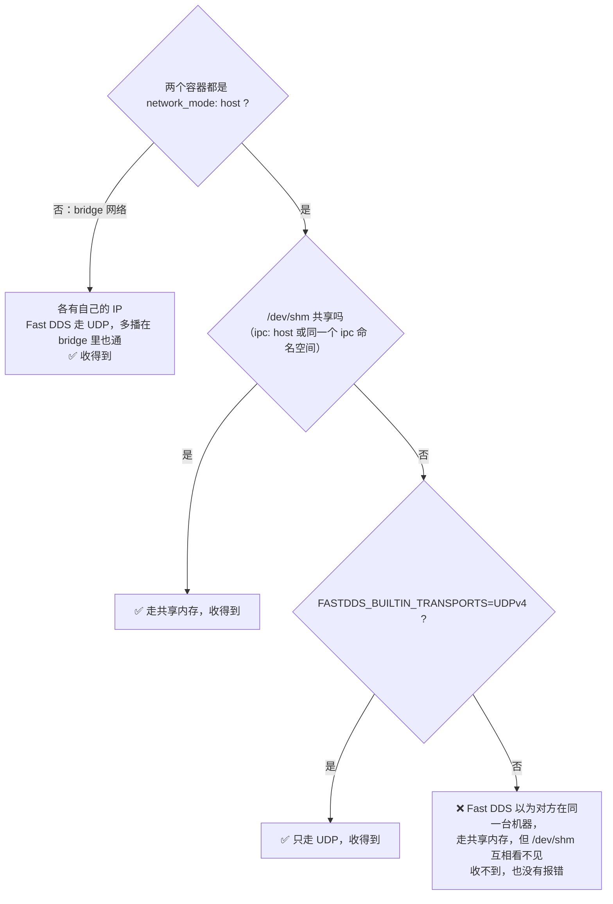

# Docker 部署

> 适用：ROS 2 **Rolling**，Fast DDS 3.6.2，Docker Compose v5.6.1（2026-11-17 实测，镜像 `ros:rolling-ros-base`）
> 来源标记：📄 仓库文档原文 · 🔍 源码或实测核实 · 💡 经验补充（可信，但请自己验证）
> 源文档：[Run-2-nodes-in-single-or-separate-docker-containers.rst](../../../source/Developer-Tools/Build/Run-2-nodes-in-single-or-separate-docker-containers.rst)、[Setup-ROS-2-with-VSCode-and-Docker-Container.rst](../../../source/Developer-Tools/Build/Setup-ROS-2-with-VSCode-and-Docker-Container.rst)、[Deployment-Guidelines.rst](../../../source/Developer-Tools/Build/Deployment-Guidelines/Deployment-Guidelines.rst)、[About-Cross-Compilation.rst](../../../source/Developer-Tools/Build/About-Cross-Compilation.rst)

## 1. 一句话定义

把 ROS 2 节点装进容器，用镜像固定发行版和依赖。容器之间能不能通信取决于两件事：**网络模式**（bridge 还是 `host`，决定多播和 IP）和 **IPC 命名空间**（`/dev/shm` 是否共享，决定 Fast DDS 的共享内存传输能不能用）。📄🔍

## 2. 为什么需要

- 同一份镜像在开发机、CI、机器人上跑，"在我机器上能跑"的问题少很多。
- 部署时一台机器上可能有多个容器（感知、规划、驱动各一个），它们之间的 DDS 通信方式和裸机不一样，配错了**不报错、只是收不到**。

### 网络模式和共享内存（🔍 实测矩阵）



| 发布端容器 | 订阅端容器 | 8 秒内收到 |
|---|---|---|
| host 网络 | host 网络（各自 `/dev/shm`） | **0** |
| host 网络 + `ipc: host` | host 网络 + `ipc: host` | 39 |
| host 网络 + `UDPv4` | host 网络 + `UDPv4` | 39 |
| bridge | bridge | 40 |
| host 网络 | bridge（以及反方向） | 都能收到 |
| host 网络 + `--ipc host` | host 网络（默认 ipc） | **0** |

### 文档里的两种用法

📄 **两个容器各跑一个节点**：两个终端分别 `docker run -it --rm osrf/ros:{DISTRO}-desktop ros2 run demo_nodes_cpp talker` / `listener`，默认 bridge 网络，能通。也可以用一个 compose 文件起两个服务。

📄 **VS Code devcontainer**：`devcontainer.json` 里 `"privileged": true`、`runArgs` 带 `--net=host --pid=host --ipc=host`，挂载 `/tmp/.X11-unix` 并传 `DISPLAY`（宿主机先 `xhost +local:<用户名>`）让 RViz 能显示；`containerEnv` 里设 `ROS_AUTOMATIC_DISCOVERY_RANGE=LOCALHOST`；容器里建一个和宿主机同 UID（文档用 1000）的用户，挂载进来的源码文件权限才对得上。`--ipc=host` 正是为了上面那个共享内存问题。

### 部署带安全的系统（📄 Deployment Guidelines）

| 目录 | 组织内部 | 目标设备 | 敏感度 |
|---|---|---|---|
| `public/`（CA 证书） | ✓ | ✓ | 低 |
| `private/`（CA 私钥） | ✓ | **✕** | 高 |
| `enclaves/`（每个应用的密钥和签名策略） | ✓ | ✓（只放这台设备需要的） | 中 |

- CA 在组织内部创建；每个应用一个 enclave；`public/` 和对应的 `enclaves/` 随设备部署；`private/` 留在组织内并备份。**`private/` 丢了就再也不能改权限、加节点。**
- `enclaves/` 设为只读；可以用 PKCS#11 URI 把 enclave 私钥放进硬件安全模块（HSM）。
- 文档的 compose 示例：`keystore-creator` 服务生成密钥库到共享卷，`talker`、`listener` 两个服务**只挂载** `governance.p7s`、`governance.xml`、自己那个 enclave 目录和 `public/`，环境变量 `ROS_SECURITY_KEYSTORE`、`ROS_SECURITY_ENABLE=true`、`ROS_SECURITY_STRATEGY=Enforce`，用 `depends_on: condition: service_completed_successfully` 等密钥库建好再启动。

### 交叉编译（📄 简述）

为什么要交叉编译：开发机和目标机架构不同；要针对特定 CPU 调优（如树莓派 3 的 `-mcpu=cortex-a53 -mfpu=neon-fp-armv8`）；目标文件系统不是官方预编译镜像支持的。难点：代码要支持目标架构，**所有依赖都要先有目标架构的版本**，构建工具（colcon）要能把交叉编译设置传给每个包。替代方案：用 `docker buildx` 构建多平台镜像。（`Cross-compilation.rst` 正文为空，只剩相关文章列表。）

## 3. 最小用法

[compose.yaml](../../labs/mw_lab/docker/compose.yaml)（改好后的版本）：

```yaml
services:
  pub:
    image: ros:rolling-ros-base
    network_mode: host
    ipc: host                        # 或者两个服务都设 FASTDDS_BUILTIN_TRANSPORTS=UDPv4
    environment:
      - ROS_DOMAIN_ID=42
    # 命令写成列表：一整行字符串里的 "{data: x}" 会被 YAML 当成映射
    command: ["ros2", "topic", "pub", "-r", "5", "/probe", "std_msgs/msg/String", "{data: from-pub-container}"]
  sub:
    image: ros:rolling-ros-base
    network_mode: host
    ipc: host
    environment:
      - ROS_DOMAIN_ID=42
    command: ["ros2", "topic", "echo", "/probe", "std_msgs/msg/String", "--field", "data"]
```

```bash
docker compose up -d && sleep 8 && docker compose logs sub | tail -3 && docker compose down
```

💡 选哪种：

- 机器人上多个容器、要高带宽（点云、图像）：host 网络 + `ipc: host`，保留共享内存的性能。
- 只是隔离、带宽不大：默认 bridge 网络最省心，不会和宿主机上的其他 ROS 进程串在一起。
- 不想共享 IPC 又要 host 网络：`FASTDDS_BUILTIN_TRANSPORTS=UDPv4`，代价是同机通信也走网络栈。

## 4. 常见坑

1. **两个 host 网络的容器互相收不到，没有任何报错。** 🔍 见上表第一行。Fast DDS 根据"对方的 IP 和我一样"判断同机，优先用共享内存；`/dev/shm` 不共享就断了。排查时 `mw_probe` 的订阅端会显示 `publishers in graph=1`（发现走 UDP，成功了），但收不到数据。
2. **只给一边加 `ipc: host` 没用。** 🔍 一个 `--ipc host`、一个默认 ipc：仍然 0 条。要么都共享，要么都关共享内存。
3. **compose 的 `command:` 写成字符串时冒号出错。** 🔍 `command: ros2 topic pub ... "{data: x}"` 报 `mapping values are not allowed in this context`，用列表形式。
4. **文档 compose 的 `version: '2'` 已经过时。** 🔍 Docker Compose v5 提示 `the attribute version is obsolete, it will be ignored`，删掉即可。
5. **部署教程的 Dockerfile 下载链接失效。** 🔍 文档里的 `wget https://raw.githubusercontent.com/ros2/ros2_documentation/{DISTRO}/source/Tutorials/Advanced/Security/resources/deployment_gd/Dockerfile` 是旧路径，`rolling` 分支返回 404；现在的路径是 `source/Developer-Tools/Build/Deployment-Guidelines/resources/deployment_gd/Dockerfile`。这个 Dockerfile 的默认值是 `ARG ROS_DISTRO=humble`，一定要 `--build-arg ROS_DISTRO=...`。
6. **部署教程的"预期输出"把 talker 和 listener 写反了。** 📄 文档里写的是 `tutorial-listener-1`: `Publishing: 'Hello World: <number>'`、`tutorial-talker-1`: `I heard: [Hello World: <number>]`，实际是 talker 发布、listener 收到。看日志时按容器名对不上，别以为配错了。
7. **把 `private/` 打进镜像。** 📄 `private/` 只用于签发和修改权限，运行时不需要。💡 `COPY keystore /keystore` 一行就把整个 CA 私钥发到了每台机器人上；用 `.dockerignore` 排除，或者只挂载需要的目录。
8. **容器里改不了内核参数。** 🔍 `sysctl -w` 报 `Read-only file system`。DDS 调优的 `ipfrag_*`、`rmem_max` 要在宿主机上改（或用 `docker run --sysctl` 设置能按命名空间隔离的那部分）。
9. **镜像没有你要的 RMW。** 🔍 `ros:rolling-ros-base` 只有 `rmw_fastrtps_cpp`。系统里有一台换了 Cyclone，所有镜像都要装同一个 RMW（见 [中间件 RMW 与 DDS](rmw-dds.md)）。

## 5. 与其他概念的关系

- [Domain ID 与发现](domain-discovery.md)：bridge 网络里的多播、`LOCALHOST` 发现范围
- [DDS 调优与 Fast DDS XML](dds-tuning.md)：内核参数要在宿主机上调
- [安全 SROS2](sros2-security.md)：部署时哪些密钥文件该进设备
- [工作空间与 colcon](../engineering/workspace-colcon.md)、[rosdep 依赖管理](../engineering/rosdep.md)：在 Dockerfile 里编译工作空间
- [调试与回溯](../observability/gdb-debugging.md)：容器里用 gdb 的限制
- 练习：[DDS 调优、XML 配置与容器网络](../../labs/dds-and-docker.md) 第 4 部分
- 上一级：[总览脑图](../../map/overview.md)

## 6. 自测题（先自己答，再看[答案](../../answers/docker-deploy-answers.md)）

1. 机器人上有三个容器：`driver`（激光、相机驱动）、`perception`、`planner`，点云 30 Hz、每帧 2 MB。为了让 RViz 在宿主机上也能看到话题，你把三个容器都设成了 `network_mode: host`。上线后 `perception` 收不到任何点云，`ros2 topic list` 却一切正常。解释原因，给出两种修法，并说明在这个场景下你选哪种、为什么。
2. 给一台出厂机器人写 Dockerfile 和 compose 文件，系统开启了 SROS2。列出镜像里、设备上、组织内部分别应该有哪些密钥库文件，以及至少两条防止私钥泄露的做法。
