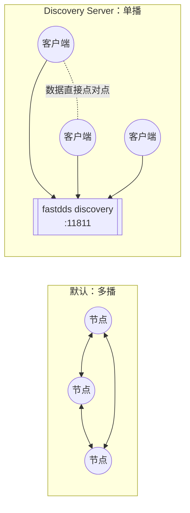

# Domain ID 与发现

> 适用：ROS 2 **Rolling**，Fast DDS 3.6.2（2026-11-17 实测：单机多进程 + 两个 Docker 容器模拟两台机器）
> 来源标记：📄 仓库文档原文 · 🔍 源码或实测核实 · 💡 经验补充（可信，但请自己验证）
> 源文档：[About-Domain-ID.rst](../../../source/ROS-Framework/nodes/About-Domain-ID.rst)、[Configuring-ROS2-Environment.rst](../../../source/Get-Started/Configuring-ROS2-Environment.rst)（Domain 与发现部分）、[Improved-Dynamic-Discovery.rst](../../../source/Developer-Tools/Launch/Improved-Dynamic-Discovery.rst)、[Discovery-Server.rst](../../../source/Developer-Tools/Launch/Discovery-Server/Discovery-Server.rst)
> 📐 设计动机：[发现与协商的设计](../../design/discovery-negotiation-design.md)：计算图 vs 数据层图、七种发现系统、图事件与存活性（`kill -9` 后约 20 秒才从图里消失）

## 1. 一句话定义

发现（discovery）是节点"自动找到彼此"的过程：DDS 默认用 UDP 多播广播"我在这、我发布什么"，**同一个 Domain ID** 里、**发现范围**允许的节点会互相找到并直接连起来。三个旋钮：`ROS_DOMAIN_ID`（分组，默认 0）、`ROS_AUTOMATIC_DISCOVERY_RANGE`（多远，默认 `SUBNET`）、`ROS_STATIC_PEERS`（额外指定的对端）。节点多、网络差时可以换成集中式的 Discovery Server。📄

## 2. 为什么需要

- 同一个局域网里有几台机器人、几个开发者，不隔离的话大家的 `/cmd_vel` 会串在一起。Domain ID 是最粗的隔离，💡 实验室里一人一个 Domain 是常见做法。
- 机器人上几十个节点各自在 Wi-Fi 上多播发现报文，会占不少带宽。把发现限制在本机（`LOCALHOST`），再只对调试笔记本开一个口子（`ROS_STATIC_PEERS`），既安静又可调试。
- 多播在很多网络（公司 Wi-Fi、云、部分 VPN）里不通；Discovery Server 用单播，绕开多播。

### Domain ID 决定端口（📄 公式，🔍 实测一致）

每个进程（准确说是每个 context）创建一个 DDS 参与者（participant），不管里面有几个节点。参与者编号 $p$ 从 0 开始按启动顺序分配，Domain 为 $d$：

$$
\begin{aligned}
\text{发现多播} &= 7400 + 250d \\
\text{用户数据多播} &= 7400 + 250d + 1 \\
\text{发现单播} &= 7400 + 250d + 10 + 2p \\
\text{用户数据单播} &= 7400 + 250d + 11 + 2p
\end{aligned}
$$

🔍 实测 Domain 0：第一个进程 7400、7410、7411，第二个 7412、7413；Domain 5：8650、8660、8661；Domain 101：32650 起。用户数据多播端口 7401 没被占用（Fast DDS 默认不用）。第 6 批 gdb 里看到的线程名 `dds.udp.7400`、`dds.udp.7410`、`dds.udp.7411` 就是这些端口。

由此推出的限制（📄）：

| 平台 | 安全的 Domain ID | 原因 |
|---|---|---|
| Linux | **0–101**（以及 215–232） | 临时端口（ephemeral port）范围是 32768–60999（🔍 `ip_local_port_range` 实测一致），不能撞上 |
| macOS / Windows | 0–166 | 临时端口从 49152 开始 |
| 所有平台 | 最大 232 | 端口号不能超过 65535 |

- 每个参与者占 2 个单播端口，一个 Domain 250 个端口，所以同一台机器同一 Domain **超过 120 个进程**会挤进下一个 Domain 的端口。
- Domain 101 在 Linux 上最多 54 个进程（第 55 个撞上 32768）；Domain 232 最多 63 个。

### 发现范围（📄 规则，🔍 两个容器实测全部一致）

| 取值 | 含义 |
|---|---|
| `SUBNET`（默认） | 本子网内多播发现 |
| `LOCALHOST` | 只和本机节点发现 |
| `OFF` | 谁都不发现，**本机也不行**，写了静态对端也不行 |
| `SYSTEM_DEFAULT` | 不改 RMW 自己的默认设置 |

记住三条就能推出文档两张 6×6 表格的全部 72 格：

1. 任何一边是 `OFF` → 不通。
2. 同一台机器：`LOCALHOST` 和 `SUBNET` 任意组合都通。
3. 不同机器：两边都 `SUBNET` → 通；否则需要**至少一边**把对方写进 `ROS_STATIC_PEERS`（IP 或主机名，分号分隔，如 `'192.168.0.1;robot2'`）。

🔍 实测一边 `LOCALHOST` + `ROS_STATIC_PEERS=hb`、另一边 `LOCALHOST` 不写对端：能通。一边 `LOCALHOST`、另一边 `SUBNET`、都不写对端：跨机器不通。

### Discovery Server（Fast DDS 专有）



📄 要点：

- 服务器：`fastdds discovery -i 0`（默认端口 11811）；客户端：`export ROS_DISCOVERY_SERVER=<IP>:11811`。
- 只负责**发现**：端点互相认识以后数据直接点对点走。🔍 实测杀掉服务器，已连上的订阅者继续收（5 秒内从 17 条涨到 43 条），新启动的客户端就收不到了。
- 冗余：`ROS_DISCOVERY_SERVER="a:11811;b:11888"`，位置对应服务器 ID（第 0 个位置给 ID 0）；只想连 ID 1 就写 `";b:11888"`。
- 备份：`--backup` 在当前目录写 sqlite 和 json，服务器重启后恢复。
- 用不用服务器的节点**互相看不见**。🔍 实测一致。
- Discovery Server v2 按话题过滤发现信息，普通客户端身份的 CLI 可能看不全图，要让 CLI 和 daemon 以 **Super Client** 身份运行。
- 用 Discovery Server 时一台机器上超过 100 个参与者（进程数，不是节点数），Fast DDS 为每个参与者找空闲单播监听端口的尝试次数 `mutation_tries`（默认 100）用完，多出来的参与者收不到任何东西（"聋了"）。在 XML 的 `<rtps><builtin><mutation_tries>1000</mutation_tries>` 里调大，**除服务器外所有参与者**都要用这个配置。

## 3. 最小用法

```cpp
// 一般用环境变量 ROS_DOMAIN_ID；需要在代码里指定时：
rclcpp::InitOptions opts;
opts.set_domain_id(42);                      // 🔍 rclcpp/init_options.hpp 有 set_domain_id / get_domain_id
rclcpp::init(argc, argv, opts);

// 运行时查询（mw_lab 的 mw_probe 就是这样打印的）
const size_t d = node->get_node_base_interface()->get_context()->get_domain_id();
```

```bash
export ROS_DOMAIN_ID=17                           # 0–101 之间选
export ROS_AUTOMATIC_DISCOVERY_RANGE=LOCALHOST     # 机器人上：只在本机发现
export ROS_STATIC_PEERS='192.168.1.50'             # 再加上调试笔记本
ros2 daemon stop                                   # 改了任何发现相关的变量后都要做

# Discovery Server
fastdds discovery -i 0                             # 服务器
export ROS_DISCOVERY_SERVER=192.168.1.10:11811     # 每个客户端
export ROS_SUPER_CLIENT=TRUE                       # 🔍 CLI 用：以 Super Client 身份看全图
ros2 daemon stop && ros2 topic list
```

## 4. 常见坑

1. **daemon 记住的是"启动它那一刻"的环境。** 🔍 daemon 的命令行只记录了 `--ros-domain-id` 和 `--rmw-implementation`，`ROS_DISCOVERY_SERVER`、`ROS_AUTOMATIC_DISCOVERY_RANGE`、`FASTDDS_DEFAULT_PROFILES_FILE` 都不在里面。实测：先用普通发现启动了 daemon，再 `export ROS_DISCOVERY_SERVER=...`，`ros2 topic list` 只有 `/parameter_events`、`/rosout`，看不到服务器上的 `/probe`；`ros2 daemon stop` 后马上正常。另外每个 Domain 一个 daemon，做完实验它们会一直挂在后台。
2. **`OFF` 是真的关。** 📄🔍 两边都 `OFF` 并互相写了 `ROS_STATIC_PEERS=127.0.0.1`，同一台机器上也收不到。想"只连指定的机器"要用 `LOCALHOST` + 静态对端，不是 `OFF` + 静态对端。
3. **取值区分大小写，写错不报错。** 🔍 `ROS_AUTOMATIC_DISCOVERY_RANGE=localhost` 只打印一条 `[WARN] [rcl]: Invalid value 'localhost' ... assuming localhost only`，然后按 `LOCALHOST` 运行。如果你本想写 `subnet`，跨机器就悄悄不通了。
4. **文档的 Super Client XML 在 Fast DDS 3 里不能用。** 🔍 带 `<RemoteServer prefix="...">` 的写法报 `XMLPARSER Error: Node 'discoveryServersList' without content`，然后**整个 XML 被忽略**，节点照常启动。Fast DDS 3 的写法是把 `<locator>` 直接放在 `<discoveryServersList>` 下（见 [super_client.xml](../../labs/mw_lab/config/super_client.xml)）。更简单的是 `ROS_SUPER_CLIENT=TRUE`（文档没写，🔍 Fast DDS 3.6 支持）。另外 🔍 `fastdds discovery` 的帮助里写着 `-i/--server-id` 已弃用，不写也得到同样的 GUID 前缀。
5. **CLI "看得见"不等于节点"连得上"。** 💡 `ros2 topic list` 走的是 daemon 的发现，你的节点走的是自己的发现；两者配置不同时结论不一样。排查时用节点自己报告（`mw_probe` 的 `publishers in graph` / `matched`），或者 `--no-daemon`。
6. **Zenoh 不认这些变量。** 📄 `rmw_zenoh_cpp` 不支持 `ROS_AUTOMATIC_DISCOVERY_RANGE` 和 `ROS_STATIC_PEERS`，用 Zenoh 自己的配置文件（`ZENOH_SESSION_CONFIG_URI`、`ZENOH_ROUTER_CONFIG_URI`，🔍 来自 rmw_zenoh 源码）。
7. **Domain 101 以上要算端口。** 📄 Linux 上 Domain 101 最多 54 个进程。💡 大型仿真（每个机器人一堆进程）别贪大的 Domain 号。

## 5. 与其他概念的关系

- [中间件 RMW 与 DDS](rmw-dds.md)：发现是 RMW 的三件事之一
- [节点与 ROS 图](../communication/node.md)：ROS 图就是发现的结果
- [命令行工具](../observability/cli-tools.md)：daemon 缓存发现结果
- [Docker 部署](docker-deploy.md)：容器网络模式影响多播和共享内存
- [安全 SROS2](sros2-security.md)：加密后的发现报文；permissions 绑定 Domain ID
- 练习：[中间件、Domain 与发现](../../labs/middleware-discovery.md)
- [发现与协商的设计](../../design/discovery-negotiation-design.md)（📐 设计动机）：ROS 2 落在七种系统里的哪一种，图事件有多快
- 上一级：[总览脑图](../../map/overview.md)

## 6. 自测题（先自己答，再看[答案](../../answers/domain-discovery-answers.md)）

1. 实验室有 3 台机器人和 5 个开发者共用一个 Wi-Fi。要求：每台机器人内部节点互通，但不往 Wi-Fi 上多播；每个开发者的笔记本只能看到自己负责的那台机器人；开发者之间互不干扰。给出每台机器和每台笔记本上的 `ROS_DOMAIN_ID`、`ROS_AUTOMATIC_DISCOVERY_RANGE`、`ROS_STATIC_PEERS` 配置，并说明为什么。
2. 一台机器上用 Domain 0 跑了一个大型仿真，`ps` 里有 130 个 ROS 进程。另一个同事在同一台机器上用 Domain 1 跑自己的节点，偶尔收到奇怪的连接。用端口公式解释原因，并给出两种解决办法。
