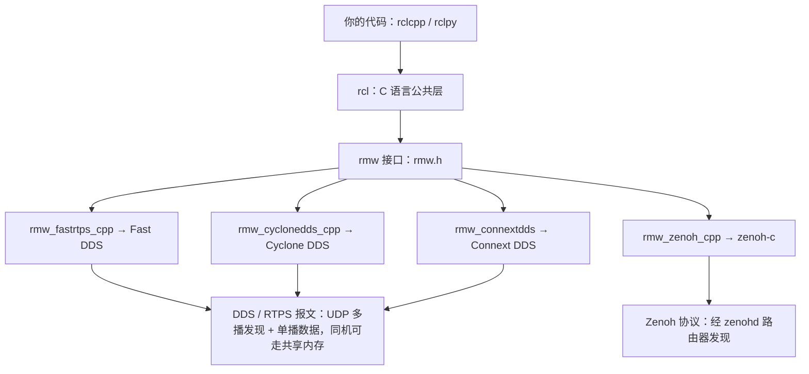

# 中间件 RMW 与 DDS

> 适用：ROS 2 **Rolling**（2026-11-17 在 `ros:rolling-ros-base` 容器里实测，Fast DDS 3.6.2；镜像里只装了 `rmw_fastrtps_cpp`）
> 来源标记：📄 仓库文档原文 · 🔍 源码或实测核实 · 💡 经验补充（可信，但请自己验证）
> 源文档：[About-Middleware.rst](../../../source/ROS-Framework/About-Middleware.rst)、[About-Middleware-Implementations.rst](../../../source/ROS-Framework/middleware/About-Middleware-Implementations.rst)、[About-Different-Middleware-Vendors.rst](../../../source/ROS-Framework/middleware/About-Different-Middleware-Vendors.rst)、[RMW-Implementations/](../../../source/Get-Started/Installation/RMW-Implementations.rst)（含 [Working-with-Zenoh.rst](../../../source/Get-Started/Installation/RMW-Implementations/Non-DDS-Implementations/Working-with-Zenoh.rst)）
> 📐 设计动机：[为什么有 ROS 2、为什么建在 DDS 上](../../design/why-ros2-dds.md)：DDS 与 ZeroMQ 等方案的取舍、"DDS 是实现细节"原则，以及 Zenoh 成为 Tier 1 后这条原则的意义

## 1. 一句话定义

RMW（ROS MiddleWare interface，中间件接口）是 `rcl` 和底层通信库之间的一层 C 接口。发现、序列化、传输这三件事都由它下面的"中间件实现"来做：默认是 Fast DDS（`rmw_fastrtps_cpp`），也可以换成 Cyclone DDS、Connext、Zenoh 等，**用 `RMW_IMPLEMENTATION` 环境变量在运行时切换，不用改代码**。📄

## 2. 为什么需要

ROS 2 没有自己写网络通信，而是把它交给成熟的中间件。你的 `create_publisher` 一路往下：



📄 DDS（Data Distribution Service，数据分发服务）是 OMG 的标准，RTPS 是它的线上协议（wire protocol）。各家 DDS 都实现同一个标准，所以 ROS 2 可以换着用。消息类型通过 `rosidl_typesupport_*` 生成各家需要的序列化代码；DDS 实现还有一个基于 X-Types 动态数据的"内省（introspection）"类型支持。

### 可选的实现（📄 文档表格）

| 产品 | 许可证 | RMW 包名 | 支持 | 怎么装 |
|---|---|---|---|---|
| eProsima Fast DDS | Apache 2 | `rmw_fastrtps_cpp` | 完整，**默认** | 随 ROS 二进制包一起装 |
| Eclipse Cyclone DDS | EPL 2.0 | `rmw_cyclonedds_cpp` | 完整 | 有二进制包 |
| RTI Connext DDS | 商业 / 研究 | `rmw_connextdds` | 完整 | Connext 本体要单独安装 |
| GurumNetworks GurumDDS | 商业 | `rmw_gurumdds_cpp` | 社区支持 | |
| Eclipse Zenoh | EPL 2.0 | `rmw_zenoh_cpp` | 完整 | Kilted 起有二进制包 |

📄 文档的定性：Cyclone DDS 较轻量，偏实时确定性；Zenoh 面向 IoT 和边缘计算，适合跨异构网络。

### 默认用哪个

📄 装了 Fast DDS 就用 Fast DDS；没装的话按包名字母序选第一个（同时装了 `rmw_cyclonedds_cpp` 和 `rmw_connextdds`，默认是 `rmw_connextdds`）。

### Zenoh 有什么不同（📄）

- 不是 DDS，节点的会话配置**默认关掉了多播发现**，靠路由器 `zenohd` 的 gossip 转发发现信息。所以必须先起路由器：`ros2 run rmw_zenoh_cpp rmw_zenohd`，没有它节点互相发现不了。
- 每个 context 对应一个 Zenoh 会话，用 liveliness token 表示节点、发布者、订阅者、服务端、客户端；服务用 queryable 实现。
- "基本上没有不兼容的 QoS"：DDS 里 reliable 订阅者收不到 best effort 发布者，Zenoh 下不会出现这种情况。
- 不支持 `ROS_AUTOMATIC_DISCOVERY_RANGE` 和 `ROS_STATIC_PEERS`（见 [Domain ID 与发现](domain-discovery.md)）；安全配置用它自己的 `zenoh_security_tools`（见 [安全 SROS2](sros2-security.md)）。

## 3. 最小用法

查当前用的是哪个：

```cpp
#include "rmw/rmw.h"
// 任何节点里都可以调用；CMake 里 find_package(rmw) 并链接 rmw::rmw
RCLCPP_INFO(get_logger(), "rmw=%s domain=%zu",
  rmw_get_implementation_identifier(),
  get_node_base_interface()->get_context()->get_domain_id());
// 🔍 输出：rmw=rmw_fastrtps_cpp domain=0
```

```bash
ros2 doctor --report | grep -A1 "RMW MIDDLEWARE"     # middleware name : rmw_fastrtps_cpp

# 切换：同一套二进制，换环境变量即可（目标 RMW 要已安装）
sudo apt install ros-rolling-rmw-cyclonedds-cpp
export RMW_IMPLEMENTATION=rmw_cyclonedds_cpp
ros2 daemon stop                                       # 让 CLI 的 daemon 也换过来

# Zenoh
sudo apt install ros-rolling-rmw-zenoh-cpp
ros2 run rmw_zenoh_cpp rmw_zenohd                      # 终端 1：路由器
RMW_IMPLEMENTATION=rmw_zenoh_cpp ros2 run <包> <节点>   # 其他终端
```

📄 源码编译工作空间里新加一个 RMW 后，要用 `colcon build --cmake-clean-cache` 重新编译，`rmw_implementation` 才会把它算进去。

## 4. 常见坑

1. **不同 RMW 之间通信不保证能通。** 📄 跨厂商 DDS 互通"不保证"（标准相同，但实现细节、默认配置不同），DDS 和 Zenoh 之间更是完全不通。💡 一个系统里所有机器、所有容器用**同一个 ROS 发行版 + 同一个 RMW**。机器人上换了 Cyclone，调试笔记本没换，表现就是"什么都看不见"。
2. **`RMW_IMPLEMENTATION` 写了没装的实现，进程直接退出。** 🔍 `RMW_IMPLEMENTATION=rmw_cyclonedds_cpp`（没装）：`Error getting RMW implementation identifier / RMW implementation not installed (expected identifier of 'rmw_cyclonedds_cpp'), with error message 'failed to load shared library 'librmw_cyclonedds_cpp.so' ...', exiting with 1.`，退出码 1。📄 只链接了一个 RMW 的源码编译版本报另一种：`Expected RMW implementation identifier of 'rmw_connextdds' but instead found 'rmw_fastrtps_cpp', exiting with 102.`
3. **daemon 还在用旧的 RMW。** 📄 改了 `RMW_IMPLEMENTATION` 后 `ros2 topic list` 等命令可能还在问旧 daemon，结果和你的节点对不上；文档示例里 daemon 进程名是 `_ros2_daemon --rmw-implementation rmw_fastrtps_cpp --ros-domain-id 0`。🔍 Rolling 里 daemon 的命令行是 `... --name ros2-daemon --ros-domain-id 0 --rmw-implementation rmw_fastrtps_cpp`。切换后先 `ros2 daemon stop`。
4. **Zenoh 忘了起路由器。** 📄 没有 `rmw_zenohd`，节点都能启动，就是互相发现不了。🔍 路由器的可执行文件名是 `rmw_zenohd`（`rmw_zenoh` 仓库 `CMakeLists.txt` 里 `add_executable(rmw_zenohd ...)`）；安全教程里写的 `ros2 run rmw_zenoh_cpp zenohd` 少了 `rmw_` 前缀。🔍 rmw_zenoh 的 README 还特别写了：Humble 的 rmw_zenoh 和更新的发行版不兼容。
5. **Fast DDS 默认的发布模式文档自相矛盾。** 📄 Fast DDS XML 教程开头说 `rmw_fastrtps` 默认同步发布，后面两处又说默认异步。🔍 以源码为准：`rmw_fastrtps` 的 README 写明默认 `SYNCHRONOUS_PUBLISH_MODE`，不设 `RMW_FASTRTPS_PUBLICATION_MODE` 时按 `SYNCHRONOUS` 处理。意思是序列化和发送在你调用 `publish()` 的线程里完成（详见 [DDS 调优](dds-tuning.md)）。
6. **"中间件是可替换的"不等于"行为一样"。** 💡 默认端口、共享内存、发现方式、资源上限各家都不同。本批卡片里的端口号、共享内存、XML 配置都是 Fast DDS 的行为；换 RMW 要重新验证。

## 5. 与其他概念的关系

- [QoS](../communication/qos.md)：rmw 把 ROS 的 QoS 翻译成各家中间件的 QoS；不兼容的组合在 DDS 下收不到数据
- [Domain ID 与发现](domain-discovery.md)：DDS 的发现机制、端口、发现范围
- [DDS 调优与 Fast DDS XML](dds-tuning.md)：超出 ROS QoS 的中间件配置
- [Docker 部署](docker-deploy.md)：容器里共享内存传输带来的坑
- [安全 SROS2](sros2-security.md)：DDS Security 插件
- [进程内通信与零拷贝](../concurrency/intra-process.md)：同进程时绕过 rmw 序列化
- 练习：[中间件、Domain 与发现](../../labs/middleware-discovery.md)
- [为什么有 ROS 2、为什么建在 DDS 上](../../design/why-ros2-dds.md)（📐 设计动机）：rmw 抽象层为什么存在
- 上一级：[总览脑图](../../map/overview.md)

## 6. 自测题（先自己答，再看[答案](../../answers/rmw-dds-answers.md)）

1. 机器人上的导航栈用默认 RMW，你在笔记本上 `export RMW_IMPLEMENTATION=rmw_cyclonedds_cpp` 后，`ros2 topic list` 能看到机器人的话题，但 `ros2 topic echo /plan` 什么也收不到。列出至少两种可能的原因，并说明每种怎么验证。
2. 同事提议"把整个系统换成 Zenoh，就不用再管 QoS 兼容和多播的问题了"。这句话哪些部分对、哪些部分有前提？换之前你要检查哪三件事？
