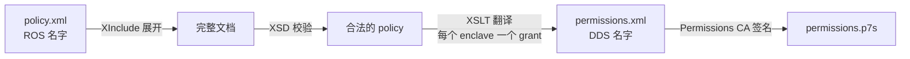

# 访问控制策略的设计：policy 为什么是 XML、为什么 DENY 优先

> 适用：ROS 2 **Rolling**（2026-11-23 在 `ros:rolling-ros-base`、sros2 0.17.1、Fast DDS 3.6.2 上实测）
> 来源标记：📐 设计文档原文 · 📄 本仓库文档原文 · 🔍 源码/实测核实 · 💡 经验补充
> 设计文档（[ros2/design](https://github.com/ros2/design) @ `93a415b`，本地副本在 `external/ros2_design/articles/`）：
> [ROS 2 Access Control Policies](https://github.com/ros2/design/blob/93a415bf928751d37fce6f83215c521658e20c93/articles/181_ros2_access_control_policies.md)（2019-08，2021-06 修订）
> 先读卡片 [安全 SROS2](../cards/middleware/sros2-security.md) 第 3 节（policy 片段、`create_permission`），以及[安全的设计](security-design.md)里"enclave 是每个进程"那一段。

## 1. 设计要回答的问题

DDS 的 `permissions.xml` 写的是 DDS 名字（`rt/chatter`、`rq/foo/get_parametersRequest`），每个服务要写请求和应答两个话题，每个动作要写五对。手写既啰嗦又容易错。所以 SROS2 要设计一种**高层的策略（policy）**：

- 用 ROS 的概念写（节点、话题、服务、动作），由工具翻译成 DDS 的 permissions 📐。
- 能校验格式、能复用公共片段、翻译逻辑不绑死在某一种编程语言上 📐。
- 默认安全：没写允许的就是拒绝 📐。

## 2. 考虑过的方案与取舍

### 四条设计原则 📐

| 原则 | 含义 | 落到 policy 上 |
|---|---|---|
| 强制访问控制（MAC，Mandatory Access Control） | 有规则允许才能访问，主体自己不能改规则，即"默认拒绝"（deny by default） | 生成的 permissions 结尾都是 `<default>DENY</default>` |
| 最小权限（PoLP，Principle of Least Privilege） | 每个主体只能访问完成任务需要的资源 | 每个节点一个 profile，只列它用到的话题和服务 |
| 权限分离（Privilege Separation） | 把权限拆小，限制漏洞的破坏范围 | 话题、服务、动作分开写；见下面的"顾虑" |
| 关注点分离（SoC，Separation of Concerns） | 加密怎么做（governance）和谁能做什么（permissions）分开 | policy 只管授权，不管加密 |

### 为什么选 XML 📐

| 需求 | XML 的做法 | 好处 |
|---|---|---|
| 校验（validation） | XSD 模式（schema） | 校验规则写在标准文件里，每种语言的工具都能用，不用各写一遍 |
| 翻译（transformation） | XSLT 模板 | 换一个模板就能翻译成另一种传输层的权限文件 |
| 组合（composition） | XInclude | 每个节点都要的"公共权限"写一次，到处引用，符合 DRY |

被否掉的方案 📐：

- **YAML**（SROS1 用的格式）：好读，但会隐式类型转换（布尔值和字符串容易混），没有模式校验，锚点和别名不能跨文件引用，表达能力也有限，写出来反而更长。
- **自定义语言**（类似 AppArmor）：最简洁，但解析器要在每种语言里各写一遍，很难保证各实现的语义一致。
- **ComArmor**（SROS2 policy 的前身）：支持 profile 嵌套导入，灵活但让翻译变复杂。最后选了**扁平的单层 profile 序列**，让 policy 作为更高层工具的"中间表示"。

### policy 的结构 📐

```xml
<policy version="0.2.0">                      <!-- 版本号，模式里固定为 0.2.0 -->
  <enclaves>
    <enclave path="/robot/nav">               <!-- 绝对路径；一个 enclave = 多个 profile 的并集 -->
      <profiles>                              <!-- type 属性：传输类型（预留） -->
        <profile ns="/" node="planner">       <!-- 一个节点一个 profile -->
          <topics publish="ALLOW"><topic>plan</topic></topics>
          <services request="ALLOW"><service>/map_server/map</service></services>
          <actions execute="ALLOW"><action>compute_path</action></actions>
        </profile>
        <!-- <metadata> 预留给传输层的额外约束，属性"待定" -->
      </profiles>
    </enclave>
  </enclaves>
</policy>
```

| 规则 | 权限属性 | 对应的角色 |
|---|---|---|
| `topics` | `publish`、`subscribe` | 发布者、订阅者 |
| `services` | `request`、`reply` | 客户端、服务端 |
| `actions` | `call`、`execute` | 动作客户端、动作服务端 |

属性值只能是 `ALLOW` 或 `DENY`。允许写空 profile：节点什么都不用，但为了 DDS 发现仍然要有身份 📐。

### 两条合并规则 📐

1. **一个 enclave 是其中所有 profile 的并集。** 因为多个节点可以组合进一个进程，而一个进程只有一个安全身份（见[安全的设计](security-design.md)）。
2. **DENY 优先于 ALLOW**，无论在同一个 profile 里，还是跨 profile。这样可以"先大范围允许，再收回一小部分敏感对象"。代价是不支持更细的嵌套限定，但翻译更简单，不容易意外放权。

### 翻译流程（Templating）📐



翻译时还会做几件事 📐：ROS 名字换成 DDS 名字；属性相同的规则合并；重复对象去掉；**DENY 规则排在前面**（DDS 按顺序匹配，先匹配到的生效）；对象按字母排序，方便看 diff。

### 设计文档自己提的顾虑 📐

- **ROS 和 DDS 之间的权限分离很弱。** 例子：允许 `/foo` 开头的话题和服务，可能顺带允许了 `/foo` 开头的动作（动作在 DDS 层就是几个话题和服务）。用 fnmatch 通配符时更严重，所以**不鼓励在权限里用通配符**。
- **关注点分离。** policy 格式故意模仿 DDS 的 permissions.xml，但不要往里加加密、发现这类和 ROS 数据流无关的东西。
- **组合性。** launch 文件可以在运行时重映射名字，静态生成的权限很难跟上。从源码推出需要哪些权限"相当于停机问题"，所以建议节点提供一份清单（manifest）或 IDL，声明自己名义上需要的接口，权限可以跟着重映射一起改。

## 3. 设计与 Rolling 现状对照

状态：✅ 按设计实现 · 🔄 实现与设计不同 · ⏳ 未实现 · 🗑️ 已过时。🔍 结果来自[练习](../labs/security-build-design-check.md)第 2 部分（[sec_design_policy.xml](../labs/design_lab/config/sec_design_policy.xml) + `sec_probe`）和 sros2 自带的模板。

| 设计文档的说法 | 状态 | Rolling 实测 |
|---|---|---|
| 用 XSD 校验 policy | ✅ | `publish="MAYBE"` 被拒：`[facet 'enumeration'] The value 'MAYBE' is not an element of the set {'ALLOW', 'DENY'}` 🔍。`version` 在模式里固定为 `0.2.0` 🔍 |
| 用 XInclude 复用公共片段 | ✅ | `<xi:include href="inc/common.xml" parse="xml"/>` 被展开，`rt/rosout` 出现在生成的权限里 🔍 |
| 用 XSLT 翻译，每个 enclave 一个 grant | ✅ | 模板在 `sros2/policy/templates/dds/permissions.xsl`；两个 profile 的 enclave 只生成 1 个 `<grant>` 🔍 |
| 同一 enclave 里 profile 取并集 | ✅（也就是说节点之间不隔离） | profile a 只允许发 `ta`、b 只允许发 `tb`：a 发 `tb`、b 发 `ta` **都成功** 🔍。生成的 `<publish>` 列表里 `rt/ta`、`rt/tb` 在一起 🔍 |
| DENY 优先于 ALLOW，跨 profile 也一样 | ✅ | profile a 允许发 `ta`、profile b 拒绝发 `ta`：a 发 `ta` 失败，`rt/ta topic denied by deny rule.` 🔍 |
| 翻译时 DENY 排在前面、对象按字母排序 | ✅ | 生成的 grant 里先是 `<deny_rule>`，再是 `<allow_rule>`；对象按字母序排列 🔍 |
| 动作翻译成底层的话题和服务 | ✅ | `call` 一个动作 `fib`：发布 3 个 `rq/fib/_action/*Request`，订阅 3 个 `rr/...Reply` 和 `rt/fib/_action/feedback`、`status` 🔍 |
| 支持 fnmatch 通配符，但不鼓励 | ✅ 确实危险 | 允许发 `fib*`，结果 `fib/_action/status`、`fib/_action/feedback`、`fib/deep/x` **全都允许** 🔍。`*` 会跨过 `/` 💡（fnmatch 不带 `FNM_PATHNAME` 时就是这样） |
| `<metadata>` 预留，属性待定 | ⏳ | 模式里 `metadata` 的类型是 `xs:anyType`，翻译模板不处理它 🔍 |
| 节点提供清单，权限跟着重映射一起生成 | ⏳ | 没有这样的清单格式 🔍。现有的办法是 `ros2 security generate_policy` 从**运行中**的图生成 policy 🔍（第 7 批练习挑战 2） |
| 额外放行 rmw 自己用的话题 | 设计文档没提 | 每个 grant 最后都追加了一条允许发布、订阅 `ros_discovery_info` 的规则（模板参数 `allow_ros_discovery_topic`）🔍。这是 rmw 用来同步"哪个参与者里有哪些节点"的 DDS 话题，见[发现与协商的设计](discovery-negotiation-design.md) |

## 4. 对写代码的影响（规划控制场景）

1. **一个进程里的节点权限是合在一起的。** profile 写得再细，也只在"进程之间"起作用 🔍。💡 导航栈放在一个组件容器里时，给容器的 enclave 写 policy，要按"容器里所有节点需要的并集"来审查，而不是看单个节点。
2. **用 DENY 兜底保护关键话题。** 例如在一个"杂项"进程的 enclave 里加 `<topics publish="DENY"><topic>/cmd_vel</topic></topics>`。DENY 优先，即使以后有人给某个 profile 加了宽泛的 ALLOW 也发不了 🔍。
3. **别用通配符授权。** `nav*` 会匹配到 `nav/_action/feedback` 等动作的内部话题 🔍。💡 要用的话至少配一条 DENY 收回动作相关的名字，并用 `grep` 检查生成的 `permissions.xml`。
4. **公共权限用 XInclude。** 每个节点都需要的 `rosout`、`/parameter_events`、参数服务写成一个文件，用 `xi:include` 引用 🔍。💡 sros2 仓库的 `test/policies/common/node/` 就是这么组织的。
5. **重映射和 policy 要一起改。** 设计文档说的"组合性"问题在 Rolling 里仍然存在 ⏳。💡 把 policy 和 launch 文件放在同一个包里，在 CI 里用 `generate_policy` 跑一遍 launch，和仓库里的 policy 做 diff。

## 5. 与其他概念的关系

- 卡片：[安全 SROS2](../cards/middleware/sros2-security.md) · [启动参数与重映射](../cards/configuration/node-arguments.md) · [动作](../cards/communication/action.md)（动作在 DDS 层是什么）
- 练习：[SROS2 密钥库、强制模式与访问控制](../labs/sros2-keystore.md)（第 4 部分）· [安全与工程化的设计还成立吗](../labs/security-build-design-check.md)（第 2 部分）
- [安全的设计](security-design.md)：为什么一个 enclave 对应一个进程
- [威胁模型](threat-model-design.md)："节点被攻破"时访问控制能挡住什么
- [ROS 图怎么映射到 DDS](graph-to-dds-mapping.md)：`rt/`、`rq/`、`rr/` 前缀
- [重映射的设计](remapping-design.md)：名字在启动时就定了
- 上一级：[总览脑图](../map/overview.md)

## 6. 自测题（先自己答，再看[答案](../answers/access-control-design-answers.md)）

1. 下面这份 policy 片段放在 enclave `/robot/misc` 里（其他公共权限省略）：

   ```xml
   <profile ns="/" node="teleop">
     <topics publish="ALLOW"><topic>cmd_*</topic></topics>
   </profile>
   <profile ns="/" node="logger">
     <topics subscribe="ALLOW"><topic>*</topic></topics>
     <topics publish="DENY"><topic>cmd_vel</topic></topics>
   </profile>
   ```

   （a）`teleop` 能不能发布 `cmd_vel`？为什么？（b）`teleop` 能不能发布 `cmd_vel_raw`、`cmd/arm`？（c）`logger` 能订阅哪些话题？这个 profile 有什么问题？
2. 你们的 `controller_server` 平时由 launch 启动，名字是 `/controller_server`。现在要在同一台机器上跑两份（双臂各一份），launch 里用 `namespace="left"` 和 `namespace="right"` 启动。（a）原来的 policy 不改，两份控制器能启动吗？会在哪一步失败？（b）按设计文档"组合性"那段的思路，你怎么组织 policy 和 launch，让这种复用不用每次手改 XML？
