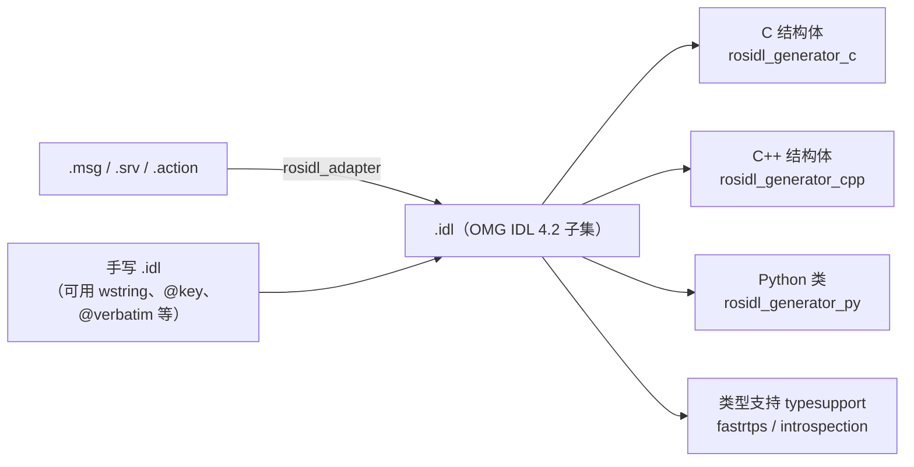

# 接口定义的设计：`.msg` 为什么要先变成 `.idl`，生成的 C++ 结构体为什么长这样

> 适用：ROS 2 **Rolling**（2026-11-23 在 `ros:rolling-ros-base`、`rosidl_generator_cpp` 5.3.2、`rmw_fastrtps_cpp` 9.6.1 上实测）
> 来源标记：📐 设计文档原文 · 📄 本仓库文档原文 · 🔍 源码/实测核实 · 💡 经验补充
> 设计文档（[ros2/design](https://github.com/ros2/design) @ `93a415b`）：
> [Interface definition using .msg / .srv / .action files](https://github.com/ros2/design/blob/93a415bf928751d37fce6f83215c521658e20c93/articles/116_legacy_interface_definition.md)（2019-03，2021-02 修订；取代了 [110_interface_definition](https://github.com/ros2/design/blob/93a415bf928751d37fce6f83215c521658e20c93/articles/110_interface_definition.md)）、
> [IDL - Interface Definition and Language Mapping](https://github.com/ros2/design/blob/93a415bf928751d37fce6f83215c521658e20c93/articles/115_idl.md)（2019-03，2020-07 修订）、
> [Generated C++ interfaces](https://github.com/ros2/design/blob/93a415bf928751d37fce6f83215c521658e20c93/articles/112_generated_interfaces_cpp.md)（2015-06，2019-03 修订）、
> [Mapping between ROS interface types and DDS IDL types](https://github.com/ros2/design/blob/93a415bf928751d37fce6f83215c521658e20c93/articles/111_mapping_dds_types.md)（2015，早期映射表，部分已过时）、
> [Unicode Support](https://github.com/ros2/design/blob/93a415bf928751d37fce6f83215c521658e20c93/articles/117_wide_strings.md)（2019-05）
> 先读卡片 [接口定义](../cards/communication/interface-definition.md)（文件语法、CMake 写法）。

## 1. 设计要回答的问题

- **保留 ROS 1 的 `.msg`。** 格式简单，社区多年演化出的消息本身就是宝贵的"语义"，很多代码的结构就是由消息决定的。📐
- **但 DDS 用的是 OMG IDL。** 要能和 DDS 对接，还要生成 C、C++、Python 等语言的类型。📐
- **实时和嵌入式要能预分配内存。** ROS 1 的数组和字符串都没有上限，算不出消息的最大尺寸。📐
- **ROS 1 的生成代码有冲突。** `.msg` 和 `.srv` 同名时生成的代码冲突；ros1_bridge 需要在一个编译单元里同时 include ROS 1 和 ROS 2 的同名消息。📐
- **消息定义会演化。** 加一个字段，不应该让已有代码以隐蔽的方式出错。📐

## 2. 设计决定与理由

### 管线：一切先变成 `.idl` 📐

Dashing 起，`.msg` 只是一种"简化写法"，先转换成 `.idl` 再生成代码；`.idl` 能表达 `.msg` 表达不了的东西（例如 `@key` 键控字段，见 [话题进阶](../cards/communication/topic-advanced.md)）。空结构体会被塞进一个占位成员 `uint8 structure_needs_at_least_one_member`，因为 IDL 不允许空结构体。📐 🔍（`std_srvs/srv/Empty` 的生成代码里就有）

### 类型映射：几处"反直觉"的地方 📐

| ROS 类型 | IDL 类型 | 设计文档的 C++ 映射 | 理由 |
|---|---|---|---|
| `byte` | `octet` | `std::byte`（没有就用 `unsigned char`） | ROS 1 里 `byte` 是 `int8` 的旧别名；IDL 的 `octet` 是"不透明的 8 位量" |
| `char` | `uint8` | `unsigned char` | 和 ROS 1 保持一致：ROS 1 里 `char` 是 `uint8` 的旧别名（所以不是字符！） |
| `string` | `string` | `std::string` | 内容按 **UTF-8**（DDS-XTypes 规定），但不保证检查 |
| `wstring` | `wstring` | `std::u16string` | 为了和用 `wstring` 的原生 DDS 程序互通，UTF-16；新消息应优先用 `string` |
| `T[N]` | `T[N]` | `std::array<T, N>` | 定长 |
| `T[]` | `sequence<T>` | `std::vector<T>` | 变长 |
| `T[<=N]` | `sequence<T, N>` | 112 说"自定义类"，115 说 `std::vector` | 有上限才能预分配 |
| `string<=N` | `string<N>` | `std::string` | 同上 |

### 生成的 C++ 结构体 📐

| 设计 | 理由 |
|---|---|
| 命名空间 `包名::msg`、`包名::srv`、`包名::action` | 不和 ROS 1 的符号冲突（ros1_bridge 要同时 include 两边），`.msg` 和 `.srv` 同名也不冲突 |
| 模板结构体 `Foo_<Allocator>` + 别名 `Foo` | 可以换分配器（实时场景） |
| 构造函数接受 `MessageInitialization`：`ALL`（默认，填默认值或零）、`SKIP`（什么都不做）、`ZERO`（全部清零，**忽略**消息里写的默认值）、`DEFAULTS_ONLY`（只填有默认值的字段） | 大消息构造后通常马上会被覆盖，全量初始化是浪费；`DEFAULTS_ONLY` 保证"以后给消息加一个带默认值的字段"时旧代码也能得到正确初始化 |
| **没有按位置传字段的构造函数**，只有 `set__字段名()` setter，可以链式调用 | 依赖位置参数的代码在消息定义改动时会**隐蔽地**出错，这会让大家不敢改消息 |
| `==`、`!=` 按成员比较；`SharedPtr`、`UniquePtr` 等指针别名；`Ptr`、`ConstPtr` 保留但弃用 | 方便；和 ROS 1 相似 |
| 约束（定长、上限）**只保证在发布时检查** | 各语言检查的时机和代价不同；用户应假设"任何时候都可能检查" |

## 3. 设计与 Rolling 现状对照

状态：✅ 按设计实现 · 🔄 实现与设计不同 · ⏳ 未实现 · 🗑️ 已过时。🔍 结果来自[练习](../labs/design-claims-check.md)第 5 部分（`msg_init_bench`）和生成的头文件。

| 设计文档的说法 📐 | 状态 | Rolling 现状 🔍 |
|---|---|---|
| `byte` → `std::byte` | 🔄 | `std_msgs/Byte` 的 `_data_type` 是 `unsigned char` |
| `char` → `char`（112）/ `unsigned char`（115） | 🔄 | `std_msgs/Char` 的 `_data_type` 是 `uint8_t`。112 的 `char` 已过时 |
| 有界数组 → 自定义类 | ✅ | `rosidl_runtime_cpp::BoundedVector`；`resize(1001)` 超过 `[<=1000]` **立刻**抛 `Exceeded upper bound` |
| 有界字符串 `string<=N` → `std::string`，约束发布时检查 | 🔄 | `string<=8` 赋 20 个字符：赋值、`rclcpp::Serialization` 序列化（走当前 RMW 的类型支持）、反序列化**都不报错**，订阅端拿到完整的 20 个字符；Python 赋值也不报错 |
| `uint8[]` → `std::vector<uint8_t>` | 🔄 | Rolling 里变成 `rosidl::Buffer`（第 4 批发现，见 [进程内通信](../cards/concurrency/intra-process.md)），设计文档没有 |
| 数值常量生成为 `enum` | 🔄 | 生成 `static constexpr uint8_t STATUS_OK = 0u;` |
| 头文件：`foo.hpp` 只 include `foo__struct.hpp`，以后再加其他功能文件 | ✅ 扩展了 | `detail/` 下有 `__struct.hpp`、`__traits.hpp`、`__builder.hpp`、`__type_support.hpp`、`__rosidl_typesupport_fastrtps_cpp.hpp`、`__rosidl_typesupport_introspection_cpp.hpp` 等 |
| 没有位置参数构造函数，只有 setter 链 | ✅ + 新增 | setter 链 `set__width(512).set__height(512)` 可用；另外多了 **builder**：`build<PathStatus>().header(h).status(s).length_m(l).waypoints(w)` 必须按顺序给全所有字段才得到消息，消息加字段后旧代码**编译失败**而不是静默少初始化 |
| `MessageInitialization` 四种模式 | ✅ | `ALL`：resolution=0.05，cells 清零；`ZERO`：resolution=**0.00**（忽略默认值）；`DEFAULTS_ONLY`：resolution=0.05，cells 未初始化。1 MB 消息构造耗时：ALL ≈ 23 µs，**ZERO ≈ 47–57 µs**（生成代码里 ZERO 分支把数组清零了两次），DEFAULTS_ONLY / SKIP ≈ 0 |
| `Ptr`、`ConstPtr` 弃用 | ✅ | 仍在，带 `deprecated` 属性 |
| 默认值不支持嵌套消息字段 | ✅ 仍是如此 | 见卡片常见坑 7 |
| IDL 枚举（enum）暂不支持 | ⏳ | 仍用整数常量代替 💡 |
| `string` 应是 UTF-8，但不强制检查 | ✅ | 📐 未实测 |

## 4. 对写代码的影响（规划控制场景）

1. **大消息在热路径上构造时用 `SKIP` 或 `DEFAULTS_ONLY`**，例如每帧都要重填的 1 MB 栅格、点云：默认的 `ALL` 每次都会把整个定长数组清零（实测 ≈ 23 µs/MB），而你马上又要覆盖它。前提是你确实会写满每个字段，否则就是读未初始化内存。别用 `ZERO` 图省事，它反而最慢 🔍。更好的办法是复用消息对象或用借用消息（见 [进程内通信与零拷贝](../cards/concurrency/intra-process.md)）。💡
2. **构造消息用 setter 链或 builder，别依赖字段顺序。** 想让"消息加字段后所有构造点都必须更新"，用 builder，编译器会帮你找出来 🔍。
3. **`string<=N` 的上限别当成校验。** 在 Fast DDS 上它从头到尾都没被检查过 🔍；如果下游真的依赖长度（例如固定长度的设备 ID、写入定长缓冲区），在发布前、接收后自己检查。有界数组（`[<=N]`）倒是在修改时就会抛异常，要准备好处理。
4. **`char` 不是字符，`byte` 不是 `int8`。** 和 ROS 1 代码互通、或者用 `char` 存 ASCII 时，C++ 里拿到的是 `uint8_t` 🔍；打印要转换类型。💡
5. **需要键控话题、`wstring`、注释透传等功能时直接写 `.idl`**，`.msg` 是功能子集。📐
6. **改接口后重编所有依赖包。** 生成代码是编译进你的二进制的；消息的类型哈希也会变（见卡片常见坑 6）。

## 5. 与其他概念的关系

- 卡片：[接口定义](../cards/communication/interface-definition.md)、[话题进阶](../cards/communication/topic-advanced.md)（`.idl` 的 `@key`）、[进程内通信与零拷贝](../cards/concurrency/intra-process.md)（`rosidl::Buffer`、借用消息）、[实时编程](../cards/concurrency/realtime.md)（分配器、预分配）
- 上一层：[为什么有 ROS 2、为什么建在 DDS 上](why-ros2-dds.md)（为什么保留 `.msg`）
- 练习：[设计文档的说法在 Rolling 里还成立吗](../labs/design-claims-check.md)（第 5 部分）
- 上一级：[总览脑图](../map/overview.md)

## 6. 自测题（先自己答，再看[答案](../answers/interface-design-answers.md)）

1. 局部规划器每 50 ms 发一张 `FixedGrid`（1 MB 定长数组 + `float64 resolution 0.05`），代码是 `auto msg = std::make_unique<FixedGrid>(); fill(*msg); pub->publish(std::move(msg));`，其中 `fill` 会写满 `cells`，但**不写** `resolution`。同事建议把构造改成 `FixedGrid(MessageInitialization::SKIP)` 省时间。（a）这样改之后 `resolution` 是多少？（b）该用哪种模式？（c）如果再进一步改成 `ZERO`，会更快吗？
2. 设计文档说生成的结构体"故意不提供按位置传字段的构造函数"。（a）举一个"如果有位置构造函数，改消息定义后代码隐蔽出错"的具体例子（提示：两个相邻的同类型字段）。（b）setter 链和 builder 都不依赖位置，二者在"消息加了新字段"时的表现有什么不同？各适合什么场景？
