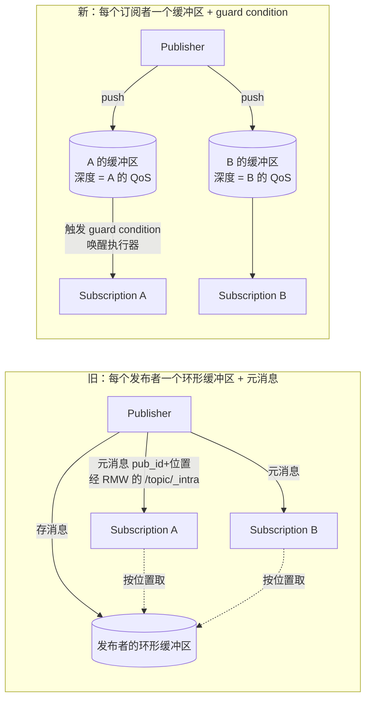

# 进程内通信与零拷贝的设计：缓冲区放哪、什么时候复制、借用消息

> 适用：ROS 2 **Rolling**（2026-11-23 在 `ros:rolling-ros-base`、rclcpp 33.2.0、rmw_fastrtps_cpp 9.6.1、Fast DDS 3.6.2 上实测）
> 来源标记：📐 设计文档原文 · 📄 本仓库文档原文 · 🔍 源码/实测核实 · 💡 经验补充
> 设计文档（[ros2/design](https://github.com/ros2/design) @ `93a415b`，本地副本在 `external/ros2_design/articles/`）：
> [Intra-process Communications in ROS 2](https://github.com/ros2/design/blob/93a415bf928751d37fce6f83215c521658e20c93/articles/intraprocess_communication.md)（2020-03）、
> [Zero Copy via Loaned Messages](https://github.com/ros2/design/blob/93a415bf928751d37fce6f83215c521658e20c93/articles/zero_copy.md)（2020-02，2020-04 修订）
> 先读卡片 [进程内通信与零拷贝](../cards/concurrency/intra-process.md)（回调签名决定是否复制、`KeepAll` 的坑、借用消息只对定长类型生效）。

## 1. 设计要回答的问题

同一进程里的节点之间传消息，本来不需要序列化，也不需要经过网络栈。Dashing 时代的进程内通信（intra-process communication）已经能用，但它有几个硬伤 📐：

- **QoS 不完整**：不支持 `transient_local`；历史深度也没有正确执行。每个发布者只有**一个**环形缓冲区，订阅者收到的"元消息"指向的位置可能已经被覆盖，于是消息丢了，而进程间通信不会丢。
- **依赖 RMW**：每发一条消息，还要通过 RMW 发一条"元消息"（发布者 id + 缓冲区位置），话题是 `/话题名/_intra`。发元消息的开销和发一条小的进程间消息一样，所以消息至少 5 KB 时进程内通信才划算。每个发布者、订阅者还要多建一个 `_intra` 实体，在 Fast-RTPS 上这部分内存随实体数量增长得很快。
- **进程内外都有订阅者时更糟**：RMW 还是会把进程间消息也送给同进程的订阅者，然后丢掉；元消息也可能送到别的进程去。实测"Sierra Nevada + 外部调试节点"时，打开旧的进程内通信反而比不打开还慢（1100 μs 对 800 μs）。

零拷贝（zero copy）是另一个问题 📐：要彻底消除复制，用户需要更多地控制内存，也就是让中间件把消息"借"给用户填（loaned message）。像 Connext Micro、iceoryx 这类中间件，借出来的内存本身就在共享内存里。

## 2. 考虑过的方案与取舍

### 缓冲区放在发布者一侧，还是每个订阅者一份 📐

| 方案 | 优点 | 缺点 |
|---|---|---|
| 旧：发布者一个缓冲区 + 通过 RMW 发元消息 | 可靠性等 QoS 交给 RMW 去执行 | 上面列的那些问题 |
| **新：每个订阅者一个缓冲区，完全不经过中间件** | 每个订阅者的 QoS 各管各的，实现简单；多个订阅者可以并行取消息，互不阻塞 | 资源复用少一些，但多出的内存和整个程序相比微不足道 |

新设计的细节 📐：

- **订阅者缓冲区的数据类型**可以是 `MessageT`、`shared_ptr<const MessageT>` 或 `unique_ptr<MessageT>`，由 `SubscriptionOptions` 选。默认值 `CallbackDefault` 会根据回调签名自动选 shared 或 unique。
- 订阅者创建一个 `SubscriptionIntraProcessWaitable`（现在叫 `SubscriptionIntraProcess`）。有消息进缓冲区时就触发它的 guard condition，唤醒执行器。
- **每次 `publish()` 时决定**只走进程内、只走进程间，还是两边都走。例如所有订阅者都在本进程时，就只走进程内。
- **QoS 怎么处理**：
  - `keep_last` 时缓冲区就是深度为 depth 的环形缓冲区；`keep_all` 时缓冲区是无界 FIFO，上限是中间件的资源限制。
  - 可靠性（reliability）只用来判断两端兼容不兼容。消息放进缓冲区就不会丢，所以 reliable 和 best_effort 都算满足了。
  - `transient_local` 时，发布者一侧也有一个缓冲区（存 `shared_ptr`），晚到的订阅者从这里取历史。而且这种发布者**总是同时走进程内和进程间**，因为说不定以后会有别的进程的 `transient_local` 订阅者加入。

### 什么时候复制 📐

不管用户发布什么类型，最后都会走到 `publish(unique_ptr)`，再由 IntraProcessManager 按订阅者要不要所有权来决定复制几次。设订阅者共 $N$ 个，其中 $M$ 个要所有权（`unique_ptr` 缓冲区）：

| 情形 | 复制次数 |
|---|---|
| 全都要所有权（$M=N$） | $N-1$，最后一个直接拿走原件 |
| 都不要所有权（$M=0$） | 0，大家共享同一个 `shared_ptr` |
| 只有 1 个不要所有权 | $N-1$ |
| 2 个以上不要所有权 | $M$：不要所有权的订阅者共享 1 份，要所有权的另外复制 $M-1$ 份 💡（推导：设计文档的表里，共享的那份也是复制出来的） |
| 进程内外都有订阅者 | 先把 `unique_ptr` 转成 `shared_ptr`，要所有权的订阅者每个都复制一份，没法省 |

另外，缓冲区类型可以和回调类型不同。例如 $N$ 个 `UniquePtr` 回调的订阅者经常来不及处理、消息被覆盖，把缓冲区设成 `SharedPtr` 后，推进缓冲区时不复制，等订阅者真正取消息时才复制 📐。

设计文档还给了实测数据 📐（Dashing，i7 笔记本，Fast-RTPS）：

| 拓扑 | 不开进程内 | 旧的进程内 | 新的进程内 |
|---|---|---|---|
| Mont Blanc（20 节点，有 250 KB 的话题） | 1050 μs | 750 μs | **160 μs** |
| Sierra Nevada + 外部调试节点 | 800 μs | 1100 μs | **180 μs** |

**开放问题** 📐：一个订阅者同时收进程内和进程间的消息时，两边各有一个深度为 depth 的队列，最多能攒 2 × depth 条。

### 借用消息的 API（zero_copy）📐

| 层 | 发布端 | 订阅端 |
|---|---|---|
| rmw | `rmw_borrow_loaned_message`、`rmw_publish_loaned_message`、`rmw_return_loaned_message` | `rmw_take_loaned_message`、`rmw_release_loaned_message` |
| rcl | 同名的 `rcl_*`，外加 `rcl_publisher_can_loan_messages` | 同名的 `rcl_*`，外加 `rcl_subscription_can_loan_messages` |
| rclcpp | `LoanedMessage<MsgT>`、`Publisher::loan_message()`、`publish(LoanedMessage)`、`can_loan_messages()` | `Subscription::can_loan_messages()`；用执行器时借不借由库决定，回调不用关心 |

需求里有几条要记住：用户必须能在至少一种配置下**完全避免内存操作和复制**；中间件借不出来时，退回用户提供的分配器；借出的消息要尽快还，否则中间件的资源耗尽，消息会丢或者发布会卡住。环境变量 `ROS_DISABLE_LOANED_MESSAGES` 可以不改代码就关掉借用。文档写的是"**默认**会尝试从中间件借"。

## 3. 设计与 Rolling 现状对照

状态：✅ 按设计实现 · 🔄 实现与设计不同 · ⏳ 未实现 · 🗑️ 已过时。🔍 结果来自[练习](../labs/perf-design-check.md)第 2 部分（`ipc_design_probe`）和 rclcpp、rcl 的头文件。

| 设计文档的说法 | 状态 | Rolling 实测 |
|---|---|---|
| 每个订阅者一个缓冲区，深度等于该订阅者的 depth | ✅ | 发布者深度 10，先发 0..7 再 spin：深度 2 的订阅者收到 `[6,7]`，深度 5 的收到 `[3,4,5,6,7]` 🔍 |
| 不再有 `/话题名/_intra` 元消息话题 | ✅ | 开了进程内通信后，图里只有 `/parameter_events`、`/rosout` 和业务话题 🔍 |
| `keep_all` 时缓冲区是无界 FIFO | 🔄 | **直接不让用**：发布者和订阅者用 `KeepAll` 都会抛异常 `intraprocess communication on topic '...' allowed only with keep last history qos policy` 🔍 |
| 可靠性只用来判断兼容性 | ✅ | best_effort 发布 → reliable 订阅：收到 0/5，并打印不兼容警告；reliable 发布 → best_effort 订阅：收到 5/5。关掉进程内通信，结果一样 🔍 |
| `transient_local` 时晚到的订阅者能拿到历史 | ✅ | 深度 3，先发 0..4：晚到的 `transient_local` 订阅者收到 `[2,3,4]`，`volatile` 订阅者什么都收不到 🔍 |
| `transient_local` 的发布者总是同时走进程间 | ✅ | 发的时候只有进程内订阅者，发完之后才出现一个只能走 DDS 的 `transient_local` 订阅者，它照样收到 `[2,3,4]` 🔍 |
| 缓冲区类型可选，默认 `CallbackDefault` | ✅ | `SubscriptionOptions::intra_process_buffer_type` 默认是 `CallbackDefault`；`PublisherOptions` 里也有这个字段，默认 `SharedPtr`（给 transient_local 用）🔍 |
| 两个 `UniquePtr` 订阅者复制 $N-1=1$ 次 | ✅ | 默认缓冲区：一个拿到原件，一个拿到副本 🔍 |
| 缓冲区设成 `SharedPtr` 时，取消息时才复制 | ✅ | 两个 `UniquePtr` 订阅者**都**拿到副本（同一个地址出现两次，因为第一份用完被释放后，同一块内存又被分配给了第二份）🔍 💡 |
| `publish(shared_ptr)`、`publish(MessageT *)` 已弃用 | 🗑️ 已删除 | Rolling 的 `Publisher::publish` 只剩 `unique_ptr`、`const T &`、序列化消息、`LoanedMessage` 这几个重载 🔍 |
| 开放问题：同时收进程内外消息时队列翻倍 | ⏳ 仍然存在 | 订阅者深度 3，同进程里一个开进程内通信的发布者发 5 条、一个关掉进程内通信的发布者发 5 条：**收到 6 条** `[202,102,203,103,204,104]` 🔍 |
| rclcpp 的借用 API：`loan_message()`、`LoanedMessage::is_consistent()` | 🔄 改名 | 方法叫 `borrow_loaned_message()`；`LoanedMessage` 上是 `is_valid()`，没有 `is_consistent()` 🔍 |
| 中间件借不出来时退回本地分配器 | ✅ | `String` 发布者借不了，日志打印 `Currently used middleware can't loan messages. Local allocator will be used.` 🔍 |
| **默认**尝试借用 | 🔄 只有发布端 | rcl 的默认值：发布者 `disable_loaned_message = false`（`ROS_DISABLE_LOANED_MESSAGES=1` 才关）；**订阅者 `disable_loaned_message = true`**（`ROS_DISABLE_LOANED_MESSAGES=0` 才开）🔍。实测默认时 `Float64` 发布者能借、订阅者不能借 🔍 |
| 借用消息能做到零拷贝 | ✅ 有条件 | 同一进程、关掉进程内通信、设 `ROS_DISABLE_LOANED_MESSAGES=0` 时，订阅者收到的地址和借出的地址**相同** 🔍；默认设置下地址不同 🔍 |
| 借用消息和进程内通信能叠加 | ⏳ | `publish(LoanedMessage)` 在能借时只调 `rcl_publish_loaned_message`，不走 IntraProcessManager 🔍（源码）。开进程内通信的节点发借用消息，同进程订阅者照样收到，但地址不同 🔍 |

## 4. 对写代码的影响（规划控制场景）

1. **每个消费者按自己的需要设 depth。** 缓冲区在订阅者一侧，代价地图订阅点云可以设深度 1（只要最新的），记录节点同一个话题设深度 50，互不影响 🔍。
2. **开了进程内通信就别用 `KeepAll`。** 发布者和订阅者两端都会抛异常 🔍。要"尽量不丢"，就用 `KeepLast` 配一个足够大的 depth。
3. **只读的消费者用 `ConstSharedPtr`；多个 `UniquePtr` 消费者经常处理不过来时，把缓冲区设成 `SharedPtr`。** 这样被覆盖掉的消息不会白复制，复制推迟到真正处理时 📐 🔍。
4. **同时被 rviz、`ros2 bag` 订阅时，同进程订阅者的队列会翻倍。** 深度 3 实测能攒 6 条 🔍。如果你靠 depth 限制延迟（例如"最多积压 1 帧"），算延迟时要按两倍算。💡
5. **地图这类 `transient_local` 话题放进组件容器也没问题。** 晚启动的 rviz、`ros2 bag` 照样能拿到历史 🔍。
6. **两套零拷贝机制选一个，不要叠加。** 同进程用进程内通信 + `unique_ptr`；同主机跨进程用借用消息 + 定长类型（像本仓库的 `FixedBlock`：没有 `string`、没有变长数组）+ 共享内存传输。借用消息的订阅端默认是关的，要设 `ROS_DISABLE_LOANED_MESSAGES=0` 🔍。💡 跨进程真的零拷贝还要看 Fast DDS 的共享内存或 data sharing 配置，本练习只测了同进程。

## 5. 与其他概念的关系

- 卡片：[进程内通信与零拷贝](../cards/concurrency/intra-process.md) · [组件与组合](../cards/concurrency/component.md) · [QoS](../cards/communication/qos.md)
- 练习：[进程内通信与零拷贝](../labs/intra-process-zero-copy.md) · [并发与性能的设计还成立吗](../labs/perf-design-check.md)（第 2 部分）
- [QoS 的设计](qos-design.md)：可靠性、持久性、兼容规则
- [ROS 图怎么映射到 DDS](graph-to-dds-mapping.md)：同进程的节点共用一个参与者
- [实时系统的设计](realtime-design.md)：IntraProcessManager 里还有系统分配
- [rmw 接口与序列化的设计](rmw-serialization-design.md)：进程间路径上的序列化成本
- 上一级：[总览脑图](../map/overview.md)

## 6. 自测题（先自己答，再看[答案](../answers/intra-process-design-answers.md)）

1. 一个组件容器里，激光驱动发布 `/scan`（KeepLast 5），同容器里有代价地图（`UniquePtr` 回调，depth 1）和障碍物检测（`UniquePtr` 回调，depth 5）两个订阅者，三个节点都开了进程内通信。（a）每发一帧，IntraProcessManager 复制几次？哪个订阅者拿到原件是确定的吗？（b）代价地图处理很慢，大部分帧都被覆盖掉了。怎样改能少复制？为什么？（c）这时有人在另一台电脑上开了 rviz 订阅 `/scan`，复制次数会变吗？
2. 同事说："借用消息是 ROS 2 的零拷贝，进程内通信也是零拷贝，两个都打开肯定最快。"（a）根据本篇的实测，在 Rolling 上两个一起开时，`publish(LoanedMessage)` 走的是哪条路？（b）他还发现订阅端 `can_loan_messages()` 一直是 `false`，原因是什么？怎么打开？（c）如果他的消息是 `sensor_msgs/PointCloud2`，能借用吗？
