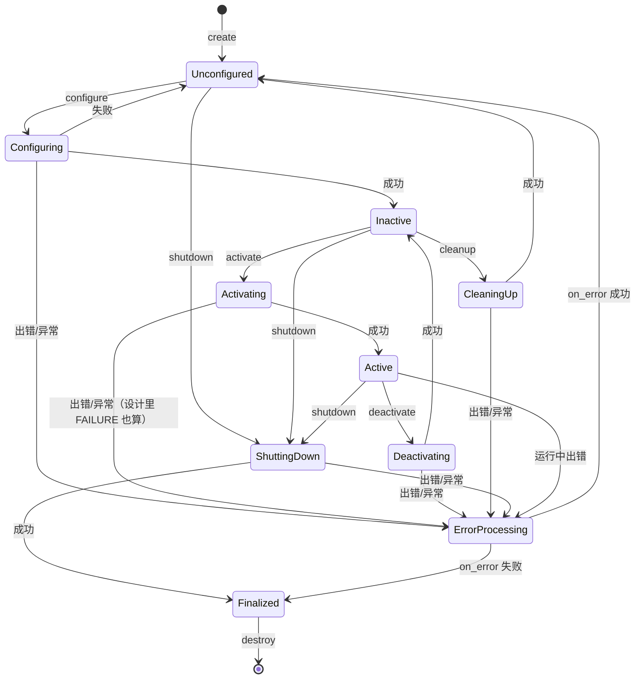

# 生命周期的设计：为什么是 4 个主状态，失败和出错分别去哪

> 适用：ROS 2 **Rolling**（2026-11-23 在 `ros:rolling-ros-base`、rclcpp_lifecycle 33.2.0、launch_ros 0.30.3 上实测）
> 来源标记：📐 设计文档原文 · 📄 本仓库文档原文 · 🔍 源码/实测核实 · 💡 经验补充
> 设计文档（[ros2/design](https://github.com/ros2/design) @ `93a415b`，本地副本在 `external/ros2_design/articles/node_lifecycle.md`）：
> [Managed nodes](https://github.com/ros2/design/blob/93a415bf928751d37fce6f83215c521658e20c93/articles/node_lifecycle.md)（2015-06，2021-02 修订）。文中的状态机图用的是 `/img/...` 绝对路径，离线不显示，图在 `external/ros2_design/img/node_lifecycle/`
> 先读卡片 [生命周期节点](../cards/configuration/lifecycle-node.md)（回调写法、`LifecyclePublisher`、命令行操作）。

## 1. 设计要回答的问题

ROS 1 的节点一启动就开始干活，外部无法知道它"准备好了没有"，也不能在不杀进程的情况下让它暂停、重新配置 📐。设计文档想要的是：

- launch 能确认所有组件都正确创建之后，才让它们开始干活。
- 节点能在线重启或替换。
- 托管节点对外是一个"黑盒"：有固定的接口，按固定的状态机运行。节点内部怎么实现由开发者决定，管理工具只依赖接口，所以对任何节点都能用 📐。

## 2. 考虑过的方案与取舍

### 状态机 📐

| 决定 | 理由 📐 |
|---|---|
| **4 个主状态**：Unconfigured、Inactive、Active、Finalized | 离开主状态都要靠外部的监督进程触发；唯一的例外是 Active 状态下出错 |
| **6 个转换状态**：Configuring、CleaningUp、ShuttingDown、Activating、Deactivating、ErrorProcessing | 转换中执行用户代码，由结果决定去哪个主状态 |
| configure 里做"一辈子只做一次"的事（长期持有的内存、不变的发布订阅） | activate 只做最后准备，例如拿到硬件的使用权；不要在 activate 里做很耗时的初始化 |
| Inactive 时**不处理任何数据**：受管理的话题不读、受管理的服务请求立刻失败 | 这样可以在不改变运行行为的前提下重新配置 |
| 有一个 Finalized 状态，而不是直接销毁 | 失败的节点仍然能被内省、被调试工具查看 |
| 管理接口**不受状态限制** | 不然节点 Inactive 时就没法再激活它了 |
| 每个转换对应一个同名服务（`configure`、`activate`……），外加一个**锁存**的 `lifecycle_state` 话题 | 管理工具调服务驱动转换，订阅话题就能知道状态变化，后加入的订阅者也能拿到当前状态 |
| **不允许扩展状态**；应用自己的状态机放在某个生命周期状态"里面" | 整个工具链都要支持这套状态机，扩展会让工具失效 |
| 不鼓励节点"自己管自己" | 会干扰外部管理逻辑；但可以提供参数，在没有管理者的系统里自动 configure 加 activate |

## 3. 设计与 Rolling 现状对照

状态：✅ 按设计实现 · 🔄 实现与设计不同 · ⏳ 未实现 · 🗑️ 已过时。🔍 结果来自[练习](../labs/config-design-check.md)第 3 部分（`lifecycle_design_probe`）。

| 设计文档的说法 | 状态 | Rolling 实测 / 源码 |
|---|---|---|
| 4 个主状态 + 6 个转换状态 | ✅ | 与 `lifecycle_msgs/msg/State` 的常量一致 |
| on_activate 返回"成功以外的任何结果"都进 ErrorProcessing | 🔄 | 返回 **FAILURE** 时回到 **Inactive**，不进 ErrorProcessing；返回 **ERROR** 或**抛异常**才进 ErrorProcessing 🔍。也就是说 FAILURE 表示"这次没成功，退回原状态"，ERROR 表示"出错了，要清理" |
| 回调里抛异常进 ErrorProcessing | ✅ | 日志 `Caught exception in callback for transition 13`、`Original error: lidar not responding`，然后调用 `on_error` 🔍 |
| on_error 成功回到 Unconfigured，失败进 Finalized | ✅ | 两种都实测到了 🔍。传给 `on_error` 的"来源状态"是 `inactive`，即转换开始前的主状态，而不是 `activating` 🔍 |
| 从 Unconfigured、Inactive、Active 都能直接 shutdown | ✅ | 三种都进 Finalized；`on_shutdown` 收到的来源状态分别是 unconfigured、inactive、active 🔍 |
| Finalized 只能 destroy | ✅ | 再请求 configure：状态不变，日志 `No transition matching 1 found for current state finalized`。**注意**带返回码参数的 `configure(rc)` 在这种情况下**不会写 rc**，变量保持调用前的值 🔍 |
| 每个转换一个同名服务 | 🔄 | 只有一个 `~/change_state` 服务（参数是转换 id），另有 `~/get_state`、`~/get_available_states`、`~/get_available_transitions`、`~/get_transition_graph` 🔍 |
| 锁存的 `lifecycle_state` 话题 | 🔄 | 话题名是 `~/transition_event`，QoS 为 depth 10、reliable、**volatile**，**不是锁存的** 🔍。后启动的监控节点收不到之前的状态变化，要先调一次 `get_state` |
| Inactive 时受管理的话题不读、服务请求立刻失败 | 🔄 只管发布者 | 只有 `LifecyclePublisher` 是受管理的：Inactive 时发布被丢弃并打一条警告。订阅、服务、定时器都照常工作（见卡片坑 2、4）🔍 |
| 管理接口不受状态限制 | ✅ | 任何状态下 `change_state` 和 `get_state` 都能用 |
| 可以提供参数，自动 configure 加 activate | ✅ | `launch_ros.actions.LifecycleNode(autostart=True)` 🔍（源码），默认 `False`；Nav2 的 lifecycle manager 也是这个思路 💡 |
| launch 可以据生命周期事件编排 | ✅ | 见 [launch 的设计](launch-design.md) |
| 节点销毁前应进入 Finalized | 🔄 只打警告 | 进程退出时节点还在 Active，只有警告 `LifecycleNode is not shut down: Node still in state(3) in destructor`，不会自动走 shutdown（见卡片坑 6）🔍 |

## 4. 对写代码的影响（规划控制场景）

1. **分清 FAILURE 和 ERROR。** 例如驱动 activate 时发现雷达还没上电，"稍后可以重试"就返回 FAILURE，节点留在 Inactive，管理者可以再试 activate 🔍。资源已经处于不一致的状态，就返回 ERROR 或抛异常，让 `on_error` 清理干净回到 Unconfigured 🔍。
2. **`on_error` 要能从任何状态清理干净。** 设计文档要求：从 Active 进入 ErrorProcessing 时，`on_error` 要同时完成 deactivate 和 cleanup 的工作 📐。它收到的来源状态参数可以帮你判断已经拿到了哪些资源 🔍。清理不了就返回 FAILURE，节点进 Finalized 等待被销毁。
3. **不要指望 Inactive 能挡住数据。** 订阅回调、服务、定时器照常运行 🔍。控制器在 Inactive 时如果还在算 `/cmd_vel`，虽然 `LifecyclePublisher` 会把消息丢掉，CPU 照样被占用；而用普通发布者发出的消息**不会**被挡住。💡 在回调开头检查状态，或者在 `on_deactivate` 里取消定时器。
4. **监控生命周期状态时先调 `get_state`，再订阅 `transition_event`**，因为它不是锁存话题 🔍。
5. **用本地 API 驱动转换时，看返回的 `State`，不要只看 `rc`。** 非法转换时 `rc` 不会被写 🔍。
6. **应用自己的状态（例如"巡航 / 避障 / 停靠"）放在 Active 里面**，不要试图给生命周期加状态 📐。生命周期只管"能不能干活"，干什么由应用状态机或行为树决定。💡

## 5. 与其他概念的关系

- 卡片：[生命周期节点](../cards/configuration/lifecycle-node.md) · 练习：[生命周期状态切换](../labs/lifecycle-transitions.md)
- [launch 的设计](launch-design.md)：用状态变化编排启动顺序、`autostart`
- [组件与组合](../cards/concurrency/component.md)：设计文档预想的"容器加载托管节点"模式
- [QoS 的设计](qos-design.md)：`transition_event` 为什么拿不到历史状态（volatile）
- 练习：[配置与启停的设计还成立吗](../labs/config-design-check.md)（第 3 部分）
- 上一级：[总览脑图](../map/overview.md)

## 6. 自测题（先自己答，再看[答案](../answers/lifecycle-design-answers.md)）

1. 激光驱动的 `on_activate` 要打开串口、发送"开始扫描"命令。下面两种情况分别应该返回什么？节点会进入什么状态？管理者接下来能做什么？（a）串口打开了，但雷达回复"电机还在加速，请 2 s 后重试"。（b）串口打开了，"开始扫描"命令发送一半时串口报 I/O 错误，雷达处于未知模式。
2. 你写了一个监控节点，启动后订阅所有驱动的 `transition_event`，在界面上显示每个驱动的状态。（a）监控节点比驱动晚启动时，界面上会显示什么？为什么？设计文档本来打算怎么避免这个问题？（b）给出修正方法。（c）控制器节点 Inactive 时，订阅 `/odom` 的回调还会被调用吗？用普通 `rclcpp::Publisher` 发布的 `/cmd_vel` 会被挡住吗？和设计文档的说法对比。
