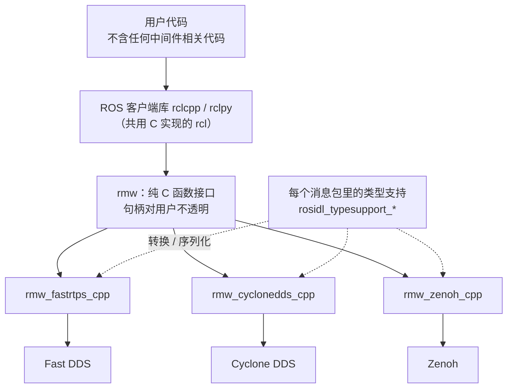

# rmw 接口与序列化的设计：中间件怎么藏起来、消息怎么变成字节、网络怎么区分流

> 适用：ROS 2 **Rolling**（2026-11-23 在 `ros:rolling-ros-base`、rclcpp 33.2.0、rmw_fastrtps_cpp 9.6.1、Fast DDS 3.6.2、rosidl 5.3.2 上实测）
> 来源标记：📐 设计文档原文 · 📄 本仓库文档原文 · 🔍 源码/实测核实 · 💡 经验补充
> 设计文档（[ros2/design](https://github.com/ros2/design) @ `93a415b`，本地副本在 `external/ros2_design/articles/`）：
> [ROS 2 middleware interface](https://github.com/ros2/design/blob/93a415bf928751d37fce6f83215c521658e20c93/articles/060_ros_middleware_interface.md)（2014-08，2017-09 修订）、
> [ROS 2 Message Research](https://github.com/ros2/design/blob/93a415bf928751d37fce6f83215c521658e20c93/articles/serialization.md)（2013-12，2019-05 修订；写于决定用 DDS 之前）、
> [Unique Network Flows](https://github.com/ros2/design/blob/93a415bf928751d37fce6f83215c521658e20c93/articles/unique_network_flows.md)（2021-05）
> 先读卡片 [中间件 RMW 与 DDS](../cards/middleware/rmw-dds.md)（有哪些实现、怎么切换）。"为什么选 DDS"见 [为什么有 ROS 2、为什么建在 DDS 上](why-ros2-dds.md)，本篇不重复。

## 1. 设计要回答的问题

- **中间件接口（060）**：ROS 2 决定建在 DDS 上，但 DDS 有好几家实现，各家的 API、平台、性能、许可证都不一样 📐。客户端库怎样才能不暴露任何 DDS 细节，又能在多家实现之间切换？切换是在编译时还是运行时？二进制包要不要为每家 DDS 各编一套？
- **消息与序列化（serialization）**：消息是每段用户代码都会用的接口，以后再改代价极大 📐。消息 API 要不要和具体的序列化库绑定？要不要支持定长消息（实时用）、可选字段、默认值、字典？
- **唯一网络流（unique network flows）**：IP 网络可以按"流"给不同的 QoS，例如 DSCP 标记、5G 的 5QI。但一个节点里的所有发布者、订阅者用的是同一组 IP 地址、端口和协议，网络分不出哪条是视频、哪条是电池状态，只能给它们同样的待遇 📐。

## 2. 考虑过的方案与取舍

### 中间件接口的分层 📐

几条设计原则 📐：

- **接口是纯 C 函数**，这样 Python、Java、C++ 的客户端库都能复用同一套核心逻辑。
- **接口尽量不带 DDS 概念**，这样就可以用非 DDS 的中间件来实现，甚至把几个分别负责发现、序列化、发布订阅的库拼起来。
- **返回的句柄是不透明的**，里面带一个实现标识，中间件拿到句柄时先核对，确认是自己创建的再解释内容。
- 可以**选择性地暴露原生句柄**：用户代码可以拿到 DDS 原生对象，去用 ROS 没暴露的功能，代价是这部分代码绑死在这家实现上。

**消息类型怎么交给中间件** 📐：

| 方式 | 做法 | 取舍 |
|---|---|---|
| 静态生成 | `.msg` → DDS IDL → 厂商代码生成器，每个消息都有专门的代码 | 快；但每个消息包都含厂商相关的代码 |
| 动态类型（XTypes DynamicData） | 运行时根据消息描述调用 DynamicData API，一份通用代码适用于所有消息 | 不用生成代码；性能"很可能总是更低" |

**在哪一步选中间件** 📐：

| 方式 | 取舍 |
|---|---|
| 编译时选 | 要从源码编译整个 ROS；或者构建农场为 M 种中间件 × N 个包编 M×N 套二进制，太贵 |
| **运行时选** | 编译时把所有可用中间件的类型支持都生成进每个消息包，运行时按环境变量加载。只装一种中间件时，应该做到"不用的功能不付出代价" |

实现上 📐：`rmw_implementation` 包在只有一种实现时直接链接它；有多种实现时，自己实现 rmw 接口，按策略模式在运行时加载选定实现的共享库，把调用转过去。每个消息包里有所有可用的"类型支持生成器"（包名前缀 `rosidl_typesupport_`）生成的代码。

### 消息 API 和序列化管线（serialization，写于选定 DDS 之前）📐

| 管线 | 做法 | 结论 |
|---|---|---|
| A | 用户的消息自己存数据；发送时先拷进序列化库的数据结构，再由序列化库序列化 | 多一次拷贝；但**序列化比内存拷贝慢至少两个数量级**，这次拷贝可以忽略。最初选了 A |
| B | 写定制代码，直接把消息字段序列化成线上格式 | 没有额外拷贝，但每种序列化格式都要写一套。**选定 DDS 之后改用 B** |
| C | 消息内部直接用序列化库的数据结构存数据 | 各家序列化库的字段类型不同（例如 Protobuf 的 `RepeatedField`、Thrift 的 `std::vector`），映射困难，被否决 |

**按成员访问还是按方法访问**：测下来两者性能没有可测的差别，原本倾向于按方法访问（以后能换存储后端）；选定 DDS 后不再需要换后端，于是保留了和 ROS 1 一样的**按成员访问** 📐。

还想要的功能 📐：序列化库可插拔（最好每个通信通道单独选）；完全不对外通信的产品可以不链接序列化库；定长消息（不动态分配，给实时和嵌入式用，生成 POD 类型）；可选字段和默认值；字典类型（会破坏 IDL 的向后兼容）。

### 怎样让每个发布者、订阅者有自己的网络流（unique network flows）📐

一条网络流由传输协议、端口、IP 协议、IP 地址，以及发布端的 DSCP 和 IPv6 流标签（flow label）组成。设计在发布者、订阅者的创建选项里加了 `require_unique_network_flow_endpoints`：

| 取值 | 含义 |
|---|---|
| `NOT_REQUIRED`（默认） | 不要求 |
| `STRICTLY_REQUIRED` | 必须唯一，做不到就报错，不创建 |
| `OPTIONALLY_REQUIRED` | 能做到就做，做不到也照样创建 |
| `SYSTEM_DEFAULT` | 交给 RMW 自己决定 |

另外加了 `get_network_flow_endpoints()`，返回**本端**的网络流端点。

RMW 可以只在一端支持：只要发布端或订阅端有一端唯一（弱唯一），一个节点每个话题只有一个发布者或订阅者的常见情况就够用了。实现办法依次是：换一个唯一端口（IPv4、IPv6 都行）；IPv6 写流标签；IPv4 写 DSCP（下下策，只有 64 个值，还要通知网管）。

被否决的替代方案：

- 把需要特殊网络 QoS 的发布者放进单独的节点：节点是重量级结构，这样破坏了按功能划分节点的架构。
- 通过厂商 XML 侧载 DDS 的 Transport Priority：要求用户懂 DDS 和 DSCP，也不支持非 DDS 的 RMW。

## 3. 设计与 Rolling 现状对照

状态：✅ 按设计实现 · 🔄 实现与设计不同 · ⏳ 未实现 · 🗑️ 已过时。🔍 结果来自[练习](../labs/perf-design-check.md)第 3 部分（`rmw_probe`、rosidl 解析器）、头文件，以及 [rosdistro](https://github.com/ros/rosdistro) 的 `rolling/distribution.yaml`（2026-11-23）。

### 中间件接口

| 设计文档的说法 | 状态 | Rolling 实测 |
|---|---|---|
| rmw 是纯 C 函数接口 | ✅ | `rmw/rmw.h` 里约 70 个 `rmw_*` 函数 🔍 |
| 句柄不透明，带实现标识 | ✅ | `rmw_publisher_t::implementation_identifier = rmw_fastrtps_cpp`，`data` 是一个不透明指针 🔍 |
| 运行时选中间件（`rmw_implementation` 按环境变量加载） | ✅ | 有 `librmw_implementation.so`；切换方法见卡片 🔍 📄 |
| 每个消息包含所有可用类型支持生成器的代码 | ✅ | `std_msgs` 有 `typesupport_c/cpp`（分发层）、`typesupport_fastrtps_c/cpp`、`typesupport_introspection_c/cpp` 三组库 🔍 |
| 订阅端接口"尚未描述" | ✅ 早已补齐 | `rmw_take`、`rmw_take_with_info`、`rmw_take_sequence`、`rmw_take_serialized_message`、`rmw_take_loaned_message` 等 🔍 |
| 可以选择性地暴露原生句柄 | ✅ | `rmw_fastrtps_cpp::get_datawriter()` 拿到 Fast DDS 的 `DataWriter`：深度 7 和 ROS 里给的一致；还能读到 ROS QoS 里没有的 `publish_mode = SYNCHRONOUS`、`data_sharing = OFF` 🔍 |
| 接口不带 DDS 概念，可以用非 DDS 中间件实现 | ✅ | rosdistro 的 Rolling 里除了 `rmw_fastrtps`、`rmw_cyclonedds`、`rmw_connextdds`、`rmw_gurumdds`、`rmw_swiftdds`，还有 `rmw_zenoh`，以及 `rmw_email`、`rmw_unix_socket_cpp` 这类显然不基于 DDS 的实现 🔍 |
| OpenSplice、旧版 Connext 的 RMW | 🗑️ | rosdistro 里没有 `rmw_opensplice`；Connext 现在是 `rmw_connextdds` 🔍 |
| 运行时动态类型（DynamicData 一类） | ✅ 换了形式 | ① 通用发布者 / 订阅者：只给类型名字符串 `"std_msgs/msg/String"` 就能收发序列化后的字节，和类型化的一端互通 🔍；② 有 `rosidl_dynamic_typesupport` 和 `rosidl_dynamic_typesupport_fastrtps` 包 🔍 |
| 每个 ROS 节点映射为一个 DDS 参与者 | 🗑️ | Foxy 起改为一个 context 一个参与者，见 [ROS 图怎么映射到 DDS](graph-to-dds-mapping.md) |

### 消息与序列化

| 设计文档的说法 | 状态 | Rolling 实测 |
|---|---|---|
| 选定 DDS 后用管线 B：直接从 ROS 消息序列化 | ✅ | 见 [为什么有 ROS 2、为什么建在 DDS 上](why-ros2-dds.md) 的对照表 |
| 保留按成员访问 | ✅ | 生成的 C++ 消息是带公有字段的结构体 🔍 |
| 序列化库可插拔，最好每个通道单独选 | ⏳ | 一个 RMW 只有一种格式：`rmw_get_serialization_format()` 返回 `cdr` 🔍；没有按话题选格式的 API 💡 |
| 序列化比内存拷贝慢至少两个数量级 | 🔄 要看消息长什么样 | 1 MB 的定长 `float` 数组：拷贝 45.7 μs，序列化 53.7 μs，**只慢 1.2 倍**；1 MB 的 `PoseArray`（18724 个位姿）：拷贝 50.1 μs，序列化 797 μs，**慢 15.9 倍** 🔍（本容器的数据，换机器数值会变）。💡 连续的基本类型数组，CDR 序列化几乎就是一次 `memcpy`；字段多而碎，才是逐字段编码 |
| CDR 线上格式 | ✅ | `Int32` = 8 字节，`String("hello")` = 14 字节，空 `String` = 9 字节 🔍。💡 推导：4 字节封装头 + 4 字节数据；字符串 = 4 字节头 + 4 字节长度 + 字符 + 结尾的 `\0` |
| 定长消息给实时和嵌入式用 | ✅ 部分 | 定长数组生成 `std::array`；有界数组仍是 `BoundedVector`，会在堆上分配（见 [接口定义的设计](interface-design.md)）。只有"平坦"的定长类型才能借用（见 [进程内通信与零拷贝的设计](intra-process-design.md)） |
| 默认值 | ✅ | `int32 x 5` 解析出默认值 5 🔍 |
| 可选字段 | ⏳ 能写但没效果 | 解析器接受 `@optional int32 b`，生成的 `.idl` 里也有 `@optional`；但生成的 C++ 字段仍是普通的 `int32_t b`、`std::string c`，没有"未设置"状态 🔍 |
| 字典类型 | ⏳ | `map<string,int32> m` 解析失败（被当成非法的消息类型名）🔍 |

### 唯一网络流

| 设计文档的说法 | 状态 | Rolling 实测 |
|---|---|---|
| 创建选项 `require_unique_network_flow_endpoints`，四个取值 | ✅ | `PublisherOptions`、`SubscriptionOptions` 里都有，默认 `NOT_REQUIRED` 🔍 |
| `get_network_flow_endpoints()` 返回本端端点 | ✅ | 返回传输协议、IP 协议、地址、端口、流标签、DSCP 🔍 |
| RMW 可以只在一端支持 | ✅ Fast DDS 只支持订阅端 | 发布者用 `STRICTLY_REQUIRED` **创建失败**：`Unique network flow endpoints not supported on publishers` 🔍；发布者用 `OPTIONALLY_REQUIRED` 时照样创建，端口和默认的一样 🔍 |
| 订阅端靠换端口实现唯一 | ✅ | 默认订阅者都用 7411 端口；`STRICTLY_REQUIRED`、`OPTIONALLY_REQUIRED` 的订阅者分别拿到 7001、7002 🔍。💡 推导：7411 = 7400 + 250 × 0 + 10 + 2 × 0 + 1，是域 0、第 0 个参与者的用户单播端口（公式见卡片 [Domain ID 与发现](../cards/middleware/domain-discovery.md)） |
| 用 IPv6 流标签或 DSCP 区分 | ⏳ | 所有端点 `flow_label=0`、`dscp=0` 🔍 |

## 4. 对写代码的影响（规划控制场景）

1. **算法代码里不要出现任何厂商 API。** 真要用原生句柄（例如确认 `publish_mode`、调 data sharing），就集中在一个文件里，先用 `rmw_get_implementation_identifier()` 判断当前实现，不是 Fast DDS 时跳过 🔍 💡。
2. **大消息的序列化成本主要看结构，不只看字节数。** 同样 1 MB，碎字段的 `PoseArray` 序列化要 0.8 ms，平坦数组只要 0.05 ms 🔍。规划器高频发布一条上万个点的路径时，可以考虑：降采样；把坐标打包成一个 `float64[]`；或者让下游和规划器在同一进程，走进程内通信。💡
3. **写录制、转发、桥接这类通用工具时，用通用发布者 / 订阅者。** 类型名写错时，创建时就会抛异常（报 typesupport 库找不到）🔍。
4. **消息里需要"可选"语义时，别依赖 `@optional`。** 它在 Rolling 的 C++ 里没有效果 🔍。💡 常见替代：加一个 `bool has_x` 字段，或者用最多一个元素的有界数组 `float64[<=1] x`。
5. **在 Wi-Fi、5G 链路上要给关键话题更好的网络待遇时**（例如车队把急停和视频走同一条链路），Fast DDS 只能让**订阅端**换端口，DSCP 和流标签都没设 🔍。💡 网络侧按订阅端端口分类；或者用设计文档否决的替代方案，把关键话题放进单独的进程，让它有自己的参与者和端口。

## 5. 与其他概念的关系

- 卡片：[中间件 RMW 与 DDS](../cards/middleware/rmw-dds.md) · [DDS 调优](../cards/middleware/dds-tuning.md) · [Domain ID 与发现](../cards/middleware/domain-discovery.md) · [接口定义](../cards/communication/interface-definition.md)
- 练习：[并发与性能的设计还成立吗](../labs/perf-design-check.md)（第 3 部分）
- [为什么有 ROS 2、为什么建在 DDS 上](why-ros2-dds.md)：rmw 抽象层的由来、管线 B
- [ROS 图怎么映射到 DDS](graph-to-dds-mapping.md)：节点与参与者
- [接口定义的设计](interface-design.md)：有界类型、默认值、生成的 C++ 代码
- [进程内通信与零拷贝的设计](intra-process-design.md)：不序列化的那条路
- 上一级：[总览脑图](../map/overview.md)

## 6. 自测题（先自己答，再看[答案](../answers/rmw-serialization-design-answers.md)）

1. （a）设计文档为什么最终选择"运行时选中间件"，而不是为每家 DDS 各编一套二进制包？它的代价体现在每个消息包里的什么地方？（b）你在机器人上只装了 Fast DDS，同事的笔记本上装的是 Cyclone DDS，你们用同一套 `.deb` 包吗？为什么能做到？
2. 你的全局规划器每秒发布 10 次 `nav_msgs/Path`，每条 20000 个 `PoseStamped`，下游控制器在另一个进程里。（a）按设计文档"序列化比拷贝慢两个数量级"的说法，和本篇的实测，哪一步最可能是瓶颈？（b）给出两种不改控制器算法、只改消息或部署方式的优化，并说明各自依据的是本批哪条设计。
