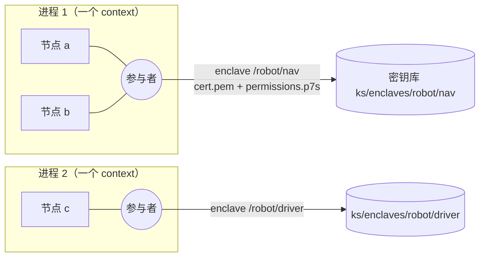

# 安全的设计：ROS 2 怎么接入 DDS-Security，enclave 为什么是"每个进程"

> 适用：ROS 2 **Rolling**（2026-11-23 在 `ros:rolling-ros-base`、sros2 0.17.1、Fast DDS 3.6.2 上实测）
> 来源标记：📐 设计文档原文 · 📄 本仓库文档原文 · 🔍 源码/实测核实 · 💡 经验补充
> 设计文档（[ros2/design](https://github.com/ros2/design) @ `93a415b`，本地副本在 `external/ros2_design/articles/`）：
> [ROS 2 DDS-Security integration](https://github.com/ros2/design/blob/93a415bf928751d37fce6f83215c521658e20c93/articles/180_ros2_dds_security.md)（2019-07，2020-07 修订）、
> [ROS 2 Security Enclaves](https://github.com/ros2/design/blob/93a415bf928751d37fce6f83215c521658e20c93/articles/182_ros2_security_enclaves.md)（2020-05，2020-07 修订）
> 先读卡片 [安全 SROS2](../cards/middleware/sros2-security.md)（密钥库、三个环境变量、抓包）。本篇讲这些设计背后的理由，以及卡片没覆盖的几条规则。

## 1. 设计要回答的问题

DDS 本身有一套安全标准 DDS-Security（DDS 安全规范）。ROS 2 要回答三件事：

1. **用 DDS-Security 的哪几部分？** 标准定义了五个插件接口（SPI，Service Plugin Interface），不是每个都要用 📐。
2. **安全凭据发给谁？** 是每个节点一份、每个进程一份，还是每台机器一份？
3. **用户怎么打开、怎么配置？** 既要方便做实验，又要在部署时"配错就不启动"。

## 2. 考虑过的方案与取舍

### 五个插件，ROS 2 只用三个（180）📐

| 插件 | 作用 | ROS 2 用的内置实现 |
|---|---|---|
| 认证 Authentication | 确认"你是谁" | `DDS:Auth:PKI-DH`：每个参与者一对公私钥 + 一张 x.509 证书，证书由受信任的 CA 签发 |
| 访问控制 Access control | 限制"你能做什么" | `DDS:Access:Permissions`：两份签名过的 XML，governance（整个 Domain 的规则）和 permissions（这个参与者的权限） |
| 加密 Cryptographic | 加密、解密、签名、哈希 | `DDS:Crypto:AES-GCM-GMAC`：认证加密 |
| 日志 Logging | 审计安全事件 | 不要求 |
| 数据标记 Data tagging | 给数据样本打标签 | 不要求 |

选内置插件的理由有两条 📐：一是标准只详细描述了这几种；二是所有符合标准的 DDS 实现**必须**支持它们，而且要能互通，所以"跨厂商只需很少的工作"。日志和数据标记不是合规的必要条件，不是每家 DDS 都实现了，ROS 2 就不依赖它们。

💡 这里的取舍是"不自己造密码学"：认证、加密都交给 DDS 和 OpenSSL，ROS 2 只负责**把文件放对位置、把开关接到环境变量上**。

### rcl 提供的三个功能（180）📐

1. **每个参与者一套安全文件。** 设计文档原话是"Domain participant 对应进程里的一个 context，所以每个进程需要一套文件"。文件放在密钥库的 `enclaves/<enclave 路径>/` 下，6 个文件的名字由 DDS-Security 标准规定。
2. **宽松（permissive）和严格（strict）两种模式。** 找不到安全文件时，宽松模式照样启动但不开安全（默认），严格模式直接失败。`ROS_SECURITY_STRATEGY=Enforce`（区分大小写）是严格，其他任何值都是宽松。
3. **总开关。** `ROS_SECURITY_ENABLE=true`（区分大小写）才打开，默认关闭，"方便做实验"。

选 enclave 的两种方式：`ROS_SECURITY_KEYSTORE` + `--ros-args --enclave`（`-e`），或者设 `ROS_SECURITY_ENCLAVE_OVERRIDE`。设计文档写明**覆盖变量优先**：两个都设时，`--enclave` 被忽略 📐。

### 为什么从"每个节点"变成"每个进程"（182）📐

早期 SROS2 给每个节点发一套凭据。后来 ROS 2 把节点和 DDS 参与者解耦了（一个 context 一个参与者，见 [ROS 图怎么映射到 DDS](graph-to-dds-mapping.md)），而 DDS-Security 规定**一个参与者只能有一个安全身份**。所以：

- 同一个 context 里所有节点的权限，必须**合并成一份** permissions，用同一个身份 📐。
- 这个合并单位叫 **enclave**（安全飞地）：一组共享同一个安全身份的节点，通常就是一个进程 📐。
- enclave 路径和节点命名空间**脱钩**：`/front/camera` 这个 enclave 里可以跑任何命名空间的节点 📐。



💡 这个设计的直接后果：**同一个进程里的节点互相没有权限隔离**。a 的 profile 只写了 `ta`，b 的只写了 `tb`，合并后 a 也能发 `tb`（练习第 2 部分实测）。想隔离，就得拆进程。

### 密钥库的布局（182）📐

```text
keystore/
├── enclaves/            每个 enclave 一个目录，加上公共的 governance
├── private/             CA 的私钥和证书请求（ca.key.pem、ca.csr.pem），部署前要拿掉
└── public/              CA 证书 ca.cert.pem；identity_ca / permissions_ca 默认都链接到它
```

设计文档允许身份 CA 和权限 CA 分开，默认指向同一个 📐。分成三个目录的理由是**按敏感程度分层**：`public/` 可以随便发，`enclaves/` 只部署设备需要的那几个，`private/` 离线保管。

### 设计时没定下来的事（182 的"未来工作"和"顾虑"）📐

- **launch 推送 enclave。** 设想 launch 像推命名空间一样推 enclave：没写路径的节点用根 enclave；写相对路径的会被推到子目录；写绝对路径 `/bar` 的不推。备选方案是给 `push_ros_namespace` 加 `enclave=` 属性，或新增 `push_ros_enclave` 动作。
- **一个进程里该不该支持多个 enclave。** 进程内存是共享的，多个身份放在同一个地址空间里，隔离意义不大。
- **别在 launch 文件里设安全相关的环境变量**，要由部署环境决定。
- 容器化部署时密钥怎么放（另有讨论）。

## 3. 设计与 Rolling 现状对照

状态：✅ 按设计实现 · 🔄 实现与设计不同 · ⏳ 未实现 · 🗑️ 已过时。🔍 结果来自[练习](../labs/security-build-design-check.md)第 1–3 部分（`sec_probe`）、第 7 批卡片和 Fast DDS 库的符号。

| 设计文档的说法 | 状态 | Rolling 实测 |
|---|---|---|
| 用三个内置插件 PKI-DH、Permissions、AES-GCM-GMAC | ✅ | `libfastdds.so` 里有 `builtin.PKI-DH`、`builtin.Access-Permissions`、`builtin.AES-GCM-GMAC` 🔍；抓包能看到 `DDS:Auth:PKI-DH:1.0` 🔍（第 7 批） |
| 日志、数据标记插件不依赖 | 🔄 日志插件其实能用 | Fast DDS 有 `builtin.DDS_LogTopic`，rmw_fastrtps 认 `ROS_SECURITY_LOG_FILE`、`ROS_SECURITY_LOG_PUBLISH`、`ROS_SECURITY_LOG_VERBOSITY` 三个变量 🔍。实测被拒绝的发布者会以 `[EMERGENCY] ... rt/ta topic denied by deny rule.` 写进日志文件 🔍。本仓库文档没提这几个变量 🔍。没找到数据标记插件 🔍 |
| 选内置插件，所以安全功能"跨厂商只需很少工作" | 🔄 | 文档现在说跨厂商**没有**安全互通 📄（见卡片坑 11）。💡 标准规定了插件，但各家的握手细节、XML 解析仍有差异 |
| 每个 context 一套安全文件 | ✅ | 同一进程里两个节点只打印一次 `Found security directory`，用同一个 enclave 🔍 |
| `ROS_SECURITY_ENCLAVE_OVERRIDE` 优先于 `--enclave` | ✅ | `-e /design/glob` 加 `OVERRIDE=/design/plain`，实际用的是 `/design/plain` 🔍 |
| 宽松 / 严格 / 总开关三个变量，区分大小写 | ✅ | 第 7 批卡片已实测；`Enforce` 下找不到文件启动失败，宽松模式照常启动 🔍 |
| 没写 enclave 的节点用根 enclave | ✅ | 不加 `-e` 时日志是 `Found security directory: .../ks/enclaves`（根目录）。根目录下没有证书，`Enforce` 下报 `couldn't find all security files!`，宽松模式下照常以不安全模式启动 🔍 |
| launch 推送相对 enclave 路径 | ⏳ | launch_ros 里没有任何 `enclave` 相关的代码，`PushROSNamespace` 只收 `namespace` 🔍。rcl 还要求 enclave 必须是绝对路径：`-e design/plain` 报 `context name must be absolute, it must lead with a '/'` 🔍 |
| enclave 路径和节点命名空间脱钩 | ✅ | `-r __ns:=/robot7 -e /design/plain` 正常运行 🔍 |
| 一个进程只用一个 enclave？（顾虑，未定） | 🔄 允许多个 | 同一进程再建一个 `rclcpp::Context`，用 `-e` 指向另一个 enclave，两个 context 各自加载各自的 enclave，都能用 🔍 |
| 密钥库分 `enclaves/`、`private/`、`public/` | ✅ | 第 7 批卡片实测；`identity_ca`、`permissions_ca` 都是指向 `ca.cert.pem` 的链接 🔍 |
| CLI：建 CA 和密钥库、生成身份、用 ROS 名字写权限、从运行中的系统生成策略 | ✅ | `ros2 security` 有 `create_keystore`、`create_enclave`、`create_permission`、`generate_policy`、`generate_artifacts`、`list_enclaves` 🔍 |

## 4. 对写代码的影响（规划控制场景）

1. **按"信任边界"拆进程，而不是按功能拆节点。** 同一个进程里的节点共享一个 enclave，权限是并集 🔍。💡 比如第三方的感知节点和自家的控制节点不要放进同一个组件容器；控制器、`cmd_vel` 的发布者单独一个进程、单独一个 enclave。
2. **启动脚本里显式写 `-e`。** 不写就落到根 enclave 🔍。💡 根 enclave 通常没有证书，`Enforce` 下直接失败还好，宽松模式下会悄悄以不安全模式运行。
3. **`ROS_SECURITY_ENCLAVE_OVERRIDE` 会盖掉所有 `-e`。** 💡 在 CI 或调试时设了它，记得在部署环境里 `unset`；排查"权限不对"时先 `env | grep ROS_SECURITY`。
4. **部署时打开安全日志。** `ROS_SECURITY_LOG_FILE=/var/log/ros/sec.log ROS_SECURITY_LOG_VERBOSITY=WARN`。🔍 访问被拒绝的事件会写进去，比在控制台里找彩色的 Fast DDS 错误好查。💡 这几个变量只对 rmw_fastrtps 有效。
5. **安全不能"一个进程两个身份"来分权。** 虽然 Rolling 允许一个进程建两个 context、用两个 enclave 🔍，但两份私钥都在同一个地址空间里，被攻破时一起泄露。这正是设计文档担心的地方 📐。

## 5. 与其他概念的关系

- 卡片：[安全 SROS2](../cards/middleware/sros2-security.md) · [中间件 RMW 与 DDS](../cards/middleware/rmw-dds.md) · [组件](../cards/concurrency/component.md)（容器里的节点共享一个 enclave）
- 练习：[SROS2 密钥库、强制模式与访问控制](../labs/sros2-keystore.md) · [安全与工程化的设计还成立吗](../labs/security-build-design-check.md)（第 1–3 部分）
- [访问控制策略的设计](access-control-design.md)：policy 怎么写、怎么合并
- [威胁模型](threat-model-design.md)：这些安全功能要防什么
- [ROS 图怎么映射到 DDS](graph-to-dds-mapping.md)：一个 context 一个参与者
- [launch 的设计](launch-design.md)：为什么 launch 里还没有 enclave
- 上一级：[总览脑图](../map/overview.md)

## 6. 自测题（先自己答，再看[答案](../answers/security-design-answers.md)）

1. 你们把导航栈做成一个组件容器：`controller_server`、`planner_server`、`bt_navigator`，还加载了一个第三方的 `people_tracker` 组件。容器用 `-e /robot/nav` 启动，policy 里给 `people_tracker` 的 profile 只写了"订阅 `/scan`、发布 `/people`"。（a）`people_tracker` 被攻破后，它能不能发布 `/cmd_vel`？为什么？（b）在不改任何节点代码的前提下，你怎么调整部署，让它发不了 `/cmd_vel`？
2. 现场机器人上设了 `ROS_SECURITY_ENABLE=true`、`ROS_SECURITY_STRATEGY=Enforce`、`ROS_SECURITY_KEYSTORE=/opt/ks`，启动脚本是 `ros2 run my_pkg planner --ros-args -e /robot/planner`。有人为了调试在 `~/.bashrc` 里加了 `export ROS_SECURITY_ENCLAVE_OVERRIDE=/robot/debug`，`/robot/debug` 的权限是默认生成的。（a）规划器实际用哪个 enclave？（b）这样会有什么后果？（c）你在启动脚本里加哪几行检查，能在启动前发现这类问题？
