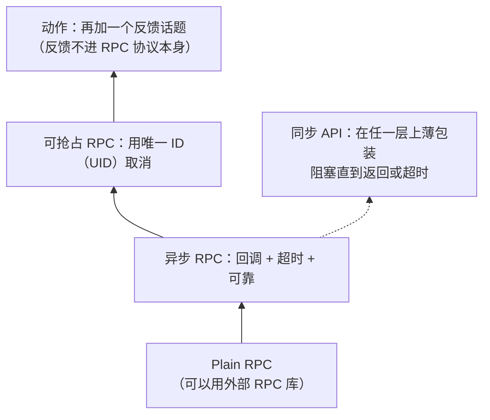

# 服务与动作的设计：RPC 为什么分层、动作为什么是 3 个服务 + 2 个话题

> 适用：ROS 2 **Rolling**（2026-11-23 在 `ros:rolling-ros-base`、rclcpp_action / rcl_action 10.6.0、`rmw_fastrtps_cpp` 9.6.1 上实测）
> 来源标记：📐 设计文档原文 · 📄 本仓库文档原文 · 🔍 源码/实测核实 · 💡 经验补充
> 设计文档（[ros2/design](https://github.com/ros2/design) @ `93a415b`）：
> [RPC API design in ROS](https://github.com/ros2/design/blob/93a415bf928751d37fce6f83215c521658e20c93/articles/050_ros_rpc_design.md)（2014-06，**文首注明已过时**：写于选定 DDS 之前，"可当作备忘录"）、
> [Actions](https://github.com/ros2/design/blob/93a415bf928751d37fce6f83215c521658e20c93/articles/actions.md)（2019-03，2020-05 修订）、
> [ContentFilteredTopic in ROS 2](https://github.com/ros2/design/blob/93a415bf928751d37fce6f83215c521658e20c93/articles/content_filtering.md)（动机部分）
> 先读卡片 [服务](../cards/communication/service.md)、[动作](../cards/communication/action.md)，这里讲它们为什么长这样。

## 1. 设计要回答的问题

ROS 1 的 RPC 有这些痛点 📐：

- 服务是**同步**的、没有超时：服务端卡住，调用线程就永远卡住。
- 服务不能取消，也没有进度反馈，所以长任务要用 actionlib；但 actionlib 是**另一个库**，建在话题上，在有损无线网上不可靠。
- 服务调用是点对点的，rosbag 录不到，事后没法看。
- actionlib 的目标 ID 可以由客户端生成，多个客户端可能撞号；客户端留空时由服务端生成，客户端又不知道是多少。
- `rostopic list` 里满是动作的内部话题。

## 2. 考虑过的方案与取舍

### 2014：理想的 RPC 应该有什么，以及"分层"📐

理想性质：**异步 API**（同步可以在异步之上薄薄包一层，反过来既难又低效）、超时、可抢占、反馈、可靠传输（丢包后系统不能停在不确定状态）、可记录可内省。

但做成一个大而全的实现，大多数用户用不到的东西（例如反馈）也会暴露在 API 里。所以提议分四层，每层只加一样东西：

文中列出的技术问题后来大多有了答案：UID 是让用户写进消息，还是生成时自动加？要不要单独的 `.action` 文件？服务调用怎么记录？要不要 `caller_id`？📐

### 2019：动作怎么落地 📐

| 方案 | 结论与理由 |
|---|---|
| **在 rmw 层实现动作** | 否：DDS 里没有比"话题 + 服务"更适合动作的特性；还会让每个 rmw 实现都更难写 |
| **用话题 + 服务拼，写一份公共 C 实现（rcl_action）** | **选它**：ROS 2 的服务在 C 层本来就是异步的，不必像 ROS 1 那样全用话题；各语言客户端库共享一份实现 |
| 每个目标一个反馈/状态话题（按目标 ID 动态命名） | 否：多数场景目标和客户端都不多，属于过早优化；话题名运行时才确定，安全策略没法提前写；C 实现和客户端库更复杂。将来可以用 DDS 的键控数据 / 内容过滤 |
| 服务端生成目标 ID | 否：**客户端**生成 UUID。客户端从一开始就知道 ID；用户还可以把它和外部系统（例如任务数据库里已有的 UUID）对应起来；UUID 让多客户端撞号的概率可以忽略 |

动作的组成 📐：

| 组成 | 方向 | 内容 | 设计要点 |
|---|---|---|---|
| `send_goal` 服务 | 客户端 → 服务端 | 目标 + UUID / 是否接受 + 接受时间 | QoS 要保证客户端一定收到响应，否则可能"服务端在执行，客户端却不知道" |
| `cancel_goal` 服务 | 客户端 → 服务端 | 目标 ID + 时间戳 / 返回码 + 进入 CANCELING 的目标列表 | ID 空、时间 0：全部取消；ID 空、时间非 0：取消该时刻及之前接受的；ID 非空：取消这个（时间非 0 时再加上该时刻及之前的） |
| `get_result` 服务 | 客户端 → 服务端 | 目标 ID / 最终状态 + 结果 | 服务端**缓存结果**，多个客户端都能取；超时后丢弃：-1 永久保留，0 立即丢弃 |
| `feedback` 话题 | 服务端发布 | 目标 ID + 反馈 | **每个动作服务端只有一个**，客户端按目标 ID 自己过滤 |
| `status` 话题 | 服务端发布 | 所有已接受目标的 ID、接受时间、状态 | 状态变化时发布；默认 TransientLocal、深度 1，后加入的订阅者也能拿到最新状态 |

名字都是"动作名 + `/_action/...`"，`_action` 以下划线开头，所以是隐藏的，`ros2 topic list` 默认看不到；生成的类型放在 `action` 子命名空间，不会和 `msg`、`srv` 冲突。📐

### 内容过滤的动机 📐

[content_filtering.md](https://github.com/ros2/design/blob/93a415bf928751d37fce6f83215c521658e20c93/articles/content_filtering.md) 点名了两个浪费：`/parameter_events`（每个节点都发、都收，订阅者只关心少数参数）和动作的 `feedback`/`status`（M 个目标、N 个客户端时，每个客户端都收全部再丢掉大部分）。DDS 的 ContentFilteredTopic 可以让**写端**按读端的过滤表达式少发（是否在写端过滤取决于实现，所以读端也必须再过滤一次）；表达式参数可以运行时改，正好对应"客户端手上的目标 ID 会变"。文中实验：10 个读端只有 1 个需要数据时，网络发送量下降 90%。

## 3. 设计与 Rolling 现状对照

状态：✅ 按设计实现 · 🔄 实现与设计不同 · ⏳ 未实现 · 🗑️ 已过时。🔍 结果来自[练习](../labs/design-claims-check.md)第 1、4 部分。

| 设计文档的说法 📐 | 状态 | Rolling 现状 |
|---|---|---|
| RPC 的核心 API 是异步的，同步是薄包装 | ✅ | rclcpp 客户端只有 `async_send_request`，"同步调用"是你自己等 future（见 [服务](../cards/communication/service.md)）📄 |
| 请求和响应靠 UID 配对 | ✅ 不在消息里 | 配对信息在 rmw 层的请求头 `rmw_request_id_t`：写端 GUID + 序号 🔍，不需要写进 `.srv` |
| 异步 RPC 自带超时 | 🔄 | 协议里没有超时；客户端自己 `wait_for`，超时后要 `remove_pending_request()` 或 `prune_pending_requests()` 清理 🔍（见服务卡片常见坑 4） |
| 可抢占 RPC（服务也能用 UID 取消） | 🔄 | 服务不能取消；"可抢占"只在动作里有 |
| 服务调用可记录、可内省 | ✅ | 服务内省（Iron 起），见 [服务与动作内省](../cards/observability/service-introspection.md) |
| 动作 = 3 个服务 + 2 个话题，C 层公共实现 | ✅ | 🔍 `/move_to/_action/{send_goal,cancel_goal,get_result}` 服务 + `/move_to/_action/{feedback,status}` 话题；类型 `study_interfaces/action/MoveTo_SendGoal` 等在 `action` 命名空间 |
| 客户端生成 UUID 作目标 ID | ✅ | rclcpp_action 客户端生成；旁观者拿着这个 ID 直接调 `get_result` 也能取到结果 🔍 |
| 结果缓存，超时可配置 | ✅ | 默认 `result_timeout` **10 s**（`rcl_action_server_get_default_options()`）🔍。实测：完成后 3 s 取到 SUCCEEDED，12 s 取到 **UNKNOWN**；改成 60 s 后 12 s 仍是 SUCCEEDED |
| `status` 默认 TransientLocal、深度 1 | ✅ | `rcl_action_qos_profile_status_default`：KeepLast 1、Reliable、TransientLocal 🔍；目标完成后才创建的订阅收到 1 个目标、状态 SUCCEEDED 🔍。注意：结果过期（`get_result` 已返回 UNKNOWN）后新建的状态订阅**仍收到 SUCCEEDED**，过期时没有重新发布状态 🔍 |
| `status` 只用于内省，客户端不用 | 🔄 | rclcpp_action 客户端订阅了 `status`，用它更新目标句柄的状态（`handle_status_message`）🔍 |
| 反馈话题共享、客户端过滤；将来用内容过滤优化 | ✅ 可选 | `rclcpp_action::create_client(..., enable_feedback_msg_optimization=true)` 用内容过滤只收自己目标的反馈。**默认关闭**；每个客户端最多同时 6 个目标（DDS 规定过滤参数最多 100 个，一个 UUID 占 16 个）；超了或 rmw 不支持内容过滤时自动关闭 🔍（`rclcpp_action/client.hpp` 注释）|
| 动作的 ROS 1 桥接 | ⏳ | 文中为 TODO |

## 4. 对写代码的影响（规划控制场景）

1. **判断该用服务还是动作，看的是"要不要取消和进度"**，这是设计层面的分界：服务在协议上就不能取消，超时只是客户端不等了，服务端还在算。规划耗时不可控时用动作（Nav2 的 `ComputePathToPose` 就是动作）。📐 🔍
2. **服务超时后一定清理挂起请求**（`remove_pending_request` / `prune_pending_requests`），否则客户端内部的待处理表一直增长。🔍
3. **结果只缓存 10 s。** 任务管理器重启、或者行为树过了一阵才去取结果，会拿到 UNKNOWN 🔍。需要更久就在 `create_server` 时传 `rcl_action_server_options_t`，把 `result_timeout` 调大；更稳的做法是客户端拿到结果后自己持久化。💡
4. **多个客户端盯着同一个动作服务端时**（例如多个行为树节点、监控面板），每个客户端都收全部反馈。反馈大、频率高时考虑开 `enable_feedback_msg_optimization`，并记住"最多 6 个并发目标"这个限制；Cyclone DDS、Zenoh 不支持内容过滤，开了也自动退回 🔍 📄（RMW 支持表见 [话题进阶](../cards/communication/topic-advanced.md)）。
5. **监控工具想知道"现在有哪些目标在跑"，订阅 `status` 就行**，TransientLocal 保证后启动也能拿到最新一份 🔍；不需要去调用动作服务。但它是"最后一次发布时"的快照：结果过期后它仍显示终态，和 `get_result` 的 UNKNOWN 不一致 🔍，别把它当成"结果还能取"的依据。
6. **手写 SROS2 策略时，动作要放行 5 个 DDS 名字**（`rt/.../_action/feedback`、`rt/.../_action/status` 和 3 对 `rq/rr`），见 [ROS 图怎么映射到 DDS](graph-to-dds-mapping.md)。

## 5. 与其他概念的关系

- 卡片：[服务](../cards/communication/service.md)、[动作](../cards/communication/action.md)、[通信方式怎么选](../cards/communication/communication-patterns.md)、[话题进阶](../cards/communication/topic-advanced.md)（内容过滤怎么用）、[服务与动作内省](../cards/observability/service-introspection.md)
- 练习：[动作抢占](../labs/action-preempt.md)、[设计文档的说法在 Rolling 里还成立吗](../labs/design-claims-check.md)（第 4 部分）
- 上一层：[为什么有 ROS 2、为什么建在 DDS 上](why-ros2-dds.md)
- 上一级：[总览脑图](../map/overview.md)

## 6. 自测题（先自己答，再看[答案](../answers/service-action-design-answers.md)）

1. 设计文档说"异步 API 上可以薄薄包出同步 API，反过来既难又低效"。（a）为什么反过来难？用"一个线程同时等 3 个服务的结果"举例说明。（b）rclcpp 只给了异步 API，可大家还是经常把节点写死锁，问题出在"薄包装"的哪一步？
2. 你的任务管理器把"去 A 点"发给导航动作服务端，拿到目标 ID 后存进数据库，然后任务管理器崩溃重启，花了 20 秒。重启后它用数据库里的目标 ID 去取结果。（a）在默认配置下会拿到什么？为什么？（b）设计文档里"客户端生成目标 ID"这个决定，在这个场景里带来了什么好处？（c）给出两种让重启后的任务管理器仍能知道结果的办法。
