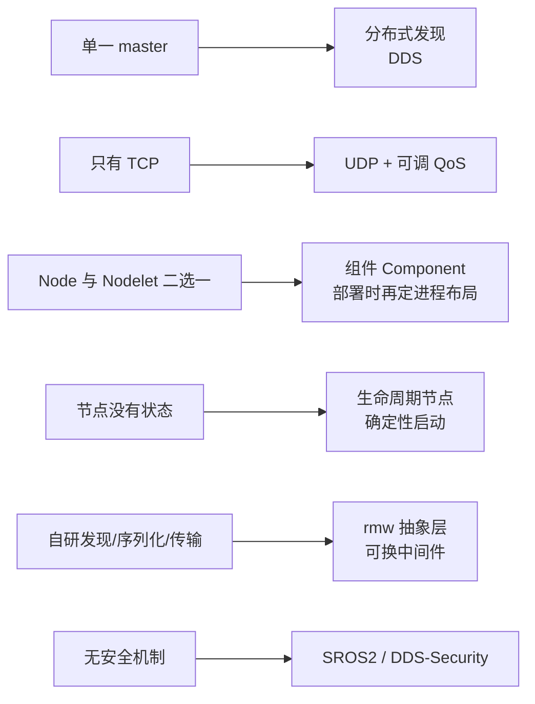

# 为什么有 ROS 2、为什么建在 DDS 上

> 适用：ROS 2 **Rolling**（2026-11-23 在 `ros:rolling-ros-base`、rclcpp 33.2.0、`rmw_fastrtps_cpp` 9.6.1、Fast DDS 3.6.2 上核对）
> 来源标记：📐 设计文档原文 · 📄 本仓库文档原文 · 🔍 源码/实测核实 · 💡 经验补充
> 设计文档（[ros2/design](https://github.com/ros2/design) @ `93a415b`，Apache-2.0）：
> [Why ROS 2?](https://github.com/ros2/design/blob/93a415bf928751d37fce6f83215c521658e20c93/articles/010_why_ros2.md)（2014-06，2022-05 修订）、
> [ROS on DDS](https://github.com/ros2/design/blob/93a415bf928751d37fce6f83215c521658e20c93/articles/020_ros_with_dds.md)（2014-06，**文首注明写于选定 DDS 之前**）、
> [ROS on ZeroMQ and Friends](https://github.com/ros2/design/blob/93a415bf928751d37fce6f83215c521658e20c93/articles/030_ros_with_zeromq.md)（2014-06）、
> [Stories driving the development](https://github.com/ros2/design/blob/93a415bf928751d37fce6f83215c521658e20c93/articles/040_stories.md)（2016-12）、
> [Changes between ROS 1 and ROS 2](https://github.com/ros2/design/blob/93a415bf928751d37fce6f83215c521658e20c93/articles/changes.md)（2015-09，2017-06 修订，⏳ 标记大多已过时）

## 1. 设计要回答的问题

ROS 1 是为 Willow Garage 的 PR2 机器人做的，它默认了这样一个世界 📐：

| ROS 1 的隐含假设 | 后来遇到的新场景 📐 |
|---|---|
| 一台机器人 | 多机器人编队（ROS 1 只有单一 master，多机都是"变通方案"） |
| 机上是工作站级算力 | 小型嵌入式平台，甚至裸机微控制器（microcontroller）也要成为 ROS 的一等成员 |
| 没有实时要求 | 实时控制直接在 ROS 里做，包括进程间、机器间通信 |
| 网络很好（有线或近距离高带宽无线） | 非理想网络：有丢包、延迟的 Wi-Fi，甚至地面到太空的链路 |
| 用于科研 | 产品环境：实验室原型要能长成产品 |
| 什么都不规定（"不包你的 `main()`"） | 需要规定好的模式：生命周期管理、部署用的静态配置 |

另一个动机是 API：ROS 1 的很多 API 从 2009 年就没变，有些决定后来证明不是最好的。ROS 2 借机重新设计，**核心概念保留**（分布式处理、匿名发布/订阅、带反馈的 RPC 即动作、语言无关、系统可内省），但**不保证与 ROS 1 API 兼容**，靠桥接（bridge）共存。📐

**为什么不直接改 ROS 1？** 这些改动太侵入，会危及大量正在用 ROS 1 的人；所以 ROS 2 作为一套可以并行安装的新包开发。📐

## 2. 考虑过的方案与取舍

2014 年团队比较了三条路 📐：

| 方案 | 好处 | 代价 | 结论 |
|---|---|---|---|
| 继续改进 ROS 1 自研传输（TCPROS） | 社区熟悉 | 发现、序列化、传输都要自己维护；ROS 1 从来没有可供第三方审计的规范，只有 wiki 和参考实现 | 否 |
| 用组件库自己拼：ZeroMQ + Protocol Buffers + zeroconf | 控制权最大，可以调得很细 | 原型发现：没有能独立使用的现成**发现**系统；发现↔传输、类型安全、进程内传指针都要写大量"胶水"；还得写一份能被验证和复现的规范，工作量"几乎不亚于实现本身" | 否 |
| 端到端中间件 **DDS** | 有成文规范（DDS API + DDSI-RTPS 线上协议 wire protocol），多家厂商实现，可审计；默认**分布式发现**，没有单点故障；跑在 UDP 上，可靠性自己实现，因此可以用 QoS 调成"像 TCP"或"像 UDP 狂发"；有几十到几百 KB 的嵌入式实现；在军舰、水坝、航天、金融等关键系统里验证过 | 配置和 API 复杂；社区文化很不一样（OMG 标准组织、政府和军工用户，问题基本只有厂商员工回答）；部分实现是商业许可 | **选它** |

ROS on DDS 一文的结论 📐：对 DDS 的社区和许可证保持怀疑之后，"很难找到真正的技术性批评"。

### 关键设计原则：DDS 只是实现细节 📐

- DDS 的 API 和消息定义全部藏在 ROS API 后面。用户用的是 ROS 1 风格的 Node / Publisher / Subscriber，DDS 的 DomainParticipant、Topic、DataWriter、DataReader 这些层级大多不需要露出来。
- 真要直接用 DDS，就要**额外依赖**一个平时不用的包；看包依赖就能知道它有没有绑死某个厂商。直接用 DDS 的代价是失去厂商可移植性。
- 厂商可移植性不是为了鼓励频繁换厂商，而是让有特殊需求的人能选，也为将来留后路；**有一个推荐的默认实现**。
- 要提供完整的 C API（后来的 `rcl`），其他语言做薄封装，这样各语言行为一致。

## 3. 设计与 Rolling 现状对照

状态：✅ 按设计实现 · 🔄 实现与设计不同 · ⏳ 未实现 / 仍是提案 · 🗑️ 已过时

| 设计文档的说法 📐 | 状态 | Rolling 现状 |
|---|---|---|
| DDS 是实现细节，藏在 ROS API 后，可换厂商 | ✅ | `rmw` 接口；默认 `rmw_fastrtps_cpp`，另有 Cyclone DDS、Connext 等（见 [中间件 RMW 与 DDS](../cards/middleware/rmw-dds.md)）📄 |
| "目前所有 rmw 实现都基于 DDS"（changes.md） | 🔄 | `rmw_zenoh_cpp` 不是 DDS，Kilted 起与三家 DDS 一样是一级支持（Tier 1）📄（`Releases/Release-Kilted-Kaiju.rst`）。"DDS 是实现细节"的设计正是让换成非 DDS 成为可能 |
| 发布前把 ROS 消息逐字段拷贝成 DDS 生成的类型，再由 DDS 序列化；这次拷贝比序列化便宜至少一个数量级，所以可以接受 | 🔄 | Fast DDS 的类型支持直接把 ROS C++ 结构体序列化成 CDR：生成的头文件里是 `cdr_serialize(const std_msgs::msg::String & ros_message, eprosima::fastcdr::Cdr &)` 🔍。线上的类型名仍是 `std_msgs::msg::dds_::String_` 这种带 `dds_` 的形式 🔍（抓包，见[练习](../labs/design-claims-check.md)） |
| 同机跨进程靠 DDS 厂商的共享内存；**进程内**通信要 ROS 自己做，不序列化、直接传指针 | ✅ | 进程内通信（intra-process）和 Fast DDS 共享内存都在（见 [进程内通信与零拷贝](../cards/concurrency/intra-process.md)） |
| 服务：等 DDS-RPC 标准，或者用可靠的发布/订阅实现 | ✅（后者） | 一个服务 = 请求话题 `rq/<名字>Request` + 响应话题 `rr/<名字>Reply` 🔍（见 [ROS 图怎么映射到 DDS](graph-to-dds-mapping.md)） |
| 动作是一等公民，"服务也许会变成动作的退化情况" | 🔄 | 动作是一等公民（有 C 层 `rcl_action`），但由 3 个服务 + 2 个话题拼成；服务没有变成动作的特例（见 [服务与动作的设计](service-action-design.md)） |
| 040：让 ROS 直接跑在硬件节点（微控制器）上 | 🔄 | 由 micro-ROS 实现：设备上跑 DDS-XRCE 客户端，经代理（agent）接入 DDS 网络，不是在 MCU 上跑完整 DDS 📄（`Integrations-and-related/Related-Projects.rst` 只有一句介绍）💡 |
| 040：进程布局推迟到部署时再定 | ✅ | 组件（Component）+ 容器（见 [组件与组合](../cards/concurrency/component.md)） |
| 040：确定性启动，launch 能内省节点是否初始化完成、通信是否建立，甚至和"已知良好"的图比对 | ⏳ 部分 | 有生命周期节点和 launch 的状态转换事件（见 [launch](../cards/configuration/launch.md)、[生命周期节点](../cards/configuration/lifecycle-node.md)）；"和已知良好的图比对"没有通用实现 💡 |
| 040：编排（orchestration），例如崩溃后自动把组件拆到独立进程、负载高时迁移到另一台机器 | ⏳ | 没有通用实现 💡 |
| changes：会有"全局参数服务器" | ⏳ 未实现 | 参数始终属于节点（见 [参数](../cards/configuration/parameter.md)） |
| changes：重映射将来在运行时也能做 | ⏳ 未实现 | 只能启动时重映射（见 [启动参数与重映射](../cards/configuration/node-arguments.md)） |
| changes：节点名唯一性尚未强制 | 仍是如此 | 同名节点仍能同时运行，后果见 [节点](../cards/communication/node.md) 常见坑 4 |
| changes：资源在编译时注册到索引，运行时查询，不再爬文件系统 | ✅ | ament 资源索引（见 [pluginlib](../cards/engineering/pluginlib.md)） |
| changes：包可以声明 ABI 版本，避免下游全部重编 | ⏳ 未实现 | 💡 二进制发行仍按"同一发行版内 ABI 稳定"的约定，没有逐包声明 |

## 4. 对写代码的影响（规划控制场景）

1. **别在节点里直接 include DDS 头文件**，除非你有意绑定某家厂商。需要的特性先在 ROS 层找：QoS、内容过滤、键控话题、等待确认（见 [话题进阶](../cards/communication/topic-advanced.md)）；再不够才用厂商 XML（见 [DDS 调优](../cards/middleware/dds-tuning.md)）。📐 💡
2. **网络差时，QoS 是给你的工具。** ROS 2 选 UDP + 可调可靠性，正是为了 Wi-Fi 场景。遥控、远程监控的大数据话题优先 BestEffort（见 [QoS 的设计](qos-design.md)）。📐
3. **把功能写成组件**，进程怎么分留到部署时决定：调试时一个组件一个进程，上车时放进同一个容器走进程内通信。📐 💡
4. **面试常问"ROS 1 和 ROS 2 的区别"**，可以按下表答，每一行都能说出"为什么" 💡：

| 维度 | ROS 1 | ROS 2 | 为什么改 |
|---|---|---|---|
| 发现 | 中心 master（XML-RPC） | 分布式发现（DDS），也可选发现服务器 | 去掉单点故障；多机器人；嵌入式设备装不下 XML-RPC 📐 |
| 传输 | TCPROS / UDPROS | DDS/RTPS（UDP，同机共享内存）或 Zenoh | QoS 可调，适应有损网络和实时 📐 |
| 进程模型 | 一进程一节点；Node 和 Nodelet 两套 API | 一进程多节点；统一的组件 | 部署时再定进程布局 📐 |
| 节点状态 | 无 | 可选生命周期节点 | 确定性启动、可编排 📐 |
| 执行模型 | 单线程或多线程两种 | 执行器 + 回调组，可自定义 | 更细的线程控制，实时 📐 |
| 消息 | `.msg` | `.msg/.srv/.action` 先转 `.idl`；支持默认值、有界数组 | 预分配内存、实时；跨语言一致 📐 |
| 构建 | catkin，可非隔离构建，有 devel 空间 | ament + colcon，只支持隔离构建，必须 install | 避免包之间目标名冲突和隐式依赖 📐 |
| 安全 | 无 | SROS2（DDS-Security） | 产品环境 📐 |

## 5. 与其他概念的关系

- 下一层细节：[ROS 图怎么映射到 DDS](graph-to-dds-mapping.md)、[QoS 的设计](qos-design.md)、[服务与动作的设计](service-action-design.md)、[接口定义的设计](interface-design.md)
- 卡片：[中间件 RMW 与 DDS](../cards/middleware/rmw-dds.md)、[Domain ID 与发现](../cards/middleware/domain-discovery.md)、[节点](../cards/communication/node.md)、[组件与组合](../cards/concurrency/component.md)
- 练习：[设计文档的说法在 Rolling 里还成立吗](../labs/design-claims-check.md)（第 1、2 部分）
- 上一级：[总览脑图](../map/overview.md)

## 6. 自测题（先自己答，再看[答案](../answers/why-ros2-dds-answers.md)）

1. 面试官问："ROS 2 为什么不在 ROS 1 的 TCPROS 上加个 UDP 就完了？为什么选了 DDS 而不是 ZeroMQ 这种更轻的库？"给出至少 3 个理由，再说出选 DDS 付出的一个代价。
2. 2014 年的设计文档说："发布前要把 ROS 消息逐字段拷贝成 DDS 类型，这次拷贝比序列化便宜至少一个数量级，所以可以接受；如果连这次拷贝都受不了，那序列化和网络传输你也受不了。"（a）这条推理的逻辑是什么？（b）Rolling 的 Fast DDS 还做这次拷贝吗？（c）你的 1 MB 点云跨进程传输嫌慢，按这条推理应该往哪个方向优化？
