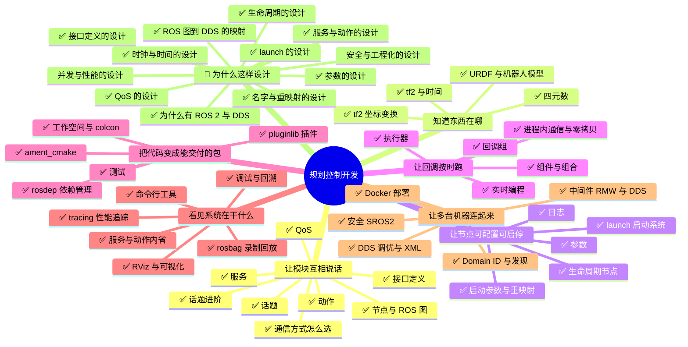

# 总览脑图

> 按**用途**组织：先问"我要解决什么问题"，再找概念。不沿用官方文档的目录。
> ✅ = 已有卡片或设计笔记（下方清单里可点击）；其余为计划中的内容，按批次补齐。每张卡片对应哪些源文档，见 [路线图](../ROADMAP.md)。

## 链接清单（与上图一一对应）

Mermaid 节点在 Obsidian 和 VS Code 里都不能稳定地点击跳转，导航靠这份清单。

- **让模块互相说话：通信**（第 1 批）
  - [节点与 ROS 图](../cards/communication/node.md)
  - [通信方式怎么选：话题、服务、动作](../cards/communication/communication-patterns.md)
  - [话题 Topic](../cards/communication/topic.md)
  - [QoS](../cards/communication/qos.md) · 练习：[QoS 不匹配时到底发生了什么](../labs/qos-mismatch.md)
  - [服务 Service](../cards/communication/service.md)
  - [动作 Action](../cards/communication/action.md) · 练习：[动作服务端忙时来了新目标](../labs/action-preempt.md)
  - [接口定义 msg / srv / action](../cards/communication/interface-definition.md)
  - [话题进阶：内容过滤、键控话题、等待确认](../cards/communication/topic-advanced.md)
- **知道东西在哪：坐标与机器人模型**（第 2 批）
  - [tf2 坐标变换](../cards/coordinates/tf2.md)
  - [tf2 与时间](../cards/coordinates/tf2-time.md) · 练习：[lookupTransform 的时间参数](../labs/tf-time-lookup.md)
  - [四元数 Quaternion](../cards/coordinates/quaternion.md) · 练习：[四元数与 tf2 缓冲](../labs/quaternion-buffer.md)
  - [URDF 与机器人模型](../cards/coordinates/urdf.md) · 练习：[URDF 关节与 TF](../labs/urdf-joint-states.md)
- **让节点可配置可启停：配置与启停**（第 3 批）
  - [参数 Parameter](../cards/configuration/parameter.md) · 练习：[参数的规则与陷阱](../labs/parameter-rules.md)
  - [生命周期节点 Lifecycle Node](../cards/configuration/lifecycle-node.md) · 练习：[生命周期状态切换](../labs/lifecycle-transitions.md)
  - [启动参数与重映射](../cards/configuration/node-arguments.md)
  - [launch 启动系统](../cards/configuration/launch.md) · 练习：[launch 与名字解析](../labs/launch-and-names.md)
  - [日志 Logging](../cards/configuration/logging.md)
- **让回调按时跑：并发与实时性**（样板 + 第 4 批）
  - [执行器 Executor](../cards/concurrency/executor.md)
  - [回调组 Callback Group](../cards/concurrency/callback-group.md)
  - 练习：[控制环为什么被卡住](../labs/executor-blocking.md)
  - [组件与组合 Component](../cards/concurrency/component.md) · 练习：[组件与容器](../labs/component-container.md)
  - [进程内通信与零拷贝](../cards/concurrency/intra-process.md) · 练习：[进程内通信与零拷贝](../labs/intra-process-zero-copy.md)
  - [实时编程 Real-time](../cards/concurrency/realtime.md) · 练习：[实时循环的抖动](../labs/realtime-jitter.md)
- **把代码变成能交付的包：工程化**（第 5 批）
  - [工作空间与 colcon](../cards/engineering/workspace-colcon.md)
  - [ament_cmake](../cards/engineering/ament-cmake.md)
  - [rosdep 依赖管理](../cards/engineering/rosdep.md)
  - 练习：[编译与依赖的常见错误](../labs/build-pitfalls.md)（覆盖上面三张卡片）
  - [pluginlib 插件](../cards/engineering/pluginlib.md) · 练习：[用插件换路径平滑器](../labs/plugin-smoother.md)
  - [测试 Testing](../cards/engineering/testing.md) · 练习：[测试与代码规范检查](../labs/testing-and-lint.md)
- **看见系统在干什么：调试与观测**（第 6 批）
  - [命令行工具：ros2 CLI 与 ros2 doctor](../cards/observability/cli-tools.md)
  - [服务与动作内省](../cards/observability/service-introspection.md)
  - 练习：[命令行与服务内省](../labs/cli-and-introspection.md)（覆盖上面两张卡片）
  - [rosbag 录制回放](../cards/observability/rosbag.md) · 练习：[录制、回放与离线分析](../labs/bag-record-replay.md)
  - [RViz 与可视化](../cards/observability/rviz.md)（Marker 检查在上一个练习的第 7 部分）
  - [调试与回溯：gdb、构建类型与 IDE](../cards/observability/gdb-debugging.md)
  - [tracing 性能追踪](../cards/observability/tracing.md)
  - 练习：[崩溃回溯与回调追踪](../labs/crash-and-trace.md)（覆盖上面两张卡片）
- **让多台机器连起来：中间件与部署**（第 7 批）
  - [中间件 RMW 与 DDS](../cards/middleware/rmw-dds.md)
  - [Domain ID 与发现](../cards/middleware/domain-discovery.md)
  - 练习：[中间件、Domain 与发现](../labs/middleware-discovery.md)（覆盖上面两张卡片）
  - [DDS 调优与 Fast DDS XML](../cards/middleware/dds-tuning.md)
  - [Docker 部署](../cards/middleware/docker-deploy.md)
  - 练习：[DDS 调优、XML 配置与容器网络](../labs/dds-and-docker.md)（覆盖上面两张卡片）
  - [安全 SROS2](../cards/middleware/sros2-security.md) · 练习：[SROS2 密钥库、强制模式与访问控制](../labs/sros2-keystore.md)
- **📐 为什么这样设计：设计理念**（第 8 批起，来自 [ros2/design](https://github.com/ros2/design)；学完对应卡片再读）
  - [为什么有 ROS 2、为什么建在 DDS 上](../design/why-ros2-dds.md)
  - [ROS 图怎么映射到 DDS：名字规则、`rt/` 前缀、节点与参与者](../design/graph-to-dds-mapping.md)
  - [QoS 的设计](../design/qos-design.md)
  - [服务与动作的设计](../design/service-action-design.md)
  - [接口定义的设计](../design/interface-design.md)
  - 练习：[设计文档的说法在 Rolling 里还成立吗](../labs/design-claims-check.md)（覆盖上面五篇）
  - 配置与启停的设计（第 9 批）：
    - [参数的设计](../design/parameter-design.md)
    - [名字与重映射的设计](../design/remapping-design.md)
    - [生命周期的设计](../design/lifecycle-design.md)
    - [时钟与时间的设计](../design/time-design.md)
    - [launch 的设计](../design/launch-design.md)
    - 练习：[配置与启停的设计还成立吗](../labs/config-design-check.md)（覆盖上面五篇）
  - 计划中：并发与性能的设计（第 10 批）、安全与工程化的设计（第 11 批），见 [路线图](../ROADMAP.md)
