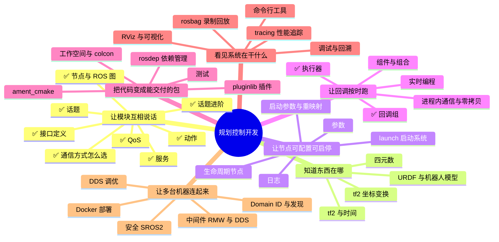

# 总览脑图

> 按**用途**组织：先问"我要解决什么问题"，再找概念。不沿用官方文档的目录。
> ✅ = 已有卡片（下方清单里可点击）；其余为计划中的卡片，按批次补齐。每张卡片对应哪些源文档，见 [路线图](../ROADMAP.md)。

## 链接清单（与上图一一对应）

Mermaid 节点在 Obsidian 和 VS Code 里都不能稳定地点击跳转，导航靠这份清单。

- **让模块互相说话：通信**（第 1 批）
  - [节点与 ROS 图](../cards/communication/node.md)
  - [通信方式怎么选：话题、服务、动作](../cards/communication/communication-patterns.md)
  - [话题 Topic](../cards/communication/topic.md)
  - [QoS](../cards/communication/qos.md) · 练习：[QoS 不匹配时到底发生了什么](../labs/qos-mismatch.md)
  - [服务 Service](../cards/communication/service.md)
  - [动作 Action](../cards/communication/action.md) · 练习：[动作服务端忙时来了新目标](../labs/action-preempt.md)
  - [接口定义 msg / srv / action](../cards/communication/interface-definition.md)
  - [话题进阶：内容过滤、键控话题、等待确认](../cards/communication/topic-advanced.md)
- **知道东西在哪：坐标与机器人模型**（第 2 批，待建）
- **让节点可配置可启停：配置与启停**（第 3 批，待建）
- **让回调按时跑：并发与实时性**（样板 + 第 4 批）
  - [执行器 Executor](../cards/concurrency/executor.md)
  - [回调组 Callback Group](../cards/concurrency/callback-group.md)
  - 练习：[控制环为什么被卡住](../labs/executor-blocking.md)
  - 组件、进程内通信、实时编程（第 4 批，待建）
- **把代码变成能交付的包：工程化**（第 5 批，待建）
- **看见系统在干什么：调试与观测**（第 6 批，待建）
- **让多台机器连起来：中间件与部署**（第 7 批，待建）
