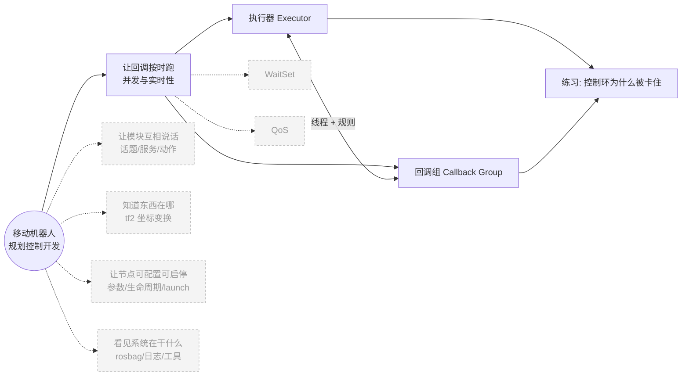

# 总览脑图（样板片段）

> 按**用途**而不是官方目录组织：先问"我要解决什么问题"，再找概念。
> 目前只建了一个分支（实线、带链接）；虚线灰色是以后铺开时的占位，仅示意结构。

## 链接清单（与上图一一对应）

Mermaid 节点在 Obsidian 和 VS Code 里都不能稳定地点击跳转，所以导航靠下面这份清单，图只负责"看结构"。

- **让回调按时跑：并发与实时性**
  - [执行器 Executor](../cards/executor.md)
  - [回调组 Callback Group](../cards/callback-group.md)
  - [练习：控制环为什么被卡住](../labs/executor-blocking.md)
  - WaitSet（待建）
  - QoS（待建）
- 让模块互相说话：话题/服务/动作（待建）
- 知道东西在哪：tf2 坐标变换（待建）
- 让节点可配置可启停：参数/生命周期/launch（待建）
- 看见系统在干什么：rosbag/日志/工具（待建）
